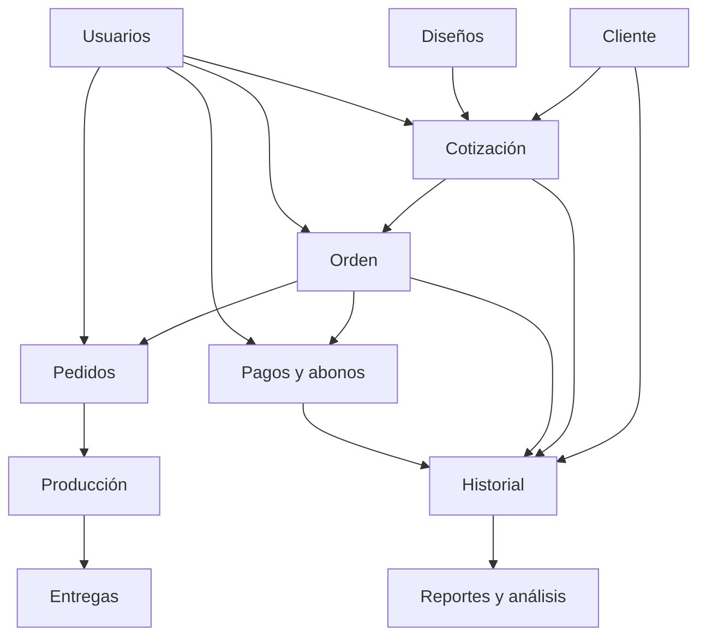

# Aplicación de CL01.01.01 al proyecto de gestión del negocio de bordados

**Clase:** CL01.01.01 — Concepto y propósito de la arquitectura  
**Competencia:** C01 — vocabulario y fundamentos de arquitectura de software  
**Nivel esperado:** EXPLICAR  
**Estado:** Análisis de aplicación completado; sujeto a revisión del usuario  
**Proyecto:** aplicación actualmente denominada *Cotizador de Bordados* (nombre provisional)

## 1. Propósito del análisis

Aplicar los criterios de CL01.01.01 al sistema real que se está estudiando. La clase oficial establece que la evidencia debe identificar elementos, relaciones y propiedades externamente visibles; justificar la abstracción utilizada; relacionar estructura y calidad; y distinguir hechos de hipótesis.

Este documento no sustituye ni modifica el contenido oficial de la clase.

## Seguimiento de objetivos oficiales

Esta tabla controla el avance frente a los seis objetivos de aprendizaje definidos en la clase oficial. Se actualizará durante el análisis y solo se marcará un objetivo como **Cubierto** cuando exista evidencia suficiente para demostrarlo, no solo porque se haya mencionado el tema.

| # | Objetivo oficial de aprendizaje | Estado | Evidencia / trabajo pendiente |
|---|---|---|---|
| 1 | Explicar qué es la arquitectura de software y qué problema práctico ayuda a resolver. | Cubierto | Se explicó la arquitectura como medio para hacer visibles las relaciones, anticipar incompatibilidades y razonar sobre la evolución del sistema. |
| 2 | Distinguir una descripción arquitectónica de una lista de funciones, de un inventario de tecnologías y del código fuente. | Cubierto | Se distinguió el propósito y la organización conceptual del sistema de las tecnologías y detalles de implementación; el usuario expresó el enfoque de definir el qué antes que el cómo. |
| 3 | Reconocer elementos, relaciones y propiedades externamente visibles en un sistema. | En progreso | Se identificaron elementos y relaciones del sistema objetivo. Falta completar la identificación de propiedades externamente visibles que condicionan a otros elementos. |
| 4 | Explicar por qué la arquitectura es una abstracción: selecciona detalles relevantes y omite otros. | Parcial | Se identificó que deben describirse estructuras y relaciones y dejar detalles tecnológicos para después. Falta justificar con precisión qué se incluye u omite según la pregunta arquitectónica. |
| 5 | Relacionar las decisiones estructurales con atributos de calidad como disponibilidad, rendimiento, seguridad y modificabilidad. | Parcial | Se reconocieron preocupaciones como disponibilidad, exactitud, integridad, seguridad y trazabilidad. Falta relacionar una estructura concreta con una preocupación de calidad y explicar sus consecuencias o compromisos. |
| 6 | Identificar por qué no existe una arquitectura óptima para todos los sistemas y por qué las decisiones deben responder al contexto. | Parcial | Se identificaron restricciones de acceso web, concurrencia, presupuesto y alojamiento. Falta explicar cómo el contexto condiciona la evaluación de alternativas y qué información adicional sería necesaria. |

**Estados:** Pendiente · En progreso · Parcial · Cubierto.

## 2. Propósito del sistema

### Sistema actual — hecho observado

La aplicación existente es una herramienta local para elaborar y consultar cotizaciones de trabajos de bordado. Incluye gestión de clientes, diseños, configuración, cotizaciones e historial, con persistencia SQLite y exportación de documentos.

### Sistema objetivo — propósito confirmado por el usuario

El objetivo es evolucionar hacia un sistema de gestión integral del negocio de bordados, que cubra el ciclo comercial y operativo: clientes, diseños, cotizaciones, órdenes, pedidos, producción, entregas y pagos. También se desea conservar información histórica y, en una etapa posterior, aprovecharla mediante reportes, análisis estadístico e inteligencia artificial.

La visión objetivo no debe confundirse con funcionalidades ya implementadas.

## 3. Elementos y responsabilidades del sistema objetivo

| Elemento conceptual | Responsabilidad prevista |
|---|---|
| Clientes | Mantener información e historial de clientes. |
| Diseños | Administrar los diseños de bordado. |
| Cotizaciones | Calcular costos y precios y presentar propuestas comerciales. |
| Órdenes | Representar el compromiso comercial aceptado y agrupar trabajos. |
| Pedidos | Representar trabajos individuales asociados a una orden, con seguimiento propio. |
| Producción | Registrar y consultar el avance de los trabajos. |
| Entregas | Registrar entregas parciales o completas. |
| Pagos | Registrar pagos, abonos y saldos. |
| Usuarios | Identificar a quienes utilizan el sistema y sus operaciones. |
| Historial y auditoría | Conservar eventos y cambios relevantes. |
| Reportes y análisis | Consultar información agregada para apoyar decisiones. |

Esta lista es una abstracción conceptual para explicar el propósito y las relaciones; no constituye todavía un diseño de módulos aprobado.

## 4. Relaciones relevantes

- Una cotización se prepara para un cliente e incluye uno o más diseños y sus cálculos comerciales.
- Una cotización aceptada puede dar lugar a una orden.
- Una orden agrupa pedidos; cada pedido representa un trabajo que puede avanzar de manera independiente.
- La producción actualiza el avance de los pedidos.
- Las entregas registran la salida de trabajos terminados, incluso parcialmente.
- Los pagos y abonos se relacionan con la operación comercial correspondiente.
- Los usuarios realizan operaciones sobre los distintos registros.
- La información histórica puede alimentar consultas, reportes y análisis.

### Vista conceptual simplificada

Las flechas representan relaciones conceptuales, no contratos técnicos ni un flujo de ejecución ya implementado.

## 5. Propiedades de calidad y consecuencias

| Preocupación | Por qué importa en el negocio |
|---|---|
| Exactitud | Errores en costos o precios pueden producir pérdidas y conflictos con clientes. |
| Integridad y conservación | Perder o alterar información de pedidos afecta la operación y la confianza del cliente. |
| Disponibilidad | El sistema debe estar accesible cuando se necesite operar o consultar información. |
| Confiabilidad | Las operaciones, especialmente las financieras, deben ejecutarse de forma correcta y controlada. |
| Seguridad y autorización | Debe controlarse quién puede consultar y modificar información. |
| Trazabilidad | Se necesita saber quién realizó una operación y cuándo. |
| Consistencia | Las reglas de cálculo deben producir resultados coherentes desde los distintos flujos que las utilicen. |
| Modificabilidad y evolución | La estructura debe permitir incorporar capacidades del ciclo operativo sin generar retrabajo desproporcionado. |

Una preocupación de calidad no se resuelve solo declarándola: las decisiones estructurales y sus consecuencias deberán analizarse en clases posteriores.

## 6. Contexto y restricciones conocidas

- Se desea acceso mediante navegador desde computadoras y teléfonos.
- Se espera que varias personas puedan trabajar simultáneamente.
- El usuario propone identificar quién está editando un registro y evitar conflictos de edición.
- Se prefiere comenzar con bajo costo y se considera evaluar servicios en la nube.
- Se desea conservar historial y poder consultar información de clientes y operaciones.
- Se contempla el uso futuro de reportes, estadística e inteligencia artificial.

## 7. Abstracción: qué incluir y qué omitir

Para explicar el propósito y la arquitectura a este nivel se incluyen las responsabilidades, relaciones, persistencia, ciclo operativo y preocupaciones de calidad.

Se omiten detalles de widgets, variables, algoritmos internos, estructura de clases y decisiones tecnológicas futuras, porque no son necesarios para responder la pregunta de esta clase. Esos detalles podrán ser relevantes en otras vistas o clases.

## 8. Hechos, inferencias y pendientes

### Hechos observados del sistema actual

- Aplicación local desarrollada en Python y Streamlit.
- Persistencia mediante SQLite.
- Existen áreas de clientes, diseños, configuración, cotizaciones e historial.
- Hay servicios de cálculo, repositorios y exportación PDF/CSV.
- El flujo actual no equivale a un sistema integral de pedidos, producción y pagos.

### Inferencias razonables

- La concentración de responsabilidades en algunos flujos puede dificultar la evolución; debe analizarse con más detalle.
- La incorporación de varios usuarios y acceso web requerirá decisiones sobre concurrencia, despliegue y seguridad.
- Las relaciones entre cotizaciones, órdenes, pedidos, producción, entregas y pagos deben definirse antes de implementar esos flujos.

### Pendientes de evidencia o decisión

- Alojamiento local o en la nube.
- Mecanismo concreto de concurrencia y edición simultánea.
- Política de archivado y eliminación definitiva.
- Autorizaciones para aprobar modificaciones.
- Reglas de negocio completas.
- Requisitos medibles de disponibilidad, recuperación y volumen.
- Alcance técnico de reportes y capacidades de IA.

## 9. Conclusión de la clase

El sistema debe entenderse por su propósito objetivo: gestionar el ciclo completo del negocio de bordados, no solamente calcular cotizaciones. Sus elementos adquieren sentido por las relaciones que mantienen y por las propiedades de calidad que esas relaciones deben preservar.

Diseñar cada parte de forma aislada puede producir incompatibilidades, dependencias no previstas y retrabajo al integrarlas. La arquitectura permite hacer visibles esas relaciones y razonar sobre ellas antes de comprometer decisiones de implementación.

## 10. Alcance y clasificación

- **Conservar:** la aplicación actual como evidencia y punto de partida del análisis.
- **Mejorar / Rediseñar:** no se determina en esta clase; requiere análisis posterior.
- **Pendiente de evidencia:** decisiones de despliegue, concurrencia, seguridad y operación.
- **Decisiones aprobadas:** propósito objetivo de gestión integral; no se aprueba todavía una arquitectura técnica objetivo.

## 11. Referencias

- [Clase oficial CL01.01.01 — Concepto y propósito de la arquitectura](https://github.com/acuscorp/SoftwareArchitecture/blob/main/Classes/M01%20-%20Pensamiento%20arquitect%C3%B3nico%20y%20fundamentos/CL01.01.01%20-%20Concepto%20y%20prop%C3%B3sito%20de%20la%20arquitectura.md)
- [Ruta curricular](https://github.com/acuscorp/SoftwareArchitecture/blob/main/LEARNING_PATH.md)
- [Plan de trabajo de arquitectura del proyecto](https://github.com/acuscorp/embroidery-price-estimator/blob/main/docs/architecture/PLAN_TRABAJO_ARQUITECTURA.md)
