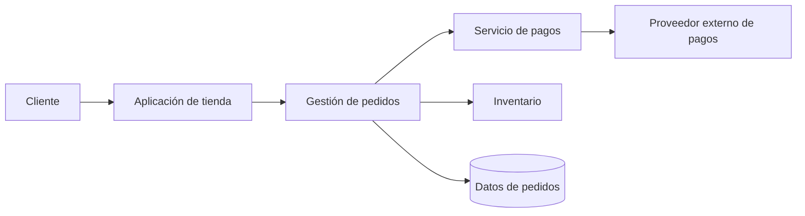
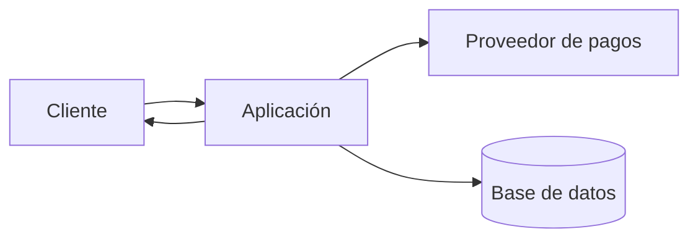

# CL01.01.01 — Concepto y propósito de la arquitectura

## Ficha de la clase

- **Módulo:** M01 — Pensamiento arquitectónico y fundamentos
- **Competencia principal:** C01 — vocabulario y fundamentos de arquitectura de software
- **Nivel esperado:** EXPLICAR
- **Duración sugerida:** 90–120 minutos
- **Prerrequisitos:** experiencia básica leyendo o escribiendo software; no se presupone experiencia previa en arquitectura.
- **Pregunta guía:** ¿Qué necesitamos entender y decidir sobre un sistema antes de que sus detalles de implementación nos impidan ver el conjunto?
- **Evidencia de aprendizaje:** explicación breve de la arquitectura de un sistema de ejemplo, con elementos, relaciones, propiedades relevantes y justificación de por qué esa descripción ayuda a tomar decisiones.

## 1. Objetivos de aprendizaje

Al terminar la clase, podrás:

1. Explicar qué es la arquitectura de software y qué problema práctico ayuda a resolver.
2. Distinguir una descripción arquitectónica de una lista de funciones, de un inventario de tecnologías y del código fuente.
3. Reconocer elementos, relaciones y propiedades externamente visibles en un sistema.
4. Explicar por qué la arquitectura es una abstracción: selecciona detalles relevantes y omite otros.
5. Relacionar las decisiones estructurales con atributos de calidad como disponibilidad, rendimiento, seguridad y modificabilidad.
6. Identificar por qué no existe una arquitectura óptima para todos los sistemas y por qué las decisiones deben responder al contexto.

**Criterio de dominio:** no basta con memorizar una definición. Debes poder explicar el concepto con tus propias palabras y usarlo para analizar un ejemplo concreto.

## 2. Motivación: el problema que resuelve la arquitectura

Imagina que desarrollas una aplicación para vender productos en línea. Al principio, el sistema puede ser pequeño: una pantalla de catálogo, un carrito y una función para registrar pedidos. Con pocos usuarios, una aplicación sencilla y una base de datos pueden ser suficientes.

Con el tiempo aparecen nuevas necesidades:

- El negocio quiere que el catálogo siga disponible aunque falle un servicio.
- Los pagos deben integrarse con un proveedor externo sin exponer datos sensibles.
- Las ventas aumentan y algunas operaciones se vuelven lentas.
- Se necesita una aplicación móvil además de la web.
- El equipo de inventario quiere desplegar cambios sin interrumpir el proceso de pedidos.
- El equipo de soporte necesita diagnosticar errores y reconstruir qué ocurrió con una compra.

Cada requisito aislado parece razonable. El problema es que las decisiones para atenderlos interactúan. Por ejemplo, separar el procesamiento de pagos puede reducir el impacto de fallos, pero también introduce comunicación de red, manejo de reintentos, consistencia y observabilidad. Una decisión que ayuda a una propiedad puede complicar otra.

La arquitectura ofrece una manera de razonar sobre esas interacciones antes de que todas queden escondidas en el código. Permite hablar del sistema como un conjunto de partes relacionadas y evaluar si la organización propuesta puede satisfacer las necesidades importantes.

**Idea central:** la arquitectura no elimina la complejidad. La hace visible, organiza una parte de ella y permite razonar sobre las consecuencias de las decisiones.

## 3. ¿Qué es la arquitectura de software?

Bass, Clements y Kazman definen la arquitectura de un programa o sistema de cómputo como las estructuras del sistema, compuestas por elementos de software, las propiedades de esos elementos que son visibles externamente y las relaciones entre ellos (*Software Architecture in Practice*, 3.ª ed., cap. 1, p. 3).

Podemos descomponer esta definición en tres partes.

### 3.1 Elementos

Un elemento es una parte que podemos identificar para razonar sobre el sistema. Dependiendo de la pregunta, puede ser un módulo, un servicio, un proceso, un almacén de datos o un subsistema.

En la tienda en línea podríamos identificar:

- Catálogo
- Carrito
- Gestión de pedidos
- Pagos
- Inventario
- Base de datos de pedidos

Estos nombres son una primera aproximación, no una arquitectura completa. Todavía debemos explicar qué responsabilidad tiene cada elemento y cómo se relaciona con los demás.

### 3.2 Relaciones

Las partes no forman una arquitectura útil solo por existir. Importa cómo se conectan y dependen entre sí.

Preguntas típicas:

- ¿Qué elemento solicita el cobro?
- ¿Quién es responsable de reservar inventario?
- ¿Qué elemento conserva el estado del pedido?
- ¿Qué sucede si el proveedor de pagos no responde?
- ¿Puede modificarse el catálogo sin desplegar el procesamiento de pedidos?

Las relaciones pueden representar llamadas, dependencias, intercambio de mensajes, uso de datos o restricciones de despliegue. La relación exacta depende de la estructura que se está describiendo.

### 3.3 Propiedades externamente visibles

No necesitamos conocer todos los detalles internos de cada elemento para razonar sobre el sistema. Sí necesitamos conocer las propiedades que afectan a otros elementos o a los objetivos del sistema.

Por ejemplo, para el componente de pagos puede ser relevante que:

- exponga una operación para solicitar un cobro;
- pueda tardar varios segundos en responder;
- devuelva un resultado de éxito, rechazo o estado desconocido;
- no garantice disponibilidad permanente;
- requiera proteger credenciales y datos sensibles.

No es necesario conocer todavía cómo está implementado cada algoritmo interno. Lo importante es el contrato y el comportamiento que condicionan al resto del sistema.

### 3.4 Una representación mínima

El siguiente diagrama es un ejemplo didáctico, no una arquitectura recomendada para todos los comercios:

La imagen permite formular preguntas que una lista de funciones no responde por sí sola:

- ¿Qué ocurre con un pedido si el proveedor externo no responde?
- ¿Quién decide si el inventario queda reservado?
- ¿Qué parte conserva el estado del pedido?
- ¿Qué elementos deben comunicarse para completar una compra?
- ¿Qué dependencias pueden afectar la disponibilidad de la tienda?

El diagrama es útil solo en la medida en que ayuda a razonar sobre preguntas importantes. Si no sabemos qué significa cada flecha ni qué responsabilidad tiene cada caja, el dibujo es decoración y no una descripción arquitectónica suficiente.

## 4. Arquitectura como abstracción

Una arquitectura es una abstracción del sistema: selecciona información que resulta útil para razonar y deja fuera detalles que no son relevantes para la pregunta actual. *Software Architecture in Practice*, 3.ª ed., cap. 1, pp. 5–6, explica que la arquitectura se concentra en elementos, relaciones e interfaces relevantes, omitiendo detalles internos que no tienen consecuencias fuera de un elemento.

Piensa en un mapa de una ciudad. Un mapa del metro muestra estaciones y conexiones, pero no representa todos los edificios, árboles o tuberías. Esa omisión no es un defecto si el objetivo es planear un viaje en metro. El mismo mapa sería insuficiente para diseñar el drenaje de una calle.

Con la arquitectura sucede algo parecido: una representación debe incluir los detalles necesarios para responder una pregunta, no todos los detalles que existen.

### 4.1 Qué suele incluir una descripción arquitectónica

Según la pregunta y el tipo de sistema, puede describir:

- responsabilidades de los elementos principales;
- dependencias y direcciones de comunicación;
- límites entre partes y contratos;
- dónde residen o se despliegan componentes;
- restricciones relevantes de interacción;
- propiedades que afectan al sistema en su conjunto.

### 4.2 Qué suele omitir

Una vista arquitectónica de alto nivel normalmente no necesita mostrar:

- cada variable local;
- cada línea de código;
- todos los pasos de un algoritmo interno;
- detalles de formato que no afectan contratos ni decisiones del sistema;
- decisiones pequeñas que pueden cambiar sin afectar la estructura ni propiedades importantes.

La palabra **normalmente** importa. Un detalle que hoy es interno puede volverse arquitectónicamente relevante si cruza un límite, afecta rendimiento global, crea una dependencia o cambia una propiedad importante. No existe una lista universal de detalles que siempre sean arquitectónicos.

### 4.3 La pregunta para decidir qué detalle mostrar

Antes de incluir algo en una descripción arquitectónica, pregunta:

> ¿Este detalle ayuda a explicar una propiedad importante del sistema o cambia una decisión que afecta a otras partes?

Si la respuesta es no, quizá corresponda a un nivel de diseño más detallado. Si la respuesta es sí, merece analizarse, aunque después se decida documentarlo en otra vista.

## 5. ¿Todo sistema tiene arquitectura?

Sí, en el sentido de que todo sistema tiene alguna organización de elementos y relaciones, aunque sea trivial, accidental, desconocida o no documentada. La existencia de una arquitectura no implica que sea buena, que haya sido diseñada deliberadamente ni que el equipo la comprenda.

Conviene distinguir:

- **Arquitectura existente:** la organización real del sistema, incluidas sus dependencias y restricciones.
- **Arquitectura prevista:** la organización que el equipo intenta construir o mantener.
- **Representación arquitectónica:** los diagramas, decisiones, descripciones y modelos que usamos para comunicar una comprensión del sistema.

Estas tres cosas pueden diferir. Un documento puede decir que dos módulos están separados, mientras que el código real contiene dependencias directas entre ellos. En ese caso, el documento describe una intención, no necesariamente el sistema actual.

Por ello, la arquitectura no es sinónimo de diagramas ni de documentación. La documentación representa la arquitectura; no la crea mágicamente ni garantiza que el sistema la respete.

## 6. ¿Para qué sirve la arquitectura?

La arquitectura es una herramienta para comunicar, razonar, analizar y facilitar la evolución del sistema. Estas funciones están relacionadas.

### 6.1 Comunicación

Diferentes participantes necesitan comprender distintas partes del sistema: desarrolladores, responsables de producto, operaciones, seguridad, soporte y dirección. Un modelo compartido permite discutir dependencias y consecuencias sin revisar todo el código.

Una buena explicación arquitectónica no intenta mostrarlo todo a todo el mundo. Selecciona la información adecuada para sus lectores y preguntas.

### 6.2 Razonamiento y análisis

Antes de construir o modificar una solución, podemos evaluar hipótesis:

- Si el servicio de pagos falla, ¿qué operaciones quedan bloqueadas?
- Si el volumen de lectura aumenta diez veces, ¿qué parte podría convertirse en cuello de botella?
- Si se requiere una nueva interfaz de usuario, ¿qué lógica puede reutilizarse?
- Si debemos auditar una compra, ¿podemos reconstruir las transiciones de estado?

La arquitectura no responde automáticamente a estas preguntas. Hace explícitos los elementos y las relaciones que necesitamos analizar.

### 6.3 Coordinación del trabajo

Los límites entre elementos ayudan a dividir responsabilidades y reducir conflictos entre equipos. Pero un límite mal elegido puede generar coordinación excesiva, duplicación o dependencias difíciles de cambiar. La organización del software también afecta cómo las personas pueden desarrollarlo.

### 6.4 Evolución y mantenimiento

El sistema cambiará. La arquitectura ayuda a identificar qué partes podrían cambiar de forma independiente y qué modificaciones tienen un radio de impacto amplio.

Una arquitectura útil no es necesariamente la que anticipa todos los cambios posibles. Es la que responde razonablemente a las necesidades conocidas y permite gestionar los cambios probables sin introducir complejidad desproporcionada.

### 6.5 Control del riesgo

Las decisiones importantes pueden generar costes difíciles de revertir. Hacer visibles las dependencias y las hipótesis permite experimentar o validar los riesgos principales antes de comprometerse con una solución costosa.

Fairbanks presenta la arquitectura como una forma de diseño macroscópico y propone un enfoque guiado por riesgos: dedicar atención especial a las decisiones cuya incertidumbre y consecuencias justifican investigarlas (*Just Enough Software Architecture: A Risk-Driven Approach*, caps. 1–3). La idea no es diseñar todo por anticipado, sino usar el análisis para decidir qué conviene resolver primero.

## 7. Arquitectura, funcionalidad y calidad

Una función describe algo que el sistema debe hacer. Un atributo de calidad describe una propiedad relevante de cómo se comporta o de qué tan bien satisface una necesidad.

Ejemplo de funcionalidad:

- “El cliente puede consultar el estado de su pedido”.

Ejemplos de preocupaciones de calidad:

- **Rendimiento:** ¿cuánto tarda la consulta?
- **Disponibilidad:** ¿puede consultarse cuando una dependencia falla?
- **Seguridad:** ¿solo las personas autorizadas ven el pedido?
- **Modificabilidad:** ¿qué tan difícil es añadir un nuevo estado?
- **Observabilidad:** ¿puede soporte entender por qué una consulta falló?

Una aplicación puede cumplir todas sus funciones visibles y aun así ser difícil de operar, lenta, insegura o costosa de modificar. La funcionalidad es necesaria, pero no describe por completo el éxito del sistema.

### 7.1 Las decisiones arquitectónicas implican compromisos

Supongamos que queremos que la tienda soporte picos de demanda. Podríamos introducir una cola para procesar algunas operaciones de manera asíncrona. Esto puede absorber picos y desacoplar al emisor del procesamiento, pero también agrega latencia, manejo de mensajes repetidos, seguimiento del estado y complejidad operativa.

No existe una solución que maximice todas las propiedades sin coste. Una decisión debe evaluarse frente a requisitos, restricciones y riesgos concretos.

| Preocupación | Pregunta que conviene formular | Posible consecuencia arquitectónica |
|---|---|---|
| Rendimiento | ¿Qué operaciones deben responder rápidamente? | Revisar rutas críticas, llamadas remotas y acceso a datos |
| Disponibilidad | ¿Qué debe seguir funcionando ante una falla? | Analizar dependencias, redundancia y modos degradados |
| Seguridad | ¿Qué datos y operaciones requieren protección? | Definir límites de confianza, autorización y manejo de secretos |
| Modificabilidad | ¿Qué cambios son probables y qué partes deberían aislarse? | Establecer responsabilidades, interfaces y límites de módulos |
| Escalabilidad | ¿Qué recurso se saturará cuando aumente la carga? | Analizar capacidad, estado compartido y distribución de carga |
| Operabilidad | ¿Cómo se detectan y diagnostican fallos? | Considerar registros, métricas, trazas y procedimientos operativos |

La columna final presenta líneas de investigación, no recetas. La necesidad concreta y la evidencia determinan qué alternativa conviene.

## 8. ¿Qué hace que una estructura sea arquitectónicamente importante?

No toda agrupación de elementos merece el mismo nivel de atención. Una estructura resulta arquitectónicamente relevante cuando ayuda a razonar sobre el sistema o sus propiedades importantes para los interesados. Esta es una idea explícita en *Software Architecture in Practice*, 3.ª ed., cap. 1, pp. 5–6.

Considera dos detalles:

1. El nombre de una variable privada dentro de una función.
2. El hecho de que todos los pedidos dependan sin alternativa de un único servicio externo de pagos.

El primer detalle suele afectar una pequeña parte de la implementación. El segundo puede afectar disponibilidad, latencia, recuperación ante errores y experiencia del cliente. Por eso, el segundo suele tener un impacto arquitectónico mayor.

No es una regla basada únicamente en el tamaño del código. Un componente pequeño puede ser crítico si todos dependen de él. Un módulo grande puede tener una frontera clara y poca influencia sobre el resto del sistema. Importan las consecuencias de las relaciones y las propiedades involucradas.

## 9. Caso guiado: una tienda que empieza a crecer

Usaremos un caso hipotético durante el resto de la clase. Los datos son supuestos didácticos, no resultados de una medición real.

### Situación inicial

La tienda tiene una aplicación que recibe pedidos, consulta inventario y solicita pagos a un proveedor externo. Los pedidos se guardan en una base de datos.

Los responsables reportan dos problemas:

- Cuando el proveedor de pagos tarda en responder, el cliente no sabe si el pedido se procesó.
- En periodos de alta demanda, el proceso de compra se vuelve lento.

### Paso 1: separar hechos de hipótesis

**Hechos conocidos del caso:**

- El proceso de compra depende de un proveedor externo.
- El proveedor puede tardar en responder.
- El usuario experimenta lentitud durante algunos periodos.

**Hipótesis que necesitan evidencia:**

- La llamada al proveedor es la principal causa de la lentitud.
- La base de datos no tiene capacidad suficiente.
- El sistema carece de límites de tiempo o de un mecanismo para consultar el estado.
- Aumentar el número de instancias resolverá el problema.

Una arquitectura razonada no transforma una sospecha en una certeza. Primero identifica qué relaciones pueden explicar el comportamiento y qué mediciones o experimentos permiten comprobarlo.

### Paso 2: representar las relaciones relevantes

Esta representación ayuda a detectar una dependencia externa y un almacén de datos. No explica aún si la llamada de pago es síncrona, cómo se manejan los errores o dónde se origina la lentitud. Esas preguntas requieren una descripción más precisa.

### Paso 3: formular preguntas arquitectónicas

1. ¿La aplicación espera la respuesta del proveedor antes de responder al cliente?
2. ¿Qué estado se guarda antes y después de solicitar un pago?
3. ¿Qué ocurre si el proveedor procesa el cobro, pero la respuesta se pierde?
4. ¿Cómo evita el sistema cobrar dos veces al reintentar?
5. ¿Qué mediciones permiten saber si el cuello de botella está en pagos, en la base de datos o en otro punto?

Estas preguntas no son detalles de sintaxis. Afectan la interacción entre partes, el comportamiento ante fallos y la consistencia del estado del pedido.

### Paso 4: comparar alternativas sin elegir por moda

**Alternativa A: mejorar el flujo actual.** Medir latencias, establecer límites de tiempo apropiados, mejorar el manejo de estados y errores, y corregir el cuello de botella identificado.

- Ventaja posible: menor cambio estructural.
- Coste o riesgo: puede no resolver límites fundamentales del diseño actual.

**Alternativa B: procesar algunas operaciones de forma asíncrona.** Registrar el pedido y un estado pendiente, procesar el trabajo mediante una cola y permitir que el cliente consulte el estado.

- Ventaja posible: separar la recepción de la solicitud de su procesamiento completo.
- Coste o riesgo: mayor complejidad, consistencia eventual, mensajes duplicados, reintentos y necesidad de observabilidad.

**Alternativa C: separar el servicio de pagos en un componente independiente.**

- Ventaja posible: un límite explícito para la integración y sus políticas.
- Coste o riesgo: la separación no elimina la dependencia del proveedor externo y puede añadir llamadas de red y trabajo operativo.

No hay información suficiente en el caso para declarar una alternativa ganadora. La elección depende de medidas, requisitos de experiencia de usuario, volumen, tolerancia a fallos, capacidades del equipo y coste operativo.

### Paso 5: explicar qué aporta la arquitectura

La arquitectura permite describir la dependencia externa, discutir el flujo de control y estado, identificar los atributos afectados y comparar consecuencias antes de invertir en una solución. No sustituye la observación del sistema ni el análisis detallado; orienta dónde investigar y qué decisiones deben justificarse.

## 10. Errores comunes y cómo evitarlos

### Error 1: “La arquitectura es el diagrama”

Un diagrama es una representación parcial. Para que sea útil, debe explicar qué representan los elementos, qué significan las relaciones y qué pregunta responde.

**Corrección:** acompaña el dibujo con responsabilidades, supuestos, restricciones y decisiones relevantes.

### Error 2: “La arquitectura es elegir una tecnología”

Elegir una base de datos, un framework o un proveedor no constituye por sí solo una explicación arquitectónica.

**Corrección:** explica qué necesidad impulsa la elección, qué alternativas existen y qué consecuencias introduce. La tecnología es parte de una decisión cuando condiciona la estructura o propiedades relevantes.

### Error 3: “Si funciona, la arquitectura es buena”

Un sistema puede cumplir las funciones actuales y ser difícil de modificar, lento, inseguro o frágil ante fallos.

**Corrección:** define qué propiedades importan y cómo se observará si se satisfacen.

### Error 4: “La mejor arquitectura es la más distribuida”

Distribuir componentes puede ayudar con algunos problemas, pero también añade fallos de red, latencia, consistencia, despliegue y observabilidad.

**Corrección:** introduce distribución cuando exista una necesidad concreta que justifique sus costes.

### Error 5: “Todo debe decidirse antes de programar”

Un diseño temprano puede reducir riesgos importantes, pero las decisiones basadas en supuestos no validados también pueden ser costosas.

**Corrección:** decide pronto lo que tiene consecuencias amplias y evidencia suficiente; experimenta con incertidumbres importantes; deja detalles reversibles para cuando haya más información.

### Error 6: “La arquitectura solo existe en sistemas grandes”

Cualquier sistema tiene una organización, aunque sea simple. La cantidad de documentación y análisis necesaria depende de la complejidad, el riesgo y las necesidades de sus participantes.

**Corrección:** ajusta la profundidad del trabajo arquitectónico a las consecuencias de equivocarse, no solo al número de archivos o líneas de código.

## 11. Actividad guiada

Elige una aplicación que conozcas: una tienda, una aplicación de transporte, un sistema de inventario o una aplicación de notas.

Responde en una hoja o documento:

1. ¿Qué objetivo principal cumple el sistema?
2. ¿Cuáles son entre tres y seis elementos que conviene distinguir para comprenderlo?
3. ¿Qué dos o tres relaciones entre ellos son importantes?
4. ¿Qué propiedad externa de cada elemento condiciona a los demás?
5. ¿Qué preocupación de calidad sería importante para una persona usuaria o para quien opera el sistema?
6. ¿Qué detalle de implementación omitirías en una descripción de alto nivel y por qué?
7. ¿Qué pregunta no puedes responder sin recopilar más información?

**Entrega esperada:** una descripción de 250–400 palabras y un diagrama simple. No se evalúa la complejidad del dibujo, sino la claridad de los elementos, las relaciones, el propósito y los límites de lo que sabes.

## 12. Evaluación de comprensión

### Preguntas

1. Explica con tus palabras los tres componentes de la definición de arquitectura: elementos, propiedades externamente visibles y relaciones.
2. ¿Por qué una lista de funcionalidades no describe por completo la arquitectura?
3. ¿Por qué la arquitectura es una abstracción y cuándo una omisión se convierte en un problema?
4. ¿Un sistema sin diagramas carece de arquitectura? Explica la diferencia entre arquitectura y su representación.
5. En el caso de la tienda, ¿por qué introducir una cola puede mejorar una propiedad y complicar otras?
6. Un equipo propone microservicios porque espera que el sistema crezca. ¿Qué información solicitarías antes de apoyar la decisión?
7. Da un ejemplo de un detalle que normalmente sería local a la implementación y otro que probablemente afectaría la arquitectura. Justifica la diferencia.

### Respuestas orientativas y criterios

1. **Elementos:** partes identificables; **propiedades visibles:** comportamiento o contrato relevante para otros; **relaciones:** dependencias e interacciones entre partes. Se acepta otra redacción si conserva las distinciones.
2. Las funcionalidades describen qué hace el sistema, pero no necesariamente su organización, dependencias, límites ni propiedades de calidad.
3. Porque no es posible razonar a la vez sobre todos los detalles. Una omisión es problemática si oculta una dependencia o propiedad necesaria para la pregunta analizada.
4. No. El sistema tiene una organización aunque nadie la haya documentado; los diagramas son representaciones que pueden ser incompletas o estar desactualizadas.
5. Puede desacoplar la recepción del trabajo y absorber picos, pero agrega procesamiento diferido, reintentos, duplicados, consistencia y seguimiento de estado.
6. Requisitos de calidad, volumen y variabilidad de carga, límites organizacionales, necesidades de despliegue independiente, tolerancia a fallos, experiencia del equipo, coste operativo y alternativas más simples.
7. Un nombre de variable local suele ser un detalle de implementación; una dependencia obligatoria de un proveedor externo puede afectar disponibilidad y latencia. La justificación debe mencionar el alcance de sus consecuencias.

### Rúbrica de evaluación

| Criterio | Logrado | En desarrollo |
|---|---|---|
| Definición | Explica elementos, propiedades visibles y relaciones sin reducir arquitectura a tecnología | Omite una parte o confunde arquitectura con implementación |
| Abstracción | Justifica qué incluir u omitir según la pregunta | Trata el diagrama como una representación completa |
| Propósito | Conecta arquitectura con comunicación, análisis y evolución | Solo enumera ventajas sin explicar su mecanismo |
| Calidad y compromisos | Identifica una propiedad y explica al menos una consecuencia o coste | Afirma que una solución es mejor sin justificarla |
| Razonamiento | Distingue hechos, hipótesis y preguntas abiertas | Presenta supuestos como hechos o salta directamente a una tecnología |

**Condición de éxito sugerida:** lograr “Logrado” en los cuatro primeros criterios y no presentar supuestos relevantes como hechos. Si no se alcanza, repasar las secciones correspondientes y revisar la actividad antes de avanzar.

## 13. Resumen de la clase

- La arquitectura de software describe estructuras formadas por elementos, sus propiedades externamente visibles y las relaciones entre ellos.
- Es una abstracción que permite concentrarse en los detalles necesarios para razonar sobre preguntas importantes.
- Todo sistema tiene alguna organización, pero eso no significa que sea intencional, adecuada o conocida.
- La arquitectura ayuda a comunicar, analizar, coordinar el trabajo, gestionar riesgos y facilitar la evolución.
- Las funciones no bastan para definir el éxito: rendimiento, disponibilidad, seguridad, modificabilidad y otras propiedades también importan.
- Las decisiones tienen consecuencias y compromisos. Deben responder a requisitos, contexto y evidencia, no a modas tecnológicas.
- Los diagramas son herramientas de comunicación, no sustitutos del razonamiento ni evidencia automática de que la implementación corresponde al diseño.

## 14. Glosario

- **Arquitectura de software:** estructuras relevantes del sistema, sus elementos, propiedades externamente visibles y relaciones.
- **Elemento:** parte identificable del sistema que se utiliza para razonar sobre su organización o comportamiento.
- **Relación:** dependencia, comunicación, conexión o restricción entre elementos.
- **Abstracción:** selección de detalles relevantes y omisión de otros para facilitar el razonamiento.
- **Propiedad externamente visible:** característica de un elemento que afecta a otros elementos o a la evaluación del sistema.
- **Atributo de calidad:** propiedad del sistema que expresa cómo satisface una necesidad, por ejemplo rendimiento o disponibilidad.
- **Trade-off (compromiso):** situación en la que mejorar una propiedad puede introducir costes o empeorar otra.
- **Stakeholder (interesado):** persona o grupo con necesidades, responsabilidades o intereses relacionados con el sistema.
- **Representación arquitectónica:** modelo, diagrama o descripción que comunica una parte de la arquitectura.
- **Riesgo arquitectónico:** posibilidad de que una decisión o supuesto importante produzca consecuencias negativas para el sistema o el proyecto.

## 15. Lecturas y trazabilidad de las fuentes

### Lectura principal asignada

1. **George Fairbanks, *Just Enough Software Architecture: A Risk-Driven Approach*, caps. 1–2.**  
   [Página oficial del libro](https://www.georgefairbanks.com/book/). Introduce la arquitectura como diseño macroscópico y el enfoque de razonamiento guiado por riesgos. La muestra pública disponible no permite verificar íntegramente todos los pasajes de los capítulos asignados; por ello, la clase no atribuye citas textuales ni números de página no comprobados a esos capítulos.

2. **Len Bass, Paul Clements y Rick Kazman, *Software Architecture in Practice*, 3.ª ed., cap. 1, pp. 3 y 5–6.**  
   El PDF de la tercera edición disponible en los materiales del curso respalda la definición basada en estructuras, elementos, propiedades externamente visibles y relaciones; también respalda la arquitectura como abstracción y la relevancia de las estructuras para razonar sobre propiedades del sistema. Se usa como fuente de apoyo disponible, aunque la ruta curricular actual enlaza la cuarta edición.

### Fuente curricular complementaria

3. ***Designing Software Architectures*, 2.ª ed. (2024), §§1.2–1.3.**  
   [Índice oficial de O’Reilly](https://www.oreilly.com/library/view/designing-software-architectures/9780138108069/toc.xhtml). La ruta curricular asigna estas secciones para el concepto de arquitectura y el papel de quien la diseña. El acceso consultado permite verificar el índice, no el texto íntegro; esta clase no presenta afirmaciones como citas textuales de esas secciones.

### Cómo se han usado las fuentes

- La definición de arquitectura y la explicación de la abstracción se atribuyen explícitamente a *Software Architecture in Practice*, 3.ª ed., cap. 1.
- El enfoque de diseño macroscópico y guiado por riesgos se atribuye a Fairbanks, caps. 1–3, sin adjudicar páginas ni citas textuales no verificadas.
- La tienda en línea, sus diagramas, preguntas y alternativas son ejemplos didácticos creados para enseñar a aplicar las ideas; no se presentan como casos literales de los libros.
- Las recomendaciones de medir latencias, distinguir hechos de hipótesis y comparar alternativas son aplicaciones pedagógicas del razonamiento arquitectónico al caso, no citas textuales de una fuente.
- La diferencia entre la edición disponible del libro *Software Architecture in Practice* (3.ª) y la edición enlazada por la ruta (4.ª) se declara de forma explícita; no se afirma que ambas tengan paginación idéntica.

## 16. Siguiente paso dentro del curso

La siguiente clase de la ruta, **CL01.02.01 — Distinguir elementos, responsabilidades y relaciones**, profundiza en cómo identificar y describir los componentes de una estructura. En esta clase inicial solo se introduce el vocabulario necesario para comprender la definición general; no se pretende cubrir todavía el modelado sistemático, las vistas arquitectónicas ni la selección de estilos.
