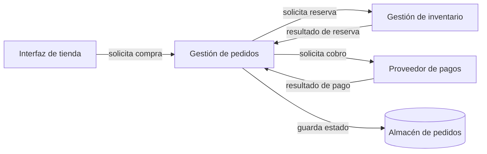

# CL01.02.01 — Distinguir elementos, responsabilidades y relaciones

## 1. Teoría

### 1.1. Para qué sirve esta clase

Cuando explicamos un sistema de software, no basta con enumerar tecnologías o dibujar cajas conectadas por flechas. Necesitamos explicar qué partes son relevantes, de qué se hace cargo cada parte y cómo se relacionan.

Al finalizar esta clase podrás explicar estas distinciones usando un caso concreto. No se espera que diseñes una arquitectura completa, selecciones la mejor tecnología ni produzcas un modelo formal avanzado.

La idea central es:

- **Elemento:** qué parte identificamos.
- **Responsabilidad:** de qué se hace cargo esa parte.
- **Relación:** cómo se conecta o queda condicionada por otras partes.
- **Interacción:** qué solicitud, información o resultado intercambian las partes.
- **Implementación:** qué mecanismo concreto realiza el comportamiento.

Estas ideas están relacionadas, pero no significan lo mismo.

### 1.2. Elemento arquitectónico: ¿qué parte del sistema estamos describiendo?

Un **elemento arquitectónico** es una parte identificable que resulta útil para explicar una estructura o una preocupación relevante del sistema. Según la pregunta, puede ser un subsistema, módulo, servicio, proceso, almacén de datos o elemento de infraestructura.

Imagina una tienda en línea. Si queremos explicar cómo se procesa una compra, podrían ser relevantes:

- Interfaz de la tienda.
- Gestión de pedidos.
- Gestión de inventario.
- Proveedor de pagos.
- Almacén de pedidos.

No es obligatorio que esos nombres correspondan a cinco programas o servidores distintos. Son partes conceptuales que nos ayudan a explicar el sistema.

**El nivel de detalle depende de la pregunta.** Para explicar el proceso de compra, puede bastar con “Gestión de pedidos”. Si la pregunta es cómo está organizada internamente esa parte, quizá convenga descomponerla en módulos o clases. Si queremos entender dónde se ejecuta, necesitaremos describir procesos o infraestructura. No debemos asumir que elemento conceptual, módulo de código, proceso y servidor son equivalentes.

#### Cómo reconocer un elemento útil

Pregúntate:

1. ¿Qué pregunta sobre el sistema quiero responder?
2. ¿Qué parte necesito identificar para responderla?
3. ¿El nombre indica una parte reconocible o solo menciona una tecnología?
4. ¿El nivel de detalle es suficiente sin distraernos con mecanismos que todavía no importan?

Por ejemplo, “PostgreSQL” nombra una tecnología. Para que tenga significado en una explicación arquitectónica, debemos indicar su papel: “Almacén de pedidos, implementado con PostgreSQL”. La tecnología puede ser relevante, pero no sustituye la explicación de la función que cumple.

**Contraejemplo:** “La arquitectura tiene Python, Docker y PostgreSQL”. La frase enumera tecnologías, pero no explica qué partes tiene el sistema, qué responsabilidades asumen ni cómo colaboran.

### 1.3. Responsabilidad: ¿de qué se hace cargo un elemento?

Una **responsabilidad** expresa el comportamiento, resultado, regla o estado del que un elemento debe hacerse cargo dentro del sistema. Describe su cometido, no el nombre de una función ni la tecnología usada para realizarlo.

Considera el elemento **Gestión de pedidos**:

- **Responsabilidad:** coordinar el ciclo de vida del pedido y conservar su estado de negocio.
- **Comportamientos que pueden contribuir:** registrar una solicitud, comprobar las condiciones para confirmarla y reflejar el resultado.
- **Detalle de implementación:** una función llamada `confirm_order()`.
- **Tecnología posible:** un framework web.

La función y el framework pueden cambiar sin que necesariamente cambie la responsabilidad. Por eso, describir la responsabilidad en términos del cometido permite razonar sobre el sistema sin quedar atados prematuramente a una implementación.

#### Cómo redactar una responsabilidad clara

Una responsabilidad útil debería permitir responder:

- **Ámbito:** ¿de qué se hace cargo?
- **Resultado:** ¿qué resultado o estado produce o mantiene?
- **Límite:** ¿qué no le corresponde decidir o realizar?
- **Condiciones relevantes:** ¿qué necesita conocer o recibir para cumplir su cometido?

Ejemplo:

> Gestión de inventario consulta la disponibilidad y registra la reserva de existencias solicitadas para un pedido. No decide si el pago fue aprobado; utiliza la información que le corresponde dentro del flujo de compra.

La frase delimita un ámbito y un límite. No necesita decir si se usa SQL, REST, una cola de mensajes o una clase de Python.

En cambio, “se encarga de todo lo relacionado con la tienda” es demasiado amplio: no permite distinguir responsabilidades ni saber dónde termina el cometido de un elemento. “Ejecuta `reserve_stock()`” puede ser demasiado concreto si la pregunta trata sobre la arquitectura general: describe una operación, pero no explica el ámbito de responsabilidad al que contribuye.

No hay una cantidad universal de responsabilidades que deba tener cada elemento. El objetivo de esta clase es poder explicar responsabilidades y límites, no aplicar una fórmula mecánica para dividir el sistema.

### 1.4. Elemento, responsabilidad, interacción e implementación

Usa la siguiente tabla para separar conceptos que a menudo se confunden.

| Concepto | Pregunta | Ejemplo |
|---|---|---|
| Elemento | ¿Qué parte identificamos? | Gestión de pedidos |
| Responsabilidad | ¿De qué se hace cargo? | Coordinar el estado del pedido |
| Interacción | ¿Qué hace con otra parte o qué intercambian? | Solicitar una reserva de inventario |
| Relación | ¿Cómo están conectadas o condicionadas las partes? | Pedidos necesita el resultado de inventario para continuar |
| Implementación | ¿Cómo se realiza concretamente? | Una función ejecuta una consulta SQL |

La **interacción** suele describir un intercambio o una acción entre partes. La **relación** expresa el vínculo o condicionamiento relevante entre ellas. Una interacción puede ser evidencia de una relación, pero no define por sí sola todos sus detalles.

Una llamada a una función es una forma de implementar una interacción; no es la única. El intercambio también podría ocurrir mediante una petición de red o un mensaje. Por tanto, un diagrama conceptual no permite deducir automáticamente un protocolo, una secuencia temporal o un mecanismo de despliegue.

### 1.5. Relaciones: ¿cómo se conectan o condicionan los elementos?

Una **relación** expresa cómo dos o más elementos están conectados o condicionados entre sí. Una línea o flecha solo resulta informativa cuando podemos explicar qué significa.

En esta clase utilizaremos cuatro ideas prácticas:

- **Dependencia:** un elemento necesita algo proporcionado, mantenido o controlado por otro.
- **Comunicación:** dos elementos intercambian solicitudes, información o resultados.
- **Colaboración:** varios elementos contribuyen coordinadamente a una actividad.
- **Restricción:** una condición limita las opciones o el comportamiento permitido.

Son categorías didácticas útiles, no una taxonomía universal y exhaustiva. Pueden coexistir. Por ejemplo, Gestión de pedidos puede comunicarse con Inventario y, además, depender del resultado que Inventario devuelva.

#### Ejemplo desarrollado: reservar existencias

Supongamos que un cliente solicita un producto.

1. Gestión de pedidos recibe la solicitud.
2. Solicita a Gestión de inventario reservar las unidades necesarias.
3. Inventario devuelve un resultado: reserva aceptada o rechazada.
4. Gestión de pedidos utiliza ese resultado para determinar qué puede ocurrir después.

Podemos describir la relación así:

> Gestión de pedidos solicita a Gestión de inventario reservar las unidades de un pedido. Inventario devuelve el resultado de la reserva. Pedidos depende de ese resultado para continuar el flujo.

Esta descripción identifica las partes, la intención del intercambio, el resultado y la dependencia. Sin embargo, **no** nos dice si la interacción es síncrona o asíncrona, qué protocolo utiliza, cuánto tarda ni qué mecanismo de persistencia emplea. Esos datos requieren evidencia adicional.

#### Cómo explicar una relación

Al describir una relación, intenta especificar:

1. Qué elementos están relacionados.
2. Qué significa el vínculo.
3. Qué solicitud, dato o resultado se intercambia, si aplica.
4. Qué necesita un elemento del otro.
5. Qué sabemos y qué permanece desconocido.

Una flecha sin etiqueta no responde por sí sola a estas preguntas. Tampoco significa necesariamente “llamada HTTP” o “llamada a una función”. El significado debe establecerse en el contexto del modelo.

### 1.6. Dependencia, comunicación y colaboración: diferencias importantes

Estas palabras se parecen, pero responden preguntas distintas.

- **Comunicación:** ¿qué se intercambia entre las partes?
- **Dependencia:** ¿qué necesita una parte de la otra o qué condición la afecta?
- **Colaboración:** ¿cómo contribuyen varias partes a una actividad común?

En el ejemplo anterior, la solicitud de reserva es una comunicación; la necesidad de conocer el resultado de inventario es una dependencia; la participación de pedidos e inventario en el flujo de compra es colaboración.

No siempre se pueden deducir todas estas características de un dibujo. Dos elementos pueden intercambiar información sin que el diagrama explique la dependencia funcional. Un elemento también puede depender de un dato o una configuración sin comunicarse directamente con quien los administra.

### 1.7. Restricciones: condiciones que limitan las opciones

Una **restricción** es una condición que limita las soluciones o los comportamientos permitidos. Puede proceder del negocio, una obligación normativa, una plataforma, una infraestructura o una interfaz externa.

Ejemplos:

- El proveedor de pagos exige autenticar las solicitudes.
- Los datos sensibles no deben aparecer en registros accesibles sin autorización.
- El sistema debe conservar una referencia que permita relacionar el pedido con el resultado del cobro.
- Un sistema heredado solo permite consultar inventario a través de una interfaz existente.

Una restricción no es necesariamente un elemento ni una interacción, aunque puede afectar a ambos. Por ejemplo, una obligación de proteger datos condiciona qué información se intercambia y cómo se asignan ciertas responsabilidades.

Aquí solo necesitamos identificar y explicar la condición. El análisis formal de amenazas y el diseño avanzado de controles de seguridad pertenecen a otros objetivos.

### 1.8. De la estructura a una consecuencia: razonar sin inventar certezas

Las responsabilidades y relaciones importan porque influyen en cómo se comporta el sistema y cómo puede cambiarse. Sin embargo, una relación no demuestra por sí sola que una propiedad de calidad esté garantizada.

Supongamos que Gestión de pedidos depende de un proveedor de pagos externo. Si el proveedor tarda en responder, el flujo de compra podría demorarse o quedar esperando una respuesta. La consecuencia concreta dependerá de las reglas del sistema, los tiempos de espera, el manejo de errores y otros mecanismos que todavía no hemos especificado.

Por eso conviene distinguir:

- **Hecho conocido:** pedidos solicita un cobro al proveedor externo.
- **Consecuencia plausible:** una demora del proveedor puede retrasar la confirmación.
- **Supuesto no confirmado:** el sistema cancela automáticamente la compra al cumplirse cierto tiempo.
- **Conclusión injustificada:** el proveedor siempre estará disponible porque existe una integración.

Un **timeout no demuestra que un pago haya sido rechazado**. Puede significar que el sistema no recibió respuesta a tiempo; el proveedor podría haber procesado el cobro sin que la confirmación llegara. Para afirmar el resultado se necesita información adicional.

Esta forma de razonar es esencial: una explicación arquitectónica debe separar lo que el modelo indica, lo que razonablemente podría ocurrir y lo que todavía no sabemos.

### 1.9. Ejemplo integrado: una compra en línea

Considera esta descripción conceptual:

El diagrama representa relaciones e intercambios a nivel conceptual. No afirma que cada flecha sea una llamada síncrona, que cada caja se ejecute en un servidor separado ni que una solicitud garantice el resultado solicitado.

| Elemento | Responsabilidad ilustrativa | Límite ilustrativo |
|---|---|---|
| Interfaz de tienda | Recoger la solicitud del cliente y mostrar el estado comunicado | No decide por sí sola si hay existencias o si un pago fue aprobado |
| Gestión de pedidos | Coordinar el flujo y mantener el estado del pedido | No controla directamente la disponibilidad interna del proveedor de pagos |
| Gestión de inventario | Consultar o reservar existencias y comunicar el resultado | No decide el resultado del pago |
| Proveedor de pagos | Procesar solicitudes de cobro según su contrato | No determina por sí solo todo el ciclo de vida del pedido |
| Almacén de pedidos | Conservar información del pedido para su recuperación | No coordina por sí solo el flujo de negocio |

Esta tabla es una explicación posible, no una arquitectura única obligatoria. Un sistema real puede asignar las responsabilidades de otra manera. Para esta clase importa que puedas explicar y justificar tus elecciones.

### 1.10. Errores frecuentes y cómo corregirlos

**Error 1: nombrar una tecnología como si fuera una responsabilidad.**

- Impreciso: “La responsabilidad es PostgreSQL”.
- Mejor: “El almacén de pedidos conserva los datos del pedido; PostgreSQL es una tecnología posible para implementarlo”.

**Error 2: confundir responsabilidad con una operación aislada.**

- Impreciso: “La responsabilidad de pedidos es ejecutar `confirm_order()`”.
- Mejor: “Pedidos coordina el ciclo de vida y el estado del pedido; esa operación puede contribuir a cumplir esa responsabilidad”.

**Error 3: dibujar una flecha sin explicar su significado.**

- Impreciso: “Pedidos está conectado con inventario”.
- Mejor: “Pedidos solicita reservar unidades y utiliza el resultado de inventario para continuar”.

**Error 4: asumir un mecanismo que el modelo no especifica.**

- Impreciso: “La flecha significa que se usa HTTP”.
- Mejor: “El diagrama indica un intercambio; el protocolo todavía no está especificado”.

**Error 5: convertir una posibilidad en garantía.**

- Impreciso: “Si pagos no responde, el pago fue rechazado”.
- Mejor: “No llegó respuesta a tiempo; el resultado del cobro sigue siendo desconocido hasta obtener evidencia adicional”.

### 1.11. Cómo comprobar tu propia explicación

Antes de dar por terminada una descripción arquitectónica, revisa:

- ¿Puedo explicar por qué cada elemento es útil para la pregunta?
- ¿Puedo describir su responsabilidad con un verbo y un resultado reconocible?
- ¿He explicado al menos un límite importante?
- ¿Las relaciones indican qué conectan y qué significan?
- ¿He separado hechos, consecuencias plausibles y supuestos?
- ¿He evitado inventar tecnologías o mecanismos que no están especificados?

No necesitas incluir todos los detalles posibles. Necesitas los detalles que permiten responder la pregunta de manera precisa.

## 2. Preguntas conceptuales sobre la teoría

Responde con tus propias palabras y justifica cuando la pregunta lo pida. El objetivo es razonar, no repetir definiciones de memoria.

1. ¿Por qué “Python, Docker y PostgreSQL” no basta para explicar la arquitectura de una tienda?
2. ¿Cuál es la diferencia entre un elemento y su responsabilidad? Usa un ejemplo.
3. ¿Por qué una responsabilidad no equivale necesariamente a un método?
4. ¿Qué información añade una descripción de interacción que no aparece en el simple nombre de dos elementos?
5. Explica la diferencia entre comunicación y dependencia. ¿Cómo pueden coexistir?
6. Si un diagrama muestra una flecha de pedidos a pagos, ¿qué podemos afirmar y qué no podemos afirmar todavía?
7. ¿Por qué el nivel de abstracción depende de la pregunta que queremos responder?
8. Un proveedor de pagos deja de responder antes de que expire el tiempo de espera. ¿Qué sabemos, qué es plausible y qué sigue siendo desconocido?
9. ¿Cómo ayuda un límite de responsabilidad a explicar qué le corresponde a cada elemento?
10. ¿Qué diferencia existe entre una restricción y un elemento del sistema?

## 3. Ejercicios

### Ejercicio 1 — Clasificación de conceptos

Clasifica cada frase como **elemento**, **responsabilidad**, **interacción**, **relación/dependencia** o **detalle de implementación**. Si una frase puede pertenecer a más de una categoría según el contexto, explica por qué.

1. “Gestión de inventario”.
2. “Reservar las unidades solicitadas y comunicar el resultado”.
3. “Pedidos solicita a inventario una reserva”.
4. “Pedidos necesita el resultado de la reserva para continuar”.
5. “La función `reserve_stock()` ejecuta una consulta SQL”.

**Criterio de revisión:** la respuesta debe explicar la categoría elegida, no solo etiquetar la frase.

### Ejercicio 2 — Delimitar responsabilidades

Una tienda utiliza estas partes: Gestión de pedidos, Gestión de inventario y Proveedor de pagos.

Completa una tabla:

| Elemento | Responsabilidad | Algo que no le corresponde decidir |
|---|---|---|
| Gestión de pedidos | … | … |
| Gestión de inventario | … | … |
| Proveedor de pagos | … | … |

Después, explica por qué “manejar toda la compra” sería una descripción poco precisa de la responsabilidad de un solo elemento.

### Ejercicio 3 — Interpretar relaciones

Describe con palabras estas relaciones de la tienda:

1. Pedidos solicita una reserva a inventario.
2. Inventario comunica el resultado de la reserva a pedidos.
3. Pedidos solicita un cobro al proveedor de pagos.

Para cada una, indica los elementos implicados, la intención, la información o resultado relevante y una cosa que no se puede deducir sin más información.

### Ejercicio 4 — Hechos, consecuencias y supuestos

El proveedor de pagos tarda en responder. El cliente ve que la página sigue esperando.

Separa tus afirmaciones en tres categorías:

- **Hechos conocidos por el enunciado.**
- **Consecuencias plausibles, expresadas condicionalmente.**
- **Supuestos que necesitarían verificación.**

Incluye explícitamente por qué no es correcto concluir automáticamente que el pago fue rechazado.

### Ejercicio 5 — Aplicación integrada

Dibuja o describe una explicación conceptual del flujo de compra usando entre cuatro y seis elementos. Para cada elemento, escribe su responsabilidad. Añade al menos tres relaciones etiquetadas y una restricción relevante.

Cierra con un párrafo que explique una dependencia y una consecuencia plausible sin afirmar que el resultado sea inevitable.

## 4. Tarea

### Caso: inscripción a una plataforma de cursos

Una plataforma permite que una persona se inscriba en un curso. Antes de confirmar la inscripción, debe comprobar si hay cupo y registrar la inscripción. Después, puede enviar un correo de confirmación.

La descripción inicial solo contiene: “Frontend, API, base de datos, correo electrónico y servidor”.

Prepara una explicación arquitectónica conceptual que permita a otra persona entender el proceso.

### Entregable

**A. Elementos**

Propón entre cuatro y seis elementos pertinentes para explicar el proceso. No estás obligado a conservar los nombres de la descripción inicial si estos no explican adecuadamente el sistema.

**B. Responsabilidades y límites**

Para cada elemento, describe de qué se hace cargo y una decisión o tarea que queda fuera de su responsabilidad.

**C. Relaciones e interacciones**

Explica al menos tres relaciones. Para cada una, identifica los elementos, su significado y el intercambio relevante, si lo hay.

**D. Consecuencia y límites del conocimiento**

Explica qué podría ocurrir si el proveedor de correo no responde. Distingue el resultado de la inscripción del resultado del envío del correo. Indica qué información adicional necesitarías para saber qué hace realmente el sistema.

**E. Síntesis**

Escribe un párrafo de entre 100 y 180 palabras que explique el flujo, una dependencia importante y al menos un supuesto que tu descripción no puede confirmar.

### Respuestas del alumno — caso de inscripción (borrador revisado)

Estas respuestas recogen el razonamiento desarrollado durante la resolución de la tarea. La redacción se ha ajustado para mejorar la claridad sin cambiar las decisiones principales. Las decisiones añadidas al enunciado se identifican como supuestos de diseño.

#### A. Elementos

**Objetos del dominio**
- **Curso:** representa un curso ofrecido por la plataforma, con su información y estado.
- **Inscripción:** representa la solicitud de una persona para inscribirse en un curso y el estado de esa solicitud.
- **Cupo:** representa la capacidad y disponibilidad de lugares de un curso.
- **Confirmación:** representa el proceso por el que el usuario confirma la inscripción.

**Gestores**
- **Gestor de cursos:** administra los cursos, incluida su creación, modificación y publicación.
- **Gestor de inscripciones:** coordina las solicitudes de inscripción y actualiza su estado.
- **Gestor de cupos:** comprueba la disponibilidad, reserva temporalmente un lugar y libera la reserva cuando corresponde.
- **Gestor de confirmaciones:** gestiona la solicitud de confirmación, coordina el envío del correo y comunica si se recibió la confirmación o venció el plazo.

#### B. Responsabilidades y límites

| Elemento | Responsabilidad | Límite |
|---|---|---|
| Curso | Representar la información y el estado de un curso. | No administra por sí mismo las inscripciones. |
| Inscripción | Representar una solicitud y su estado. | No controla directamente la disponibilidad de cupos. |
| Cupo | Representar la capacidad o disponibilidad de lugares. | No administra el ciclo de vida de las inscripciones. |
| Confirmación | Representar la confirmación requerida para completar el proceso. | No decide si el curso existe ni si hay cupos disponibles. |
| Gestor de cursos | Crear, modificar y publicar cursos; informar si un curso existe y está abierto a inscripciones. | No registra inscripciones ni controla cupos. |
| Gestor de inscripciones | Coordinar el flujo de inscripción y registrar o actualizar su estado. | No administra la información del curso ni ejecuta directamente la gestión de cupos. |
| Gestor de cupos | Comprobar disponibilidad, apartar lugares temporalmente y liberar reservas. | No administra cursos ni inscripciones. |
| Gestor de confirmaciones | Solicitar el envío de la confirmación y comunicar el resultado conocido o el vencimiento del plazo. | No decide si una inscripción es válida ni administra cursos o cupos. |

#### C. Relaciones e interacciones

1. **Gestor de inscripciones → Gestor de cursos:** solicita información del curso y su estado para comprobar que existe y está abierto a nuevas inscripciones. Si no es válido para inscribirse, se comunica al usuario el motivo correspondiente.
2. **Gestor de inscripciones → Gestor de cupos:** solicita comprobar disponibilidad y apartar un lugar temporalmente. El Gestor de cupos responde si la reserva se realizó o no.
3. **Gestor de inscripciones → Gestor de confirmaciones:** una vez registrada la solicitud como pendiente, solicita enviar al usuario un correo con el mecanismo para confirmar.
4. **Gestor de confirmaciones → Gestor de inscripciones:** comunica que se recibió la confirmación o que venció el plazo sin confirmación. No se debe asumir por qué el usuario no confirmó.
5. **Gestor de inscripciones → Gestor de cupos:** cuando la inscripción se confirma, se completa la reserva según las reglas del sistema; si vence el plazo o no puede completarse el proceso, solicita liberar el cupo.

Si falla el registro después de apartar el cupo, el diseño también debe prever cómo resolver la reserva para evitar dejar un lugar bloqueado.

#### D. Fallo del proveedor de correo y vencimiento

El resultado de la inscripción y el resultado del envío del correo son distintos. Si el proveedor de correo no responde, no se puede concluir automáticamente que la inscripción falló ni que el usuario recibió el mensaje: el resultado del envío puede ser desconocido.

Como regla de diseño propuesta, si no se logra completar el envío de la solicitud de confirmación conforme a la política definida, el sistema informa al usuario que no fue posible completar el proceso y solicita liberar la reserva. El mensaje no debe afirmar que el usuario falló al confirmar, porque quizá no recibió el correo.

Si el correo se envía, pero no se recibe una confirmación antes del vencimiento, el Gestor de confirmaciones comunica el vencimiento al Gestor de inscripciones y al Gestor de cupos, según el contrato que se defina. El Gestor de inscripciones marca la solicitud como expirada y solicita la liberación; el Gestor de cupos ejecuta la liberación. No se puede conocer solo con esa información si el correo no llegó, no se abrió o el usuario decidió no confirmar.

#### E. Síntesis (100–180 palabras)

La plataforma permite que un usuario solicite su inscripción a un curso. El Gestor de inscripciones consulta al Gestor de cursos para validar que el curso exista y esté abierto para nuevas inscripciones. Después solicita al Gestor de cupos apartar un lugar temporalmente. Si hay disponibilidad, registra la inscripción como pendiente de confirmación y solicita al Gestor de confirmaciones enviar un correo al usuario.

Si el usuario confirma dentro del plazo permitido, el Gestor de inscripciones actualiza el estado de la inscripción como confirmada. Si vence el plazo sin recibir confirmación, el Gestor de confirmaciones comunica el vencimiento; el Gestor de inscripciones marca la solicitud como expirada y solicita al Gestor de cupos liberar la reserva.

Una dependencia importante es que la inscripción necesita una reserva de cupo válida. Como supuesto de diseño, la reserva tiene un tiempo límite y se libera si la inscripción no se confirma. El enunciado no especifica la duración de ese plazo ni el mecanismo para detectar su vencimiento.

### Criterios de autoevaluación

Revisa tu trabajo antes de entregarlo:

- Los elementos son pertinentes para explicar el proceso y tienen un nivel de abstracción coherente.
- Las responsabilidades expresan cometidos reconocibles y tienen límites comprensibles.
- Las relaciones están explicadas; no son únicamente flechas sin significado.
- Las consecuencias están formuladas como posibilidades condicionadas cuando falta información.
- Los hechos conocidos se distinguen de los supuestos y los detalles de implementación.
- La explicación permite comprender el sistema sin depender de una tecnología concreta.

### Guía para revisar tu solución

Una solución posible podría incluir Interfaz, Gestión de inscripciones, Gestión de cupos, Almacén de inscripciones y Servicio de notificaciones. Es una alternativa orientativa, no la única correcta.

- Gestión de inscripciones coordina la solicitud y el resultado de la inscripción.
- Gestión de cupos consulta o reserva capacidad.
- El almacén conserva los datos necesarios para recuperar la inscripción.
- Servicio de notificaciones solicita el envío del correo.
- Si el proveedor de correo no responde, el envío podría demorarse o quedar pendiente. No se puede concluir automáticamente que la inscripción falló: son resultados distintos, y el enunciado no especifica la política de reintentos ni cómo se recupera el resultado.

Evalúa si tu propia solución explica los conceptos y las relaciones con la misma precisión. No es necesario copiar exactamente esta propuesta.

## 5. Resumen

- **Elemento arquitectónico:** una parte identificable que ayuda a responder una pregunta sobre el sistema.
- **Responsabilidad:** el comportamiento, resultado, regla o estado del que un elemento se hace cargo.
- **Límite:** aclara qué corresponde al elemento y qué queda fuera.
- **Relación:** expresa cómo se conectan o condicionan elementos.
- **Interacción:** describe una solicitud, intercambio de información o resultado entre partes.
- **Detalle de implementación:** el mecanismo concreto que realiza un comportamiento.
- **Dependencia:** indica que un elemento necesita algo de otro o queda condicionado por él.
- **Restricción:** limita las opciones o los comportamientos permitidos.

La regla práctica es explicar primero las partes relevantes, después sus responsabilidades y finalmente las relaciones que importan para la pregunta. No infieras automáticamente protocolos, despliegues ni resultados de negocio a partir de una flecha. Distingue lo conocido de lo supuesto y formula las consecuencias como posibilidades cuando no haya evidencia suficiente.

**Conexión con la siguiente clase:** en CL01.02.02 se retomarán los elementos y relaciones para distinguir la estructura conceptual, el comportamiento durante la ejecución y las vistas que responden a preguntas diferentes.

---

## Referencias y alcance de las fuentes

Las explicaciones, tablas, diagramas, preguntas y casos de esta clase son una síntesis didáctica elaborada para SAC01; no son citas textuales de las obras referenciadas.

1. **George Fairbanks, _Just Enough Software Architecture: A Risk-Driven Approach_ (2010).** La ruta curricular prescribe los capítulos 7 y 12–13. El material de muestra disponible permite revisar el capítulo 7; el índice editorial confirma los títulos y el alcance nominal de los capítulos 12 (“Model Elements”) y 13 (“Model Relationships”). El texto íntegro de esos capítulos no estaba incluido en la muestra consultada, por lo que esta clase no afirma haberlos verificado línea por línea.
   - https://www.georgefairbanks.com/book/
   - https://www.georgefairbanks.com/assets/jesa/Just_Enough_Software_Architecture__Fairbanks_2010-demo.pdf

2. **Humberto Cervantes y Rick Kazman, _Designing Software Architectures: A Practical Approach_, 2.ª ed. (2024).** La ruta prescribe §3.2 y §4.5. El extracto público consultado permite cotejar parte de §3.2; el índice editorial sitúa §4.5 en el proceso de diseño. La clase solo utiliza la idea general de que las estructuras pueden tener consecuencias para las propiedades del sistema; no presenta el método ADD completo como objetivo de esta sesión.
   - https://www.oreilly.com/library/view/designing-software-architectures/9780138108069/toc.xhtml
   - https://ptgmedia.pearsoncmg.com/images/9780138108021/samplepages/9780138108021_Sample.pdf

Referencias curriculares:
- Ruta de aprendizaje: https://github.com/acuscorp/SoftwareArchitecture/blob/main/LEARNING_PATH.md
- Matriz de competencias: https://github.com/acuscorp/SoftwareArchitecture/blob/main/MATRIZ_COMPETENCIAS.md
- Clase anterior: https://github.com/acuscorp/SoftwareArchitecture/blob/main/Classes/M01%20-%20Pensamiento%20arquitect%C3%B3nico%20y%20fundamentos/CL01.01.01%20-%20Concepto%20y%20prop%C3%B3sito%20de%20la%20arquitectura.md
- Clase siguiente: https://github.com/acuscorp/SoftwareArchitecture/blob/main/Classes/M01%20-%20Pensamiento%20arquitect%C3%B3nico%20y%20fundamentos/CL01.02.02%20-%20Conectar%20estructura%2C%20runtime%20y%20vistas%20introductorias.md
