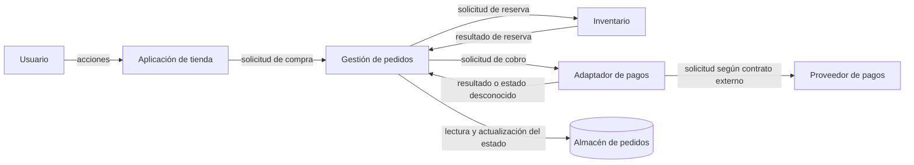

# CL01.02.01 — Distinguir elementos, responsabilidades y relaciones

## 1. Ficha de la clase

- **Módulo:** M01 — Pensamiento arquitectónico y fundamentos
- **Competencia principal:** C01 — Definir arquitectura de software operativamente
- **Nivel esperado:** EXPLICAR
- **Duración sugerida:** 90–120 minutos
- **Prerrequisitos:** CL01.01.01 — Concepto y propósito de la arquitectura. Experiencia básica leyendo o escribiendo software.
- **Pregunta guía:** ¿Cómo explicamos qué partes importan en un sistema, de qué se hace responsable cada una y cómo colaboran, sin confundir la arquitectura con el código?
- **Estado documental:** FINAL, revisión 3. El plan está aprobado para uso docente; la matriz curricular conserva su propio estado y no se modifica con este documento.
- **Resultado esperado:** el estudiante explica, con un ejemplo concreto, la diferencia entre elementos arquitectónicos, responsabilidades y relaciones; describe cómo interactúan algunos elementos y conecta esas relaciones con consecuencias plausibles para el sistema.

## 2. Propósito y lugar en la ruta

La clase anterior presentó la arquitectura como una descripción abstracta de estructuras, propiedades externamente visibles y relaciones relevantes. Aquí se profundiza en cómo hablar de esas estructuras de forma precisa: nombrar elementos, delimitar responsabilidades y describir las relaciones necesarias para entender el sistema.

Una lista de componentes no es suficiente. Decir «la aplicación tiene una API, una base de datos y un servicio de pagos» no explica qué debe hacer cada parte, qué información intercambia ni por qué una depende de otra. Tampoco basta una lista de funciones, clases o tecnologías: esos detalles pueden ser útiles, pero no necesariamente representan las unidades relevantes para una pregunta arquitectónica.

La finalidad de esta clase es aprender a **explicar una estructura**, no diseñar una arquitectura completa ni evaluar profesionalmente alternativas complejas.

### 2.1 Qué se recupera de CL01.01.01

- La arquitectura se describe mediante elementos, propiedades relevantes y relaciones.
- Una descripción arquitectónica es una abstracción: incluye información útil para una pregunta y omite detalles que no lo son.
- Las decisiones estructurales pueden afectar atributos de calidad, como disponibilidad, rendimiento, seguridad y modificabilidad.
- Los nombres de cajas y flechas no explican por sí solos una arquitectura: deben interpretarse en contexto.

No se repetirá aquí la definición general de arquitectura en extenso.

### 2.2 Qué se aprende ahora

- Cómo reconocer un elemento arquitectónico según la pregunta y el nivel de abstracción.
- Cómo expresar una responsabilidad como resultado o comportamiento del que un elemento debe hacerse cargo.
- Cómo distinguir el elemento, su responsabilidad, la interacción que realiza y el detalle concreto de implementación.
- Cómo describir dependencias, comunicación, colaboración y restricciones a nivel conceptual.
- Cómo explicar consecuencias posibles de las relaciones, sin convertir una posibilidad en una garantía.

### 2.3 Qué queda para clases posteriores

- **CL01.02.02 — Conectar estructura, runtime y vistas introductorias:** profundizará en la diferencia entre estructura estática, comportamiento en ejecución y representaciones orientadas a distintas preguntas.
- **M03 — Fundamentos de modelado:** abordará con mayor detalle las notaciones y técnicas de modelado.
- **CL01.05.01 — Decisiones arquitectónicas:** desarrollará el razonamiento sobre decisiones y sus consecuencias.
- Las relaciones se describen aquí de manera introductoria; la documentación formal y la justificación sistemática de decisiones no son objetivos centrales de esta clase.

> **Nota curricular:** la ruta vigente identifica `CL01.04.01` como *Contexto y participantes*. No se usa ese identificador para una clase de documentación de decisiones.

## 3. Objetivos de aprendizaje

Al terminar la clase, podrás:

1. **Explicar** qué es un elemento arquitectónico y por qué su identificación depende del propósito y del nivel de abstracción.
2. **Distinguir** un elemento, la responsabilidad que asume, una interacción con otros elementos y un detalle de implementación.
3. **Describir** responsabilidades delimitadas usando verbos, resultados y límites comprensibles.
4. **Explicar** relaciones conceptuales entre elementos, incluyendo qué conecta a las partes, qué fluye o se solicita y qué dependencia se introduce.
5. **Relacionar** una estructura o relación con una consecuencia plausible para una propiedad relevante del sistema, señalando las condiciones y los supuestos.

**Criterio de dominio:** no basta con nombrar cajas o memorizar definiciones. La respuesta debe explicar las distinciones con sus propias palabras y usarlas de forma coherente en un caso.

## 4. Activación de conocimientos previos

Antes de continuar, considera una tienda en línea con catálogo, pedidos, inventario, pagos y una base de datos.

1. ¿Por qué «Python», «PostgreSQL» y «Docker» no describen por sí solos las responsabilidades del sistema?
2. ¿Qué diferencia hay entre «Gestión de pedidos» y «registrar un pedido»?
3. Si la gestión de pedidos solicita un cobro al proveedor de pagos, ¿qué información faltaría para comprender esa interacción?
4. ¿Por qué no se puede concluir que el sistema es altamente disponible solo porque tiene varios servicios?

Las respuestas iniciales pueden ser incompletas. La clase construye el vocabulario necesario para mejorarlas.

## 5. Desarrollo conceptual

### 5.1 ¿Qué es un elemento arquitectónico?

En esta clase, llamaremos **elemento arquitectónico** a una parte identificable del sistema que resulta útil para explicar una estructura o una preocupación relevante. Según el contexto, puede representar un subsistema, módulo, servicio, proceso, almacén de datos o componente de infraestructura.

La expresión no implica que todos los autores utilicen exactamente la misma taxonomía ni que cada elemento deba corresponder a una clase de programación, un contenedor desplegable o un proceso separado. La escala depende de la pregunta que se intenta responder.

Por ejemplo, para explicar el flujo de compra pueden ser útiles «Aplicación de tienda», «Gestión de pedidos», «Inventario» y «Proveedor de pagos». Para explicar cómo está implementada la gestión de pedidos, esa caja podría descomponerse en módulos más pequeños. Para explicar la operación, quizá interese distinguir procesos, nodos o almacenes de datos.

**Prueba práctica:** si nombrar una parte ayuda a responder una pregunta significativa sobre el sistema, puede ser una candidata a elemento en esa descripción. Si el nombre solo enumera una tecnología sin indicar su papel, todavía falta contexto.

#### Elemento no equivale necesariamente a despliegue

Un elemento lógico puede ejecutarse dentro del mismo proceso que otros elementos. Dos servicios lógicos pueden compartir un despliegue, y un elemento lógico podría distribuirse en varias instancias en ejecución. No debe inferirse una correspondencia uno-a-uno entre elemento conceptual, módulo de código, proceso, contenedor y servidor.

La distinción importa porque cada representación responde preguntas diferentes. En esta clase se identifican elementos conceptuales; la relación entre estructura, ejecución y vistas se estudiará con mayor profundidad en la clase siguiente.

### 5.2 ¿Qué es una responsabilidad?

Una **responsabilidad** expresa aquello de lo que un elemento debe hacerse cargo dentro del sistema: una capacidad, una regla, una decisión operativa o la custodia de un estado. No es simplemente una acción aislada ni una lista de métodos.

Considérese el elemento `Gestión de pedidos`.

- **Responsabilidad:** coordinar el ciclo de vida del pedido y conservar su estado de negocio.
- **Ejemplos de comportamiento:** registrar una solicitud, comprobar que se cumplen las condiciones para confirmarla y reflejar el estado resultante.
- **Posible detalle de implementación:** una función `confirm_order()` escrita en Python.
- **Posible tecnología:** un framework web específico.

La función y el framework pueden participar en la implementación, pero no definen por sí solos la responsabilidad. Si se reemplaza la función por otra implementación, la responsabilidad puede mantenerse. Si se cambia la responsabilidad principal del elemento, en cambio, puede cambiar la manera en que el resto del sistema entiende y utiliza esa parte.

#### Cómo redactar una responsabilidad

Una responsabilidad útil suele responder:

1. **¿De qué se hace cargo?** Expresa un resultado o ámbito reconocible.
2. **¿Qué límites tiene?** Aclara qué queda fuera de su responsabilidad.
3. **¿Qué información o condiciones necesita?** Indica dependencias relevantes sin especificar detalles innecesarios.
4. **¿Qué resultado observable produce?** Explica qué pueden esperar otros elementos o usuarios.

Ejemplo:

> `Inventario` es responsable de consultar la disponibilidad y registrar reservas de existencias para una solicitud de pedido. No decide si el pago ha sido aprobado; esa información procede del flujo de pago y de las reglas del pedido.

Esta formulación identifica un ámbito y un límite. No especifica si se utiliza SQL, una API REST, una cola de mensajes ni una estructura interna de clases.

Una descripción vaga como «manejar inventario» es difícil de revisar: puede significar consultar existencias, reservar unidades, ajustar cantidades, registrar movimientos o todas esas tareas. La precisión no exige describir cada línea de código; exige que el alcance pueda entenderse y discutirse.

#### Responsabilidad no equivale a una regla universal de diseño

No hay una cantidad universal de responsabilidades que deba tener cada elemento. Una responsabilidad puede ser demasiado amplia o demasiado estrecha según el sistema, su contexto y el nivel de descripción. En esta clase se aprende a explicar límites; no se aplica una fórmula mecánica para decidir la descomposición correcta.

Tampoco debe confundirse «una responsabilidad» con «un método». Una responsabilidad puede necesitar múltiples operaciones coordinadas. A la inversa, una operación puede colaborar con elementos distintos sin que estos compartan la misma responsabilidad.

### 5.3 Elemento, responsabilidad, interacción e implementación: cuatro cosas distintas

| Concepto | Pregunta que responde | Ejemplo en una tienda |
|---|---|---|
| Elemento | ¿Qué parte identificamos? | `Gestión de pedidos` |
| Responsabilidad | ¿De qué se hace cargo esa parte? | Coordinar el estado del pedido |
| Interacción | ¿Qué hace un elemento con otro o qué intercambian? | Solicitar una reserva de inventario |
| Detalle de implementación | ¿Cómo se realiza concretamente? | Método `reserve_stock()` que ejecuta una consulta SQL |

La interacción no es una responsabilidad: «solicitar un cobro» describe una acción entre partes; «gestionar el ciclo de vida del pedido» describe un ámbito de responsabilidad. La implementación tampoco debe confundirse con la estructura conceptual: una llamada de método es una forma concreta de interacción, pero una interacción puede realizarse mediante una llamada local, una petición de red, un mensaje o un mecanismo distinto.

La distinción se hace según la pregunta. Una clase o función puede ser relevante para una descripción de bajo nivel y demasiado detallada para una descripción arquitectónica general. No es correcto afirmar que las clases nunca son elementos arquitectónicos; lo importante es justificar el nivel de abstracción.

**Conexión con la lectura:** el capítulo 12 de *Just Enough Software Architecture* organiza los elementos de un modelo bajo categorías como componentes, ensamblajes, conectores, decisiones de diseño, escenarios funcionales, restricciones, módulos, puertos, atributos de calidad, escenarios de calidad, responsabilidades y trade-offs. Esta clase no exige memorizar ni modelar toda esa taxonomía; toma de ella el principio operativo de que un modelo puede contener tanto elementos estructurales como decisiones, restricciones y escenarios relevantes para una pregunta.

### 5.4 ¿Qué es una relación?

Una **relación** expresa cómo dos o más elementos están conectados o condicionados entre sí. Para que una flecha o línea sea informativa, debe poder explicarse qué significa.

Entre las relaciones conceptuales habituales están:

- **Dependencia:** un elemento necesita algo proporcionado, mantenido o controlado por otro para cumplir parte de su función.
- **Comunicación:** dos elementos intercambian información o solicitudes mediante algún mecanismo.
- **Colaboración:** varios elementos participan en una actividad que requiere contribuciones coordinadas.
- **Restricción:** una condición limita las opciones de uno o más elementos, por ejemplo, una obligación de proteger datos sensibles o una regla de compatibilidad.

Estas categorías son vocabulario explicativo para el curso, no una taxonomía universal y exhaustiva. Una relación concreta puede tener más de una característica: la comunicación entre pedidos y pagos también puede crear una dependencia respecto de la disponibilidad o del contrato del proveedor.

#### Describir una relación de forma útil

Para explicar una relación, intenta contestar:

- ¿Qué elementos están relacionados?
- ¿Qué significa la relación?
- ¿Quién inicia la interacción, si aplica?
- ¿Qué solicitud, información o resultado se intercambia?
- ¿Qué condición o dependencia importa?
- ¿Qué no sabemos todavía?

Ejemplo:

> `Gestión de pedidos` solicita a `Inventario` reservar las unidades requeridas para un pedido. Inventario devuelve un resultado de reserva aceptada o rechazada. La gestión de pedidos depende de ese resultado para continuar el flujo. No se especifica todavía si el intercambio es una llamada síncrona o un mensaje asíncrono.

Esta descripción es más informativa que una flecha sin etiqueta. Explica intención, dirección, resultado y dependencia sin inventar una tecnología.

#### 5.4.1 Relaciones entre elementos y relaciones entre modelos

Conviene separar dos sentidos de «relación» para no confundir el diagrama de una solución con el vocabulario de modelado de la lectura.

- **Relación entre elementos del sistema:** describe la dependencia, intercambio o restricción entre partes del sistema, como en el diagrama de compra de esta clase.
- **Relación entre modelos o representaciones:** explica cómo se conectan distintas descripciones de un sistema o cómo una representación se organiza o se concreta a partir de otra. El capítulo 13 de *Just Enough Software Architecture* incluye una taxonomía de estas relaciones.

| Relación de modelado | Explicación introductoria | Ejemplo orientativo |
|---|---|---|
| Proyección o vista (*projection/view*) | Selecciona una parte de un modelo para responder una pregunta; una vista no pretende mostrarlo todo. | Una vista que solo presenta dependencias entre pedidos, inventario y pagos. |
| Partición (*partition*) | Divide un modelo en partes para organizarlo. | Separar una descripción grande en subsistemas o áreas. |
| Composición (*composition*) | Une partes o modelos para formar una representación más amplia. | Integrar modelos de catálogo y compras en una visión de tienda. |
| Clasificación (*classification*) | Relaciona un elemento particular con su tipo o categoría. | Un proveedor de pagos concreto es un ejemplo de proveedor externo. |
| Generalización (*generalization*) | Relaciona un tipo específico con otro más general del que comparte características. | Un tipo especializado de notificación dentro de una categoría general. |
| Designación (*designation*) | Explicita la correspondencia entre elementos de dos dominios o modelos. | Vincular un concepto del negocio con el elemento del diseño que lo representa. |
| Refinamiento (*refinement*) | Relaciona una descripción abstracta con otra más concreta de la misma idea. | Descomponer «gestionar pedidos» en módulos y operaciones de implementación. |
| Vinculación (*binding*) | Expresa una relación de vinculación entre un modelo y una decisión, patrón o marco que condiciona su forma. | Indicar que una estructura sigue un patrón o estilo seleccionado. |
| Dependencia (*dependency*) | Expresa que un cambio o condición en una representación puede requerir cambios o afectar otra. | Un cambio en un contrato compartido exige revisar los elementos que lo usan. |

Estas descripciones son resúmenes didácticos, no definiciones normativas ni citas textuales. Para la evidencia de esta clase se evalúa que el estudiante explique una relación con precisión y distinga hechos de supuestos; no se exige memorizar las nueve categorías ni aplicar formalmente todas ellas. En especial, una **vista/proyección** no debe confundirse con una nueva arquitectura independiente: es una representación selectiva de un modelo.

### 5.5 Dependencia, comunicación y colaboración no son sinónimos

- **Comunicación** describe el intercambio de solicitudes o información.
- **Dependencia** señala que un elemento necesita algo de otro o se ve condicionado por él.
- **Colaboración** describe la participación coordinada de varios elementos en una tarea o flujo.

Pueden coexistir, pero no son idénticas. Un elemento puede depender de una configuración o dato sin comunicarse directamente con el elemento que lo administra. Dos elementos pueden intercambiar mensajes sin que la descripción explique todavía qué dependencia funcional existe. Una colaboración puede involucrar varios intercambios y decisiones distribuidas entre partes.

No se debe deducir automáticamente que una relación es síncrona, asíncrona, fiable o segura solo porque existe una conexión conceptual. Esos detalles requieren información adicional.

### 5.6 Restricciones: condiciones que delimitan el sistema

Una **restricción** es una condición que limita el conjunto de soluciones o el comportamiento permitido. Puede proceder del negocio, de la normativa, de una plataforma, de la infraestructura o de una interfaz externa.

Ejemplos:

- El proveedor de pagos exige autenticar las solicitudes.
- Los datos de pago no deben registrarse en logs accesibles sin autorización.
- El sistema debe conservar un identificador que permita correlacionar el pedido con el resultado del cobro.
- Un sistema heredado solo permite consultar inventario mediante una interfaz existente.

La restricción no es necesariamente un elemento ni una relación, aunque puede condicionar ambos. La obligación de no exponer credenciales, por ejemplo, influye en las responsabilidades y en la información que puede cruzar una frontera.

En este nivel, el estudiante debe reconocer y explicar la restricción, no elaborar un modelo completo de amenazas ni seleccionar controles avanzados de seguridad.

### 5.7 ¿Por qué importan las responsabilidades y relaciones?

La estructura afecta cómo se distribuye el trabajo y cómo una parte del sistema influye en otra. Las consecuencias dependen de las condiciones concretas; no son garantías automáticas.

| Aspecto | Posible consecuencia de una estructura o relación | Matiz necesario |
|---|---|---|
| Modificabilidad | Una responsabilidad delimitada puede reducir la cantidad de elementos que deben cambiar ante una modificación. | Si la regla está duplicada o existen dependencias ocultas, el cambio aún puede propagarse. |
| Disponibilidad | Una dependencia de un proveedor externo puede hacer que una operación se vea afectada si ese proveedor no responde. | El efecto depende del flujo, los tiempos de espera, los mecanismos de recuperación y el comportamiento permitido. |
| Rendimiento | Una interacción adicional puede introducir latencia o trabajo extra. | La importancia depende del volumen, la frecuencia, la red y el coste de la operación. |
| Seguridad | Una frontera clara puede facilitar limitar el acceso a datos o capacidades. | Una frontera nominal no garantiza controles eficaces. |
| Comprensibilidad | Responsabilidades y relaciones explícitas facilitan explicar qué hace cada parte. | Una descripción incompleta puede ocultar dependencias o comportamientos relevantes. |

La finalidad no es afirmar que «más elementos» o «menos relaciones» siempre sea mejor. Una descomposición puede facilitar el cambio, pero también agregar coordinación. Una relación puede ser necesaria para completar una compra y, a la vez, introducir una dependencia que deba comprenderse.

### 5.8 Ejemplo progresivo: un servicio de notificaciones

Supongamos una aplicación que envía una confirmación al usuario después de registrar una compra.

**Paso 1 — Elemento:** `Notificaciones`.

**Paso 2 — Responsabilidad:** preparar y solicitar el envío de una notificación con el contenido apropiado para un evento de negocio. El envío efectivo puede depender de un proveedor externo.

**Paso 3 — Relación:** `Gestión de pedidos` informa a `Notificaciones` que un pedido ha sido confirmado.

**Paso 4 — Dependencia:** la notificación depende de recibir un evento o una solicitud con datos suficientes; el pedido no debería considerarse confirmado únicamente porque se envió un correo.

**Paso 5 — Detalle aún desconocido:** no sabemos si el evento se entrega por una cola, una llamada directa o un mecanismo interno. Tampoco sabemos si el proveedor garantiza entrega.

**Explicación correcta:** la notificación comunica un resultado del pedido, pero no necesariamente es responsable de decidir si el pedido se confirma. Separar esas responsabilidades puede permitir que el envío de mensajes evolucione sin alterar las reglas centrales del pedido, aunque la consecuencia real depende de las dependencias existentes.

### 5.9 Caso integrador: tienda en línea

El caso siguiente es un ejemplo didáctico creado para esta clase; no es una arquitectura prescrita por una fuente.

#### Contexto

Una tienda permite consultar productos, crear pedidos, reservar inventario y pagar con un proveedor externo. Se requiere que el estado del pedido sea comprensible para soporte y que una demora del proveedor de pagos no se interprete automáticamente como un rechazo.

#### Elementos y responsabilidades propuestos

| Elemento | Responsabilidad principal | Fuera de su responsabilidad principal |
|---|---|---|
| Aplicación de tienda | Recibir acciones del usuario y presentar información del flujo de compra. | Determinar por sí sola la verdad del estado persistido del pedido. |
| Gestión de pedidos | Coordinar el ciclo de vida del pedido y conservar su estado de negocio. | Ejecutar internamente todas las operaciones de inventario y pago. |
| Inventario | Consultar disponibilidad y registrar reservas de unidades. | Decidir si un proveedor aprobó un pago. |
| Adaptador de pagos | Traducir la interacción interna al contrato del proveedor y comunicar su resultado. | Garantizar que el proveedor nunca falle o se demore. |
| Proveedor externo de pagos | Procesar solicitudes de pago y responder según su contrato. | Definir por sí solo el estado completo del pedido de la tienda. |
| Almacén de pedidos | Conservar los datos necesarios para recuperar el pedido y su estado. | Coordinar por sí solo toda la lógica del flujo de compra. |

Los nombres y límites son una hipótesis didáctica razonable, no una única solución correcta. En otro contexto algunos elementos podrían combinarse, dividirse o denominarse de otra manera.

#### Relaciones conceptuales

**Cómo leerlo:**

- Las etiquetas describen la intención del intercambio, no un protocolo de transporte.
- La respuesta del proveedor puede ser exitosa, rechazada o no concluyente; el comportamiento exacto depende de su contrato.
- La gestión de pedidos coordina el estado del negocio, mientras inventario y pagos aportan resultados de sus ámbitos.
- El almacén conserva información, pero el diagrama no especifica su tecnología ni el mecanismo de consistencia.
- El diagrama no demuestra que los elementos sean procesos separados ni que todas las interacciones ocurran en una única secuencia temporal.

#### Explicar un escenario de fallo sin diseñar toda la solución

Si el proveedor de pagos tarda en responder, no es correcto afirmar automáticamente que el pago fracasó. La solicitud podría no haber llegado, el proveedor podría haber procesado el cobro y la respuesta haberse perdido, o la operación podría continuar en curso.

A nivel de esta clase basta con explicar que la relación con el proveedor introduce una dependencia y que el resultado incierto debe representarse de manera que no se confunda con un rechazo confirmado. El diseño detallado de reintentos, idempotencia, reconciliación y transacciones distribuidas queda fuera del alcance actual.

## 6. Contraejemplos y errores frecuentes

### Error 1: tratar la tecnología como responsabilidad

> «La responsabilidad de pedidos es usar PostgreSQL».

**Por qué es insuficiente:** PostgreSQL es una tecnología de almacenamiento, no una explicación de qué resultado de negocio debe gestionar pedidos. La tecnología puede apoyar una responsabilidad, pero no la sustituye.

### Error 2: describir una responsabilidad con un verbo demasiado amplio

> «Inventario gestiona todo».

**Por qué es insuficiente:** no delimita qué significa «todo», qué resultados produce ni qué reglas corresponden a otros elementos. Una explicación útil especifica el ámbito y al menos un límite.

### Error 3: confundir la interacción con el resultado de negocio

> «Pedidos llama a pagos, por eso el pedido está pagado».

**Por qué es incorrecto:** iniciar una solicitud no demuestra que el cobro haya sido aprobado. La interacción debe distinguir solicitud, respuesta y estado conocido.

### Error 4: interpretar cada flecha como una llamada síncrona

> «Hay una flecha entre pedidos e inventario, por tanto pedidos espera una respuesta inmediata».

**Por qué es incorrecto:** una flecha conceptual no especifica por sí misma protocolo, sincronía ni duración. Esos detalles deben declararse cuando la pregunta los requiera y exista evidencia.

### Error 5: asumir que una caja equivale a un servidor

> «Hay seis cajas, así que necesitamos seis servidores».

**Por qué es incorrecto:** los elementos del modelo pueden ser lógicos y compartir proceso o infraestructura. El despliegue no se deduce del número de cajas.

### Error 6: afirmar una propiedad de calidad sin explicar el mecanismo

> «Separar pagos hace que el sistema sea más seguro».

**Por qué es insuficiente:** la separación puede facilitar el aislamiento, pero también puede introducir nuevas interfaces y superficies de ataque. Hace falta explicar qué riesgo se reduce y bajo qué condiciones.

### Error 7: convertir una posibilidad en una garantía

> «Si las responsabilidades están separadas, cualquier cambio será independiente».

**Por qué es incorrecto:** una responsabilidad explícita no elimina dependencias, datos compartidos ni contratos que cambian. Puede ayudar a razonar sobre el cambio, pero no garantiza independencia.

### Error 8: usar nombres de cajas sin explicar sus relaciones

> «El sistema tiene pedidos, inventario, pagos y base de datos».

**Por qué es incompleto:** el inventario no explica cómo se reserva, cuándo se consulta ni cómo su resultado afecta al pedido. Para explicar una arquitectura hay que relacionar partes y responsabilidades.

## 7. Actividad guiada

**Título:** Explicar el flujo de una compra sin confundir responsabilidades.

**Tiempo sugerido:** 20–25 minutos.

### Instrucciones

1. Lee el caso integrador de la sección 5.9.
2. Selecciona cuatro elementos y escribe una responsabilidad para cada uno.
3. Para cada responsabilidad, indica al menos una cosa que no le corresponde decidir o hacer.
4. Elige tres relaciones del diagrama y descríbelas con una oración que explique origen, destino, intención y resultado o dato intercambiado.
5. Identifica una dependencia externa y explica una consecuencia posible si el proveedor tarda en responder.
6. Señala un detalle que todavía no puede deducirse del diagrama, por ejemplo, el protocolo de comunicación o el mecanismo de persistencia.
7. Revisa que no hayas descrito una tecnología como si fuera una responsabilidad ni una llamada como si demostrara un resultado de negocio.

### Entregable

Una tabla con columnas `Elemento`, `Responsabilidad`, `Límite`, `Relación relevante` y `Consecuencia o incertidumbre`, más un párrafo de 100–180 palabras que explique el flujo y una dependencia.

### Criterios de revisión

- Los elementos son identificables y están al nivel conceptual apropiado.
- Las responsabilidades describen ámbitos reconocibles y no se limitan a nombres de tecnologías.
- Las relaciones indican qué conectan y qué intercambian o requieren.
- Las consecuencias están formuladas como posibilidades condicionadas, no como garantías.
- Los supuestos y los detalles desconocidos se distinguen explícitamente.

## 8. Ejercicio de aplicación individual

### Situación

Una plataforma de cursos permite que una persona se inscriba en un curso. Antes de confirmar la inscripción, debe verificar que haya cupo y registrar la inscripción. Después, puede enviar un correo de confirmación.

Una descripción inicial solo dice: «Frontend, API, base de datos, correo electrónico y servidor».

### Tareas

1. Propón entre cuatro y seis elementos conceptuales que permitan explicar el proceso de inscripción.
2. Describe la responsabilidad y un límite para cada elemento.
3. Explica tres relaciones entre esos elementos.
4. Describe qué podría ocurrir si el proveedor de correo no responde y qué no se puede concluir a partir de ese hecho.
5. Señala dos detalles de implementación que no son necesarios para la primera explicación arquitectónica.
6. Redacta un párrafo que distinga hechos conocidos de supuestos que hayas introducido.

### Solución orientativa

Una respuesta posible puede identificar `Interfaz`, `Gestión de inscripciones`, `Gestión de cupos`, `Almacén de inscripciones` y `Servicio de notificaciones`. No es obligatorio usar esos nombres exactos.

- `Gestión de inscripciones` coordina la solicitud y conserva el resultado de la inscripción; no debe inventar disponibilidad de cupo.
- `Gestión de cupos` consulta o reserva capacidad; no es responsable de enviar correos.
- `Almacén de inscripciones` conserva datos que permitan recuperar la inscripción; no coordina por sí solo todo el flujo.
- `Servicio de notificaciones` solicita el envío de una confirmación; el envío puede depender de un proveedor externo.
- La gestión de inscripciones necesita el resultado de la comprobación de cupo antes de confirmar el resultado al usuario.
- Si falla el correo, no puede concluirse automáticamente que la inscripción falló. Son resultados diferentes y el caso no define la política de reintentos ni el mecanismo de confirmación.

Detalles como el nombre del framework web o el tipo exacto de índice de la base de datos pueden omitirse en la primera explicación, a menos que respondan una pregunta relevante. La solución es orientativa, no una arquitectura única obligatoria.

## 9. Matriz de alineación pedagógica

| Objetivo | Contenido que lo desarrolla | Actividad | Evidencia observable | Criterio de evaluación |
|---|---|---|---|---|
| O1. Explicar qué es un elemento arquitectónico | 5.1 y 5.3 | Activación y caso de tienda | Identifica elementos apropiados y explica por qué los eligió | Distingue partes conceptuales de tecnologías aisladas y justifica el nivel de abstracción |
| O2. Distinguir elemento, responsabilidad, interacción e implementación | 5.2–5.3; errores 1–4 | Tabla de la actividad guiada | Clasifica ejemplos y explica las diferencias | No confunde nombre de elemento, ámbito de responsabilidad, intercambio y mecanismo de código |
| O3. Describir responsabilidades delimitadas | 5.2 y caso 5.9 | Redactar responsabilidades y límites | Tabla elemento–responsabilidad–límite | Cada responsabilidad describe un ámbito reconocible y al menos un límite coherente |
| O4. Explicar relaciones conceptuales | 5.4–5.6 y 5.9 | Describir tres relaciones | Oraciones que explican elementos conectados, intención y resultado/dato | La relación tiene significado explícito; no se infieren protocolos no declarados |
| O5. Relacionar estructura con una consecuencia plausible | 5.7, caso 5.9 y ejercicio | Analizar demora del proveedor | Párrafo que describe dependencia, consecuencia y supuestos | Explica una consecuencia razonable y la formula de manera condicionada, sin garantizar resultados |

## 10. Evidencias de aprendizaje

La evidencia principal es el entregable de la actividad guiada o del ejercicio individual. Debe incluir:

- Una lista de elementos conceptuales identificados.
- Responsabilidades descritas con límites.
- Al menos tres relaciones explicadas.
- Una consecuencia posible de una dependencia.
- Una distinción entre información conocida y supuestos o detalles aún desconocidos.

Estas evidencias corresponden directamente a los objetivos. La cantidad de cajas, la estética del diagrama o el uso de una tecnología particular no son criterios de dominio por sí mismos.

## 11. Evaluación

### Preguntas conceptuales

1. ¿Por qué una tecnología no describe por sí sola la responsabilidad de un elemento?
2. Explica la diferencia entre responsabilidad e interacción mediante un ejemplo.
3. ¿Por qué una flecha entre dos elementos no demuestra que exista una llamada síncrona?
4. ¿Qué diferencia hay entre una dependencia y una comunicación? ¿Cómo pueden coexistir?
5. Si el proveedor de pagos no responde, ¿qué puede afirmarse y qué debe permanecer como incertidumbre?
6. Describe una forma en que una responsabilidad delimitada puede facilitar un cambio y una condición que podría impedir esa ventaja.

### Tarea evaluable

Usa el ejercicio de inscripción de la sección 8. Entrega los elementos, responsabilidades, límites, tres relaciones y un párrafo explicativo. La evaluación se limita a EXPLICAR: no exige escoger una arquitectura óptima, justificar trade-offs complejos ni diseñar mecanismos avanzados de resiliencia.

## 12. Rúbrica analítica

Puntuación sugerida: 4 criterios, cada uno de 0 a 3 puntos; total de 12 puntos. La rúbrica mide la evidencia producida en esta clase, no el dominio global de la competencia C01.

| Criterio | 3 — Explicación sólida | 2 — Explicación correcta | 1 — Parcial | 0 — Sin evidencia suficiente |
|---|---|---|---|---|
| Identificación de elementos y nivel de abstracción | Identifica elementos pertinentes y explica por qué son útiles para la pregunta; no los equipara automáticamente con tecnologías o despliegues. | Identifica elementos adecuados, aunque la explicación del nivel de abstracción es breve. | Mezcla elementos conceptuales con tecnologías o detalles de código sin aclarar la diferencia. | No identifica elementos comprensibles o la lista no corresponde al caso. |
| Responsabilidades y límites | Cada responsabilidad describe un ámbito concreto y establece límites coherentes con otros elementos. | Las responsabilidades son comprensibles; algunos límites quedan implícitos. | Usa verbos vagos o asigna ámbitos solapados sin explicarlos. | No describe responsabilidades o las confunde completamente con tecnologías. |
| Explicación de relaciones | Explica qué elementos se relacionan, con qué intención y qué información o resultado se intercambia; evita inventar mecanismos. | Describe relaciones comprensibles, aunque omite un detalle secundario. | Presenta flechas o frases genéricas sin explicar el significado, o infiere protocolos sin fundamento. | No describe relaciones interpretables. |
| Consecuencias y manejo de incertidumbre | Conecta una dependencia con una consecuencia plausible y distingue hechos, supuestos y resultados desconocidos. | Explica una consecuencia plausible, pero distingue parcialmente los supuestos. | Afirma consecuencias como garantías o confunde solicitud con resultado confirmado. | No conecta estructura con consecuencias o hace afirmaciones incompatibles con el caso. |

### Interpretación de resultados

- **10–12 puntos:** explica las distinciones con consistencia y reconoce los límites de la información.
- **7–9 puntos:** demuestra comprensión básica, con una o más distinciones que requieren precisión.
- **4–6 puntos:** la explicación es fragmentaria; conviene revisar responsabilidades y relaciones con otro ejemplo.
- **0–3 puntos:** la evidencia no permite confirmar los objetivos; se requiere apoyo guiado y una nueva comprobación.

La puntuación orienta la retroalimentación y no constituye una certificación automática de dominio. Si una respuesta tiene una debilidad crítica —por ejemplo, tratar una solicitud de cobro como pago confirmado— debe corregirse explícitamente aunque la suma numérica sea aceptable.

## 13. Síntesis final

Una explicación arquitectónica clara separa cuatro preguntas:

- **Elemento:** ¿qué parte identificamos para responder a la pregunta?
- **Responsabilidad:** ¿de qué se hace cargo esa parte y dónde termina su ámbito?
- **Relación o interacción:** ¿cómo se conecta con otras partes, qué necesita y qué intercambia?
- **Implementación:** ¿qué mecanismo concreto realiza el comportamiento?

Los elementos adquieren significado por sus responsabilidades y por la forma en que se relacionan. Las relaciones pueden introducir dependencias, restricciones o consecuencias para el comportamiento y las propiedades del sistema. Esas consecuencias deben explicarse con condiciones y supuestos explícitos, no presentarse como certezas universales.

La meta no es producir el diagrama más detallado, sino una explicación que permita a otra persona comprender las partes relevantes, sus límites y sus interacciones sin inventar detalles.

## 14. Glosario

- **Elemento arquitectónico:** parte identificable del sistema que resulta útil para explicar una estructura o preocupación relevante.
- **Responsabilidad:** ámbito de comportamiento, resultado o estado del que un elemento debe hacerse cargo.
- **Relación:** conexión o condicionamiento entre elementos que debe interpretarse según su significado.
- **Interacción:** intercambio de solicitudes, información o resultados entre elementos.
- **Dependencia:** condición por la que un elemento necesita o queda condicionado por otro.
- **Colaboración:** participación coordinada de varios elementos en una actividad.
- **Restricción:** condición que limita opciones o comportamientos posibles.
- **Detalle de implementación:** decisión o mecanismo concreto de código, tecnología o ejecución que realiza un comportamiento.
- **Abstracción:** selección de detalles pertinentes para una pregunta, dejando fuera los que no ayudan a responderla.
- **Supuesto:** afirmación usada provisionalmente porque no está confirmada por la información disponible.

## 15. Lecturas y referencias

### 15.1 Lecturas prescritas por la ruta curricular

1. **George Fairbanks, *Just Enough Software Architecture: A Risk-Driven Approach* (2010).** La ruta prescribe los capítulos 7 y 12–13. El material de muestra del autor permite revisar el capítulo 7, **“Conceptual Model of Software Architecture”**, que explica los modelos de dominio, diseño y código, el uso de vistas y las relaciones entre representaciones. El índice editorial oficial identifica el capítulo 12 como **“Model Elements”** (incluye categorías como componentes, conectores, decisiones, restricciones, responsabilidades y trade-offs) y el 13 como **“Model Relationships”** (incluye proyección/vista, partición, composición, clasificación, generalización, designación, refinamiento, vinculación y dependencia).

   **Alcance de la verificación:** el EPUB de muestra disponible no incluye el texto íntegro de los capítulos 12 y 13, pero el índice del autor y la tabla de contenido oficial permiten confirmar sus títulos y alcance nominal. La clase emplea una síntesis didáctica de los conceptos generales, evita citas textuales y no inventa páginas ni atribuye definiciones detalladas a fragmentos que no se pudieron revisar completos. Para el estudiante siguen siendo las lecturas asignadas por la ruta.
   https://www.georgefairbanks.com/book/
   https://www.georgefairbanks.com/assets/jesa/Just_Enough_Software_Architecture__Fairbanks_2010-demo.pdf

2. **Humberto Cervantes y Rick Kazman, *Designing Software Architectures: A Practical Approach*, 2.ª ed. (2024).** La ruta prescribe §3.2, **“Design Concepts: The Building Blocks for Creating Structures”**, y §4.5, **“Producing Structures”**. La muestra de Pearson permite cotejar el apartado 3.2: presenta principios de diseño que orientan estructuras y relaciona modularidad, puntos únicos de fallo, límites de acceso y otros principios con atributos de calidad. El índice editorial sitúa §4.5 dentro del proceso de diseño arquitectónico y la producción de estructuras.

   **Uso en esta clase:** se toma únicamente la idea general de que una estructura y sus relaciones pueden tener consecuencias para propiedades del sistema; no se enseña el método ADD completo ni se atribuye a §4.5 una definición exhaustiva de elementos o relaciones. La vista previa pública no sustituye el cotejo íntegro de una edición de acceso completo.
   https://www.oreilly.com/library/view/designing-software-architectures/9780138108069/toc.xhtml
   https://ptgmedia.pearsoncmg.com/images/9780138108021/samplepages/9780138108021_Sample.pdf

### 15.2 Fuentes curriculares consultadas

- Ruta curricular: https://github.com/acuscorp/SoftwareArchitecture/blob/main/LEARNING_PATH.md
- Matriz maestra de competencias: https://github.com/acuscorp/SoftwareArchitecture/blob/main/MATRIZ_COMPETENCIAS.md
- Clase anterior, `CL01.01.01 — Concepto y propósito de la arquitectura`: https://github.com/acuscorp/SoftwareArchitecture/blob/main/Classes/M01%20-%20Pensamiento%20arquitect%C3%B3nico%20y%20fundamentos/CL01.01.01%20-%20Concepto%20y%20prop%C3%B3sito%20de%20la%20arquitectura.md
- Clase siguiente, `CL01.02.02 — Conectar estructura, runtime y vistas introductorias`: https://github.com/acuscorp/SoftwareArchitecture/blob/main/Classes/M01%20-%20Pensamiento%20arquitect%C3%B3nico%20y%20fundamentos/CL01.02.02%20-%20Conectar%20estructura%2C%20runtime%20y%20vistas%20introductorias.md
- Clase `CL01.04.01 — Contexto y participantes`: https://github.com/acuscorp/SoftwareArchitecture/blob/main/Classes/M01%20-%20Pensamiento%20arquitect%C3%B3nico%20y%20fundamentos/CL01.04.01%20-%20Contexto%20y%20participantes.md

### 15.3 Atribución y naturaleza del material

Las definiciones operativas, tablas, ejemplos de tienda e inscripción, diagrama Mermaid, actividades, preguntas y rúbrica son una **síntesis didáctica creada para el curso**. No son citas textuales ni se presentan como reproducción de un capítulo concreto. Las referencias editoriales se usan para verificar la identidad y alcance de las lecturas asignadas y para corroborar los conceptos que sí aparecen en las muestras accesibles. Cuando el texto completo no fue accesible, el documento hace explícita esa limitación y evita afirmaciones de verificación línea por línea.

No se añade bibliografía complementaria como lectura obligatoria.

## 16. Conexión con la siguiente clase

En `CL01.02.02 — Conectar estructura, runtime y vistas introductorias`, el estudiante reutilizará los elementos, responsabilidades y relaciones identificados aquí para explicar cómo una estructura conceptual se manifiesta durante la ejecución y por qué distintas vistas responden preguntas diferentes.

Se espera que llegue a la siguiente clase pudiendo explicar qué significa una relación en un diagrama, sin asumir automáticamente que la flecha define el protocolo, el despliegue o la secuencia temporal. La clase siguiente ampliará ese razonamiento; no es necesario dominar ahora notaciones UML ni técnicas formales de documentación.

## 17. Control de calidad y estado final

| Comprobación | Resultado | Evidencia/razón |
|---|---|---|
| Identificador, título, competencia y nivel | PASS | `CL01.02.01`, C01 y EXPLICAR coinciden con la ruta. |
| Convenciones de metadatos | PASS | `course_id: SAC01`; conserva el identificador estable del artefacto y registra revisión 3. |
| Continuidad curricular | PASS | Reutiliza conceptos de CL01.01.01 y prepara el trabajo de estructura, runtime y vistas en CL01.02.02. |
| Lecturas asignadas | PASS WITH SCOPE LIMITS | Se cotejaron el capítulo 7 y la estructura editorial de los capítulos 12–13 de Fairbanks; el texto íntegro 12–13 no forma parte de la muestra. En Cervantes/Kazman se cotejó el extracto público de §3.2 y el índice de §4.5. La clase limita sus atribuciones a ese alcance. |
| Distinción entre fuente y síntesis | PASS | No hay citas textuales ni páginas inventadas; ejemplos y rúbrica se identifican como elaboración didáctica. |
| Comprensión conceptual | PASS | Define elementos, responsabilidades, relaciones, límites, restricciones y abstracción; separa interacción de relación entre modelos. |
| Progresión y alcance | PASS | Secuencia explicación, ejemplo trabajado, errores, comprobación, práctica guiada y aplicación individual; no exige UML formal ni diseño avanzado. |
| Alineación pedagógica | PASS | Los cinco objetivos están relacionados con contenidos, actividades, evidencias y criterios de rúbrica. |
| Evaluación | PASS | Rúbrica de cuatro criterios (0–3 puntos, 12 máximo) con interpretación y tratamiento de errores conceptuales críticos. |
| Coherencia de diagramas y ejemplos | PASS | Las flechas expresan intención, no protocolos o despliegue implícitos; el timeout se distingue de un rechazo confirmado. |
| Consistencia curricular lateral | PASS | Se corrigió la referencia a `CL01.04.01`, que en la ruta es “Contexto y participantes”. |
| Estado documental | FINAL | El plan de clase se finaliza a petición explícita del usuario; no modifica la matriz de competencias ni registra dominio de estudiantes. |

### Correcciones incorporadas en la revisión 3

1. Se añadió una explicación explícita de los elementos que puede contener un modelo (componentes, conectores, decisiones, restricciones, responsabilidades y escenarios), sin ampliar el objetivo a una taxonomía avanzada.
2. Se distinguieron las relaciones entre elementos de un sistema de las relaciones entre modelos/representaciones descritas en la lectura asignada.
3. Se agregó una tabla introductoria de las categorías de relaciones del capítulo 13, con ejemplos originales y una indicación explícita de que no son definiciones normativas ni citas textuales.
4. Se corrigieron las referencias para documentar con precisión qué se verificó en las muestras públicas y qué partes del texto completo no estaban disponibles.
5. Se mantuvieron la alineación O1–O5, la práctica independiente y la rúbrica con criterios observables.

**Decisión:** `FINAL` para uso como plan de clase en SAC01. La ruta asigna C01 y el nivel EXPLICAR; el estado de la matriz maestra no cambia. El contenido no afirma que se haya auditado línea por línea el texto completo de todas las lecturas: esa limitación queda documentada en las referencias, sin usar la muestra como si fuera la obra íntegra.