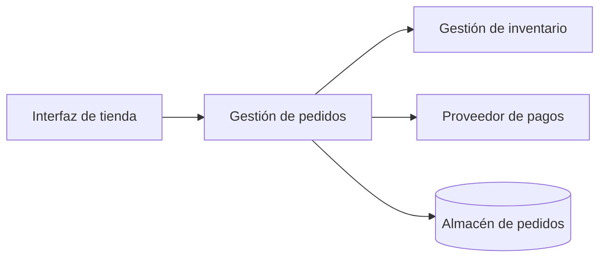

# CL01.02.02 — Conectar estructura, runtime y vistas introductorias

## 1. Propósito y resultado esperado

En la clase anterior identificaste elementos, responsabilidades y relaciones. Ahora conectarás esas ideas con dos preguntas complementarias:

- ¿Cómo está organizado el sistema?
- ¿Cómo colaboran sus partes cuando ocurre un caso de uso?

Al finalizar, la persona estudiante podrá **explicar** con un caso acotado la diferencia entre una estructura y una interacción en tiempo de ejecución, y escoger una representación introductoria que responda una pregunta concreta. No se espera producir documentación arquitectónica completa ni usar una notación formal.

## 2. Competencia, nivel y criterios propuestos

- **Competencia primaria:** `C01 — Definir arquitectura de software operativamente`.
- **Nivel esperado por esta clase:** `EXPLICAR`.
- **Criterio propuesto para revisión:** `CR-C01-EXPLAIN`.

Este plan no valida dominio. El criterio, la actividad y la rúbrica de este documento son propuestas para revisión curricular; no sustituyen los criterios específicos aprobados del curso.

## 3. Prerrequisitos y dependencias

- **Prerrequisito:** `CL01.02.01 — Distinguir elementos, responsabilidades y relaciones`.
- **Evidencia de entrada observable:** la persona puede identificar al menos dos elementos de un caso, describir la responsabilidad de cada uno y explicar una relación sin confundirla con una tecnología.
- **Dependencia curricular:** `LEARNING_PATH.md`, M01, clase `CL01.02.02`.
- **Dependencia de evaluación:** antes de impartir, validar la evidencia propuesta y el criterio `CR-C01-EXPLAIN`.

Si el prerrequisito no está demostrado, usar la remediación del apartado 12 antes de solicitar la evidencia independiente.

## 4. Alcance y límites

**Incluye**

- Estructura estática como organización relevante de elementos y relaciones.
- Comportamiento o interacción en runtime: colaboración de elementos durante un escenario.
- Vistas como representaciones parciales, elegidas por la pregunta que ayudan a responder.
- Distinción entre lo que una representación muestra, lo que no muestra y lo que requeriría evidencia adicional.

**Fuera de alcance**

- Notación UML, diagramas de secuencia o de despliegue formales.
- Métodos completos de documentación arquitectónica.
- Decidir una arquitectura, distribuir componentes o justificar tecnologías.
- Acreditar las competencias `C02` o `C06`.

Esos límites evitan anticipar contenido de M03 y módulos posteriores.

## 5. Lectura y referencias

### Lectura asignada al estudiante (propuesta)

[Software Architecture in Practice, 4.ª ed.](https://www.informit.com/store/software-architecture-in-practice-9780136885672), cap. 1 §1.2, “Architectural Structures and Views” (p. 5).

La asignación respalda la relación entre estructuras y vistas. Antes de aprobar el plan, debe cotejarse el contenido de la edición disponible y confirmarse que los ejemplos empleados para runtime cubren el resultado de esta clase.

### Fuentes de consulta para quien diseña o facilita la clase

No son lecturas obligatorias automáticas para el estudiante.

- [Just Enough Software Architecture](https://www.georgefairbanks.com/book/), caps. 7, 9–10 y 15.
- [Designing Software Architectures, 2.ª ed.](https://www.oreilly.com/library/view/designing-software-architectures/9780138108069/toc.xhtml), §§4.5 y 4.7.
- [Object-Oriented Software Engineering](https://www.informit.com/store/object-oriented-software-engineering-using-uml-patterns-9780136061250), cap. 7.3.

## 6. Teoría

### 6.1. El problema que resuelven estas distinciones

Una descripción arquitectónica fracasa cuando intenta responder preguntas distintas con una sola frase o con un solo dibujo. Considera estas tres preguntas:

1. **¿Qué partes son relevantes y de qué se encarga cada una?**
2. **¿Qué ocurre cuando una persona realiza una acción concreta?**
3. **¿Qué información necesita un lector para tomar una decisión o entender un riesgo?**

La primera habla de organización; la segunda, de colaboración durante una ejecución; la tercera, de la representación elegida para la preocupación de ese lector. Las tres están conectadas, pero no son equivalentes.

La idea de esta clase es aprender a cambiar de pregunta sin cambiar arbitrariamente de sistema. Seguiremos hablando de las mismas partes, pero observándolas desde ángulos diferentes.

### 6.2. Primer paso: separar el sistema del modo de describirlo

El sistema existe con sus partes, reglas y comportamientos. Una **representación** es una selección que hacemos para explicarlo. Por eso:

- Una representación no es el sistema.
- Una representación siempre omite algo.
- Omitir un detalle no la vuelve incorrecta, si el detalle no era necesario para la pregunta.
- Añadir detalles que no están respaldados por el caso sí puede volver engañosa una explicación.

Imagina un plano del metro. Es útil para decidir cómo llegar de una estación a otra, aunque no muestre todos los edificios, calles o desniveles de la ciudad. No es un mapa “incompleto” en el sentido negativo: es selectivo para una tarea concreta. Con las vistas arquitectónicas ocurre algo parecido.

**Pregunta de comprobación:** si un dibujo muestra “Pedidos” e “Inventario”, ¿demuestra automáticamente dónde está instalado cada uno? No. Para responder dónde se ejecutan se necesita otra información.

### 6.3. Estructura: una organización útil, no una lista de tecnologías

Una **estructura** describe cómo organizamos elementos y relaciones relevantes para una pregunta. Los elementos pueden ser partes conceptuales, módulos, servicios, procesos, almacenes de datos u otros elementos; el nombre correcto depende del nivel de detalle y de lo que se intenta explicar.

En esta clase se usará la estructura para responder:

- ¿Qué partes participan?
- ¿Cuál es la responsabilidad de cada parte?
- ¿Qué relación relevante tienen entre sí?

Por ejemplo, en una compra en línea podemos distinguir Interfaz de tienda, Gestión de pedidos, Gestión de inventario, Proveedor de pagos y Almacén de pedidos. Esta selección no obliga a que existan cinco programas, cinco equipos ni cinco servicios. Es una manera de organizar la conversación arquitectónica.

#### 6.3.1. Qué aporta una estructura

Una estructura bien explicada permite identificar límites de responsabilidad. Si Gestión de inventario reserva existencias y Gestión de pedidos coordina el ciclo de vida del pedido, podemos preguntar con precisión quién debe conocer cierta regla o quién resulta afectado por un cambio.

También permite evitar explicaciones vagas como “el backend hace todo”. Esa frase no revela qué partes existen, cómo se distribuye el trabajo ni qué relaciones son importantes.

#### 6.3.2. Qué no puede concluirse solo con una estructura

Una estructura no permite afirmar, por sí misma:

- el orden en que ocurren las interacciones;
- si una interacción es síncrona o asíncrona;
- el protocolo o tecnología utilizada;
- cuánto tarda una operación;
- si un elemento se despliega en un proceso, un servidor o varios;
- qué sucede ante un fallo.

Estas preguntas pueden ser relevantes, pero necesitan una vista o evidencia diferente.

#### 6.3.3. Cómo reconocer una estructura explicativa

Compara estas dos frases:

- “La aplicación usa Python, PostgreSQL y Docker”.
- “Gestión de pedidos conserva el estado de los pedidos; un almacén de pedidos implementa esa responsabilidad con una tecnología que debe especificarse aparte”.

La primera enumera mecanismos. La segunda identifica una responsabilidad y deja la tecnología en el lugar que le corresponde. La tecnología puede ser decisiva en otro contexto, pero no sustituye la explicación arquitectónica.

### 6.4. Runtime: observar una colaboración mientras sucede

**Runtime** se refiere a lo que ocurre mientras el sistema atiende una situación. No significa “todo lo que pasa en producción”, sino el comportamiento relevante para el escenario que estamos estudiando.

Si el escenario es confirmar una compra, puede ocurrir lo siguiente:

1. La interfaz entrega una solicitud de compra.
2. Gestión de pedidos solicita verificar o reservar existencias.
3. Inventario comunica un resultado.
4. Gestión de pedidos solicita el cobro cuando las reglas del caso lo permiten.
5. Gestión de pedidos conserva el estado correspondiente y comunica el resultado.

Esta lista no reemplaza la estructura. La utiliza: los elementos que aparecen en el recorrido son los que colaboran en ese escenario.

#### 6.4.1. Un recorrido de runtime debe tener una pregunta

No se describe runtime para narrar pasos sin propósito. Un recorrido sirve, por ejemplo, para responder:

- ¿Qué colaboraciones son necesarias para confirmar un préstamo?
- ¿Qué resultado necesita Pedidos antes de continuar?
- ¿Qué elementos intervienen en una operación?
- ¿En qué punto aparece una incertidumbre que debe resolverse?

La pregunta selecciona el detalle. Para una introducción, basta con mostrar participantes, intercambio o resultado relevante y orden lógico del escenario.

#### 6.4.2. Secuencia no es mecanismo

Que un paso aparezca antes que otro no prueba cómo se implementó la comunicación. La frase “Pedidos solicita una reserva” puede ser compatible con mecanismos distintos. El caso no autoriza a afirmar “es una llamada HTTP”, “es una cola” o “ocurre en el mismo proceso” a menos que lo indique.

Esta disciplina importa porque una explicación arquitectónica debe diferenciar:

| Tipo de afirmación | Ejemplo |
|---|---|
| Dato del caso | Gestión de pedidos solicita una reserva a inventario. |
| Inferencia condicionada | Si inventario no responde, la confirmación podría quedar pendiente o retrasarse. |
| Supuesto por verificar | La solicitud se comunica mediante HTTP. |
| Conclusión no justificada | Inventario siempre responde porque existe una flecha entre ambos. |

La columna central es especialmente importante: una inferencia puede ser razonable sin convertirse en un hecho.

### 6.5. Vistas introductorias: elegir la representación según la preocupación

Una **vista** es una representación seleccionada para responder una preocupación concreta. “Vista” no significa una pantalla de interfaz ni una fotografía completa del sistema. Significa un modo de presentar cierta información relevante.

En esta clase usamos dos representaciones introductorias:

| Preocupación | Representación que ayuda | Pregunta que responde | Límite explícito |
|---|---|---|---|
| Organización | Estructura de elementos, responsabilidades y relaciones | ¿Qué partes se consideran relevantes? | No muestra el orden exacto de las colaboraciones. |
| Comportamiento del escenario | Recorrido de runtime | ¿Cómo colaboran las partes al atender este caso? | No explica toda la organización interna ni el despliegue. |

La misma arquitectura puede necesitar más vistas cuando las preocupaciones cambian. Por ejemplo, una pregunta sobre infraestructura requerirá información diferente, pero esa vista no se desarrolla todavía aquí.

#### 6.5.1. Elegir una vista no es elegir “la mejor” vista

No existe una vista universalmente mejor. Una representación es adecuada cuando aporta la información necesaria para la pregunta, con un nivel de detalle comprensible y sin ocultar límites importantes.

Antes de dibujar o leer una representación, formula estas preguntas:

1. ¿Qué necesito comprender o decidir?
2. ¿Qué elementos y relaciones son necesarios para responderlo?
3. ¿Qué detalles puedo omitir sin cambiar la respuesta?
4. ¿Qué no permite concluir esta representación?

Responder la cuarta pregunta evita que un dibujo sencillo se convierta en una afirmación excesiva.

### 6.6. Conectar estructura y runtime paso a paso

Usaremos una secuencia de razonamiento que se puede reutilizar en otros casos.

**Paso 1: nombra el escenario.**  
Ejemplo: “una persona solicita un préstamo”.

**Paso 2: identifica los participantes relevantes.**  
Ejemplo: Interfaz web, Gestión de préstamos, Catálogo, Servicio de identidad y Registro de préstamos.

**Paso 3: describe responsabilidades antes de describir pasos.**  
Gestión de préstamos coordina la solicitud; Catálogo informa disponibilidad; Servicio de identidad comprueba una condición indicada por el caso.

**Paso 4: recorre las interacciones necesarias.**  
La interfaz entrega la solicitud, Gestión de préstamos consulta las condiciones y comunica el resultado.

**Paso 5: compara preguntas respondidas y pendientes.**  
La estructura responde quién participa y de qué se encarga. El recorrido responde cómo colaboran en el préstamo. Sigue pendiente conocer el protocolo, la infraestructura, los tiempos y la recuperación ante fallos.

Esta secuencia impide dos errores frecuentes: saltar directamente a la tecnología o convertir una secuencia de mensajes en la única descripción arquitectónica necesaria.

### 6.7. Analogía limitada: teatro y representación

Una obra de teatro permite una analogía útil, con límites:

- El reparto y los papeles se parecen a una **estructura**: quién participa y qué rol desempeña.
- Lo que sucede escena por escena se parece al **runtime**: cómo esos participantes colaboran durante una situación.
- El programa de mano, un plano del escenario o el guion resaltan aspectos distintos para lectores distintos; se parecen a **vistas**.

La analogía no debe llevarse demasiado lejos. Los elementos de software no son personas y una responsabilidad arquitectónica no implica intención humana. Úsala solo para recordar que rol, secuencia y representación responden preguntas diferentes.

### 6.8. Autoevaluación breve antes de la actividad

Comprueba si puedes responder sin mirar las soluciones:

1. ¿Por qué una lista de tecnologías no basta para describir una estructura?
2. ¿Qué dato adicional necesitarías para afirmar que una interacción es asíncrona?
3. Si quieres explicar el orden de una solicitud de préstamo, ¿qué representación introductoria usarías?
4. Si quieres explicar responsabilidades de elementos, ¿qué representación usarías?
5. ¿Cuál es la diferencia entre declarar una pregunta abierta e inventar un detalle?

Respuestas esperadas, en términos generales:

1. Porque no identifica responsabilidades ni relaciones relevantes.
2. Información explícita del caso o una fuente confiable sobre el mecanismo.
3. Un recorrido de runtime del escenario.
4. Una estructura de elementos, responsabilidades y relaciones.
5. La pregunta abierta reconoce una limitación; inventar un detalle la oculta.

## 7. Ejemplo razonado: compra en una tienda en línea

### 7.1. Estructura introductoria

Esta representación ayuda a identificar elementos y relaciones relevantes. No afirma que cada flecha sea una llamada de red, que cada elemento sea un servicio desplegable ni que el almacén sea una tecnología particular.

### 7.2. Recorrido de runtime para confirmar una compra

1. La interfaz envía la solicitud de compra a Gestión de pedidos.
2. Gestión de pedidos solicita la reserva de existencias a Gestión de inventario.
3. Inventario comunica el resultado de la reserva.
4. Si el caso define que hay existencias, Gestión de pedidos solicita el cobro al proveedor de pagos.
5. Gestión de pedidos conserva el estado que corresponda al resultado recibido.

Este recorrido ayuda a explicar las colaboraciones del escenario. No basta para conocer los mecanismos de recuperación, seguridad, persistencia o tolerancia a fallos.

### 7.3. Conexión entre ambas representaciones

Las dos representaciones hablan del mismo sistema, pero responden preguntas distintas:

- La estructura aclara **qué partes** se consideran y qué relaciones son relevantes.
- El recorrido de runtime aclara **cómo colaboran** esas partes en un escenario.
- Ninguna, por sí sola, sustituye a la otra.

## 8. Secuencia didáctica propuesta (75 minutos)

1. **Activación — 10 min.** Recuperar el prerrequisito con la pregunta: “¿Qué elementos y responsabilidades reconoces en una compra en línea?” Registrar solo los elementos respaldados por el caso.
2. **Concepto guiado — 15 min.** Explicar estructura, runtime y vista usando las preguntas de los apartados 6.2–6.4.
3. **Ejemplo razonado — 15 min.** Comparar las dos representaciones del apartado 7. Solicitar que separe hechos, inferencias y preguntas abiertas.
4. **Práctica guiada — 15 min.** Entregar el caso del apartado 9 y completar en grupo una fila de la tabla de contraste.
5. **Aplicación independiente — 15 min.** Producir la evidencia `EV-SAC01-CL01.02.02-01`.
6. **Cierre — 5 min.** Cada estudiante formula una pregunta que su representación no puede responder y explica qué información adicional requeriría.

## 9. Actividad y evidencia propuesta

### Caso

Una biblioteca digital permite buscar libros, solicitar un préstamo y consultar préstamos vigentes. El caso confirma estas partes: **Interfaz web**, **Gestión de préstamos**, **Catálogo**, **Servicio de identidad** y **Registro de préstamos**.

Cuando una persona solicita un préstamo, la interfaz entrega la solicitud a Gestión de préstamos. Esta consulta al Catálogo si hay ejemplares disponibles, solicita al Servicio de identidad comprobar que la persona puede pedir prestado y, con los resultados permitidos por las reglas del caso, actualiza el Registro de préstamos y comunica el resultado a la interfaz.

### Actividad `ACT-SAC01-CL01.02.02-01`

Construye dos representaciones breves y una explicación:

1. Una tabla de estructura con cuatro o cinco elementos, una responsabilidad por elemento y las relaciones relevantes.
2. Un recorrido numerado de runtime para la solicitud de préstamo.
3. Un párrafo de 120–180 palabras que explique qué pregunta responde cada representación y una pregunta que deja sin responder.

No añadas protocolos, tecnologías, tiempos de respuesta, servidores ni reglas no proporcionadas por el caso. Si necesitas alguno para continuar, decláralo como pregunta abierta.

### Evidencia `EV-SAC01-CL01.02.02-01` (propuesta)

- **Tipo:** `CASE_ANALYSIS`.
- **Curso / clase:** `SAC01 / CL01.02.02`.
- **Competencia / nivel:** `C01 / EXPLICAR`.
- **Criterio enlazado:** `CR-C01-EXPLAIN` (propuesto, pendiente de validación).
- **Producto:** las dos representaciones y el párrafo solicitados.
- **Límite:** esta evidencia demuestra comprensión situada de la distinción; no valida por sí sola dominio de C01 ni de otra competencia.

No se reutilizan automáticamente evidencias históricas de CL01/CL02.

## 10. Rúbrica propuesta para revisión

| Dimensión | Logro observable | Aún no logrado |
|---|---|---|
| Estructura | Identifica elementos del caso, les asigna responsabilidades pertinentes y explica relaciones sin reducirlas a tecnologías. | Enumera tecnologías, mezcla responsabilidades con operaciones aisladas o deja relaciones sin significado. |
| Runtime | Describe un recorrido coherente de interacciones y resultados del escenario. | Presenta solo una lista de elementos, altera el orden dado por el caso o inventa comportamientos. |
| Selección de representación | Explica qué pregunta responde cada representación y reconoce al menos un límite. | Trata una representación como si describiera todo el sistema o no relaciona representación y pregunta. |
| Razonamiento con incertidumbre | Distingue datos del caso, inferencias condicionadas y preguntas abiertas. | Presenta suposiciones como hechos o ignora información faltante relevante. |

La decisión de evaluación, los umbrales y cualquier estado de dominio requieren validación curricular previa. Completar la actividad no equivale a validar la competencia.

## 11. Errores frecuentes y retroalimentación

- **“Una vista es el diagrama completo del sistema”.** Pedir que señale una pregunta que el diagrama no responde.
- **“Cada caja es un servidor o microservicio”.** Recuperar que un elemento conceptual no determina su unidad de despliegue.
- **“La flecha demuestra una llamada HTTP síncrona”.** Pedir que diferencie relación, intercambio observado y mecanismo no especificado.
- **“La lista de pasos ya es estructura”.** Solicitar que nombre elementos y responsabilidades antes de describir el escenario.
- **“Si falta un detalle, lo invento”.** Convertir el detalle en una pregunta abierta o supuesto explícito.

## 12. Remediación

Si la evidencia no muestra la distinción, usar un caso más pequeño con tres elementos:

1. Entregar una estructura parcialmente completada y pedir solo asociar responsabilidades.
2. Dar tres pasos desordenados del runtime y pedir ordenarlos con base en el caso.
3. Preguntar para cada representación: “¿qué muestra?” y “¿qué no permite concluir?”.
4. Repetir la actividad con un caso diferente antes de volver a recoger evidencia.

La remediación produce práctica adicional; no modifica registros de estudiante ni valida dominio automáticamente.

## 13. Gobierno y estado

- El mapeo primario de esta clase es `C01`; no se acredita `C02` ni `C06`.
- La ruta curricular está aprobada como mapa de planificación, pero este plan conserva el estado `DRAFT_FOR_REVIEW` y no está autorizado para impartirse como material final.
- La lectura asignada debe verificarse contra la edición disponible antes de aprobarse.
- El repositorio no declara una versión activa de curso en los artefactos revisados. No se inventa una versión en este plan; esa inconsistencia requiere decisión curricular antes de una aprobación final.
- Este plan no modifica ni infiere estado, evidencia o dominio de ningún estudiante.
- La propuesta `SAC01-CP-013` debe conservar su proceso de revisión, validación y registro antes de cambiar contenido canónico o estado de aprobación.

## 14. Revisión de consistencia del artefacto

- El ID de clase, la competencia primaria y el nivel esperado se alinean con `LEARNING_PATH.md`.
- La actividad y la evidencia propuestas miden `EXPLICAR`, sin exigir justificar una decisión o aplicar una notación de M03.
- Las fuentes de diseño se separan de la lectura asignada.
- La representación de estructura y el recorrido runtime usan el mismo caso, pero declaran sus límites.
- Permanece pendiente la definición canónica de `course_version` y la validación curricular de `CR-C01-EXPLAIN`.
