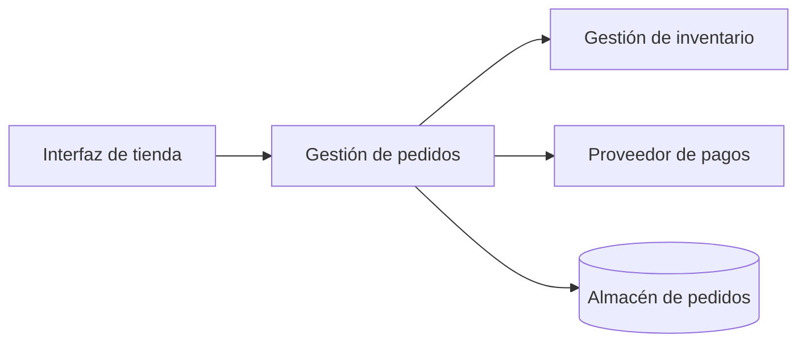

# CL01.02.02 — Conectar estructura, runtime y vistas introductorias

## 1. Propósito y resultado esperado

En la clase anterior identificaste elementos, responsabilidades y relaciones. Ahora conectarás esas ideas con dos preguntas complementarias:

- ¿Cómo está organizado el sistema?
- ¿Cómo colaboran sus partes cuando ocurre un caso de uso?

Al finalizar, la persona estudiante podrá **explicar** con un caso acotado la diferencia entre una estructura y una interacción en tiempo de ejecución, y escoger una representación introductoria que responda una pregunta concreta. No se espera producir documentación arquitectónica completa ni usar una notación formal.

## 2. Competencia, nivel y criterios propuestos

- **Competencia primaria:** `C01 — Definir arquitectura de software operativamente`.
- **Nivel esperado por esta clase:** `EXPLICAR`.
- **Criterio propuesto para revisión:** `CR-C01-EXPLAIN`.

Este plan no valida dominio. El criterio, la actividad y la rúbrica de este documento son propuestas para revisión curricular; no sustituyen los criterios específicos aprobados del curso.

## 3. Prerrequisitos y dependencias

- **Prerrequisito:** `CL01.02.01 — Distinguir elementos, responsabilidades y relaciones`.
- **Evidencia de entrada observable:** la persona puede identificar al menos dos elementos de un caso, describir la responsabilidad de cada uno y explicar una relación sin confundirla con una tecnología.
- **Dependencia curricular:** `LEARNING_PATH.md`, M01, clase `CL01.02.02`.
- **Dependencia de evaluación:** antes de impartir, validar la evidencia propuesta y el criterio `CR-C01-EXPLAIN`.

Si el prerrequisito no está demostrado, usar la remediación del apartado 12 antes de solicitar la evidencia independiente.

## 4. Alcance y límites

**Incluye**

- Estructura estática como organización relevante de elementos y relaciones.
- Comportamiento o interacción en runtime: colaboración de elementos durante un escenario.
- Vistas como representaciones parciales, elegidas por la pregunta que ayudan a responder.
- Distinción entre lo que una representación muestra, lo que no muestra y lo que requeriría evidencia adicional.

**Fuera de alcance**

- Notación UML, diagramas de secuencia o de despliegue formales.
- Métodos completos de documentación arquitectónica.
- Decidir una arquitectura, distribuir componentes o justificar tecnologías.
- Acreditar las competencias `C02` o `C06`.

Esos límites evitan anticipar contenido de M03 y módulos posteriores.

## 5. Lectura y referencias

### Lectura asignada al estudiante (propuesta)

[Software Architecture in Practice, 4.ª ed.](https://www.informit.com/store/software-architecture-in-practice-9780136885672), cap. 1 §1.2, “Architectural Structures and Views” (p. 5).

La asignación respalda la relación entre estructuras y vistas. Antes de aprobar el plan, debe cotejarse el contenido de la edición disponible y confirmarse que los ejemplos empleados para runtime cubren el resultado de esta clase.

### Fuentes de consulta para quien diseña o facilita la clase

No son lecturas obligatorias automáticas para el estudiante.

- [Just Enough Software Architecture](https://www.georgefairbanks.com/book/), caps. 7, 9–10 y 15.
- [Designing Software Architectures, 2.ª ed.](https://www.oreilly.com/library/view/designing-software-architectures/9780138108069/toc.xhtml), §§4.5 y 4.7.
- [Object-Oriented Software Engineering](https://www.informit.com/store/object-oriented-software-engineering-using-uml-patterns-9780136061250), cap. 7.3.

## 6. Teoría

### 6.1. Una arquitectura no se agota en una sola representación

Una arquitectura puede necesitar varias representaciones porque las preguntas relevantes son distintas. Una persona que quiere comprender la organización del sistema necesita información diferente de quien investiga qué ocurre cuando se confirma una compra.

Una representación útil es **selectiva**: muestra lo necesario para una pregunta y deja fuera detalles que no ayudan a responderla. Por ello, ninguna vista introductoria debe presentarse como “todo el sistema”.

### 6.2. Estructura: cómo organizamos elementos y relaciones relevantes

Una estructura describe una organización relativamente estable que resulta útil para razonar sobre el sistema. Por ejemplo, puede mostrar que una tienda cuenta con una interfaz, gestión de pedidos, gestión de inventario, un proveedor de pagos y un almacén de pedidos.

Esa estructura permite responder preguntas como:

- ¿Qué partes son relevantes para la compra?
- ¿Qué responsabilidad tiene cada parte?
- ¿Qué relación conceptual existe entre pedidos e inventario?

La estructura no determina por sí sola el orden exacto de los mensajes, el protocolo, la latencia, el número de servidores ni si dos elementos se ejecutan en procesos distintos.

### 6.3. Runtime: qué colaboraciones ocurren durante un escenario

El runtime describe lo que sucede mientras el sistema atiende un escenario. En una compra, la gestión de pedidos puede recibir la solicitud, pedir una reserva a inventario, utilizar el resultado y solicitar el cobro a un proveedor externo.

La pregunta cambia de “¿qué partes existen?” a “¿qué colaboraciones y resultados son relevantes mientras se atiende este caso?”.

No debemos inferir más de lo que la representación indica. Que pedidos solicite una reserva no prueba que la comunicación sea HTTP, que sea síncrona, que cada elemento sea un servicio independiente o que la reserva siempre se complete.

### 6.4. Vista: una respuesta situada a una pregunta

En esta clase, una vista es una representación elegida para responder una preocupación concreta. Por ejemplo:

| Pregunta | Representación introductoria útil | Lo que todavía no afirma |
|---|---|---|
| ¿Qué partes participan y de qué se responsabilizan? | Estructura de elementos y relaciones | Orden temporal, protocolo o infraestructura |
| ¿Qué ocurre durante la confirmación de una compra? | Recorrido de interacciones del escenario | Diseño interno completo de cada elemento |
| ¿Dónde se ejecuta cada parte? | Representación de despliegue | No se aborda todavía en esta clase |

La tercera fila solo delimita el tipo de pregunta: no se enseña aquí una vista de despliegue.

### 6.5. Hechos, inferencias y preguntas abiertas

Una explicación arquitectónica rigurosa distingue tres cosas:

- **Hecho representado:** “Gestión de pedidos solicita una reserva a inventario”.
- **Inferencia condicionada:** “Si inventario no responde, la confirmación podría retrasarse”.
- **Pregunta abierta:** “¿La interacción es síncrona, usa reintentos o queda registrada?”

Reconocer una pregunta abierta es correcto; completar el modelo con detalles no proporcionados no lo es.

## 7. Ejemplo razonado: compra en una tienda en línea

### 7.1. Estructura introductoria

Esta representación ayuda a identificar elementos y relaciones relevantes. No afirma que cada flecha sea una llamada de red, que cada elemento sea un servicio desplegable ni que el almacén sea una tecnología particular.

### 7.2. Recorrido de runtime para confirmar una compra

1. La interfaz envía la solicitud de compra a Gestión de pedidos.
2. Gestión de pedidos solicita la reserva de existencias a Gestión de inventario.
3. Inventario comunica el resultado de la reserva.
4. Si el caso define que hay existencias, Gestión de pedidos solicita el cobro al proveedor de pagos.
5. Gestión de pedidos conserva el estado que corresponda al resultado recibido.

Este recorrido ayuda a explicar las colaboraciones del escenario. No basta para conocer los mecanismos de recuperación, seguridad, persistencia o tolerancia a fallos.

### 7.3. Conexión entre ambas representaciones

Las dos representaciones hablan del mismo sistema, pero responden preguntas distintas:

- La estructura aclara **qué partes** se consideran y qué relaciones son relevantes.
- El recorrido de runtime aclara **cómo colaboran** esas partes en un escenario.
- Ninguna, por sí sola, sustituye a la otra.

## 8. Secuencia didáctica propuesta (75 minutos)

1. **Activación — 10 min.** Recuperar el prerrequisito con la pregunta: “¿Qué elementos y responsabilidades reconoces en una compra en línea?” Registrar solo los elementos respaldados por el caso.
2. **Concepto guiado — 15 min.** Explicar estructura, runtime y vista usando las preguntas de los apartados 6.2–6.4.
3. **Ejemplo razonado — 15 min.** Comparar las dos representaciones del apartado 7. Solicitar que separe hechos, inferencias y preguntas abiertas.
4. **Práctica guiada — 15 min.** Entregar el caso del apartado 9 y completar en grupo una fila de la tabla de contraste.
5. **Aplicación independiente — 15 min.** Producir la evidencia `EV-SAC01-CL01.02.02-01`.
6. **Cierre — 5 min.** Cada estudiante formula una pregunta que su representación no puede responder y explica qué información adicional requeriría.

## 9. Actividad y evidencia propuesta

### Caso

Una biblioteca digital permite buscar libros, solicitar un préstamo y consultar préstamos vigentes. El caso confirma estas partes: **Interfaz web**, **Gestión de préstamos**, **Catálogo**, **Servicio de identidad** y **Registro de préstamos**.

Cuando una persona solicita un préstamo, la interfaz entrega la solicitud a Gestión de préstamos. Esta consulta al Catálogo si hay ejemplares disponibles, solicita al Servicio de identidad comprobar que la persona puede pedir prestado y, con los resultados permitidos por las reglas del caso, actualiza el Registro de préstamos y comunica el resultado a la interfaz.

### Actividad `ACT-SAC01-CL01.02.02-01`

Construye dos representaciones breves y una explicación:

1. Una tabla de estructura con cuatro o cinco elementos, una responsabilidad por elemento y las relaciones relevantes.
2. Un recorrido numerado de runtime para la solicitud de préstamo.
3. Un párrafo de 120–180 palabras que explique qué pregunta responde cada representación y una pregunta que deja sin responder.

No añadas protocolos, tecnologías, tiempos de respuesta, servidores ni reglas no proporcionadas por el caso. Si necesitas alguno para continuar, decláralo como pregunta abierta.

### Evidencia `EV-SAC01-CL01.02.02-01` (propuesta)

- **Tipo:** `CASE_ANALYSIS`.
- **Curso / clase:** `SAC01 / CL01.02.02`.
- **Competencia / nivel:** `C01 / EXPLICAR`.
- **Criterio enlazado:** `CR-C01-EXPLAIN` (propuesto, pendiente de validación).
- **Producto:** las dos representaciones y el párrafo solicitados.
- **Límite:** esta evidencia demuestra comprensión situada de la distinción; no valida por sí sola dominio de C01 ni de otra competencia.

No se reutilizan automáticamente evidencias históricas de CL01/CL02.

## 10. Rúbrica propuesta para revisión

| Dimensión | Logro observable | Aún no logrado |
|---|---|---|
| Estructura | Identifica elementos del caso, les asigna responsabilidades pertinentes y explica relaciones sin reducirlas a tecnologías. | Enumera tecnologías, mezcla responsabilidades con operaciones aisladas o deja relaciones sin significado. |
| Runtime | Describe un recorrido coherente de interacciones y resultados del escenario. | Presenta solo una lista de elementos, altera el orden dado por el caso o inventa comportamientos. |
| Selección de representación | Explica qué pregunta responde cada representación y reconoce al menos un límite. | Trata una representación como si describiera todo el sistema o no relaciona representación y pregunta. |
| Razonamiento con incertidumbre | Distingue datos del caso, inferencias condicionadas y preguntas abiertas. | Presenta suposiciones como hechos o ignora información faltante relevante. |

La decisión de evaluación, los umbrales y cualquier estado de dominio requieren validación curricular previa. Completar la actividad no equivale a validar la competencia.

## 11. Errores frecuentes y retroalimentación

- **“Una vista es el diagrama completo del sistema”.** Pedir que señale una pregunta que el diagrama no responde.
- **“Cada caja es un servidor o microservicio”.** Recuperar que un elemento conceptual no determina su unidad de despliegue.
- **“La flecha demuestra una llamada HTTP síncrona”.** Pedir que diferencie relación, intercambio observado y mecanismo no especificado.
- **“La lista de pasos ya es estructura”.** Solicitar que nombre elementos y responsabilidades antes de describir el escenario.
- **“Si falta un detalle, lo invento”.** Convertir el detalle en una pregunta abierta o supuesto explícito.

## 12. Remediación

Si la evidencia no muestra la distinción, usar un caso más pequeño con tres elementos:

1. Entregar una estructura parcialmente completada y pedir solo asociar responsabilidades.
2. Dar tres pasos desordenados del runtime y pedir ordenarlos con base en el caso.
3. Preguntar para cada representación: “¿qué muestra?” y “¿qué no permite concluir?”.
4. Repetir la actividad con un caso diferente antes de volver a recoger evidencia.

La remediación produce práctica adicional; no modifica registros de estudiante ni valida dominio automáticamente.

## 13. Gobierno y estado

- El mapeo primario de esta clase es `C01`; no se acredita `C02` ni `C06`.
- La ruta curricular está aprobada como mapa de planificación, pero este plan conserva el estado `DRAFT_FOR_REVIEW` y no está autorizado para impartirse como material final.
- La lectura asignada debe verificarse contra la edición disponible antes de aprobarse.
- El repositorio no declara una versión activa de curso en los artefactos revisados. No se inventa una versión en este plan; esa inconsistencia requiere decisión curricular antes de una aprobación final.
- Este plan no modifica ni infiere estado, evidencia o dominio de ningún estudiante.
- La propuesta `SAC01-CP-013` debe conservar su proceso de revisión, validación y registro antes de cambiar contenido canónico o estado de aprobación.

## 14. Revisión de consistencia del artefacto

- El ID de clase, la competencia primaria y el nivel esperado se alinean con `LEARNING_PATH.md`.
- La actividad y la evidencia propuestas miden `EXPLICAR`, sin exigir justificar una decisión o aplicar una notación de M03.
- Las fuentes de diseño se separan de la lectura asignada.
- La representación de estructura y el recorrido runtime usan el mismo caso, pero declaran sus límites.
- Permanece pendiente la definición canónica de `course_version` y la validación curricular de `CR-C01-EXPLAIN`.
