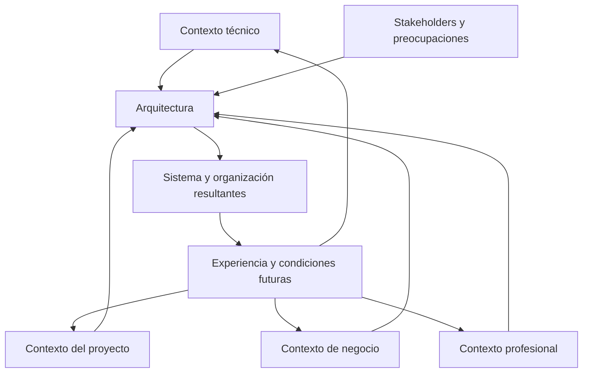

# CL01.04.01 — Contexto y participantes

> **Estado:** DRAFT_FOR_REVIEW. Esta versión reorganiza la secuencia didáctica y corrige la explicación del contexto profesional a partir de *Software Architecture in Practice* (3.ª ed.). No modifica la ruta curricular, el estado de aprobación de la versión anterior ni el progreso de ningún estudiante.

## Ficha de la clase

- **Módulo:** M01 — Pensamiento arquitectónico y fundamentos.
- **Competencia declarada por el artefacto:** C02 — Reconocer el impacto arquitectónico.
- **Nivel esperado declarado por el artefacto:** JUSTIFICAR.
- **Duración de referencia:** 165 minutos, más trabajo autónomo.
- **Pregunta guía:** ¿Cómo influyen el contexto y las preocupaciones de los participantes en las decisiones arquitectónicas, y cómo podemos justificar el alcance de su impacto?
- **Prerrequisitos declarados:** CL01.01.01, CL01.02.01 y CL01.03.01. CL01.02.02 es repaso opcional, pendiente de revisión.
- **Evidencia:** `EV-SAC01-CL01.04.01-01`.

### Nota de compatibilidad curricular

El artefacto fuente declara C02/JUSTIFICAR. Sin embargo, el mapa curricular consultado asigna C02/EXPLICAR a CL01.03.01 y C02/EXPLICAR a CL01.05.01, mientras que la revisión curricular registrada señala que las secuencias no monotónicas de C02 requieren una decisión explícita. Esta revisión conserva el alcance declarado en el artefacto y no resuelve esa discrepancia. Antes de declarar la clase READY/APPROVED, la autoridad curricular debe confirmar el nivel y su relación con las clases adyacentes.

## 1. Propósito y límites

La arquitectura de software no se desarrolla en el vacío. Existe dentro de un entorno técnico, un proyecto, una organización y una comunidad profesional. Además, diferentes personas y grupos esperan cosas distintas del sistema. Estas condiciones influyen en las decisiones arquitectónicas; a su vez, la arquitectura puede modificar las condiciones en las que se desarrollan y evolucionan sistemas posteriores.

Esta clase enseña a analizar esa relación. El estudiante aprenderá a:

1. identificar participantes relevantes y expresar sus preocupaciones de manera concreta;
2. distinguir los cuatro contextos descritos por Bass, Clements y Kazman (3.ª ed.);
3. explicar cómo una preocupación y una condición contextual pueden influir en una decisión;
4. reconocer que la influencia también opera en sentido inverso: la arquitectura modifica su entorno;
5. justificar si una decisión tiene impacto arquitectónico, es local o depende de condiciones aún no conocidas.

**La idea central:** no se clasifica una decisión por su tamaño, por la tecnología que utiliza ni por el lugar donde se implementa. Se analiza qué condiciona, a quién afecta, qué relaciones modifica y qué consecuencias introduce.

### Dentro del alcance

- Stakeholders y preocupaciones.
- Contextos técnico, del ciclo de vida del proyecto, de negocio y profesional.
- Influencias del contexto sobre la arquitectura y de la arquitectura sobre su contexto.
- Relación entre participantes, preocupaciones, decisiones y consecuencias.
- Alcance y radio de impacto de una decisión.
- Hechos, inferencias, supuestos e incertidumbre.

### Fuera del alcance

- Levantamiento exhaustivo de requisitos.
- Identificación y especificación completa de ASR.
- Construcción de utility trees.
- Evaluación formal de arquitecturas o ATAM.
- Selección de una arquitectura óptima y análisis exhaustivo de trade-offs.
- Vistas UML o documentación arquitectónica detallada.

Estos temas pueden aparecer como contexto, pero no son objetivos ni criterios de evaluación de esta clase.

## 2. Resultados de aprendizaje

Al terminar, el estudiante podrá:

1. **Identificar** participantes y formular al menos una preocupación concreta por participante.
2. **Distinguir** los cuatro contextos de Bass et al. (3.ª ed.) y seleccionar los pertinentes para una decisión dada.
3. **Relacionar** una preocupación con condiciones contextuales y con una posible influencia sobre la arquitectura.
4. **Separar** hechos del escenario, inferencias y supuestos, indicando qué evidencia falta.
5. **Justificar** la clasificación de una decisión como arquitectónica, local o condicional al contexto, explicando su alcance y sus consecuencias para participantes relevantes.
6. **Reconocer** una limitación de su conclusión y declarar qué información podría modificarla.

### Criterios de éxito

La evidencia deberá:

- identificar al menos cuatro participantes y una preocupación concreta por participante;
- analizar al menos tres datos contextuales pertinentes, sin forzar la presencia de los cuatro contextos;
- distinguir hechos, inferencias y supuestos;
- describir el mecanismo por el que la decisión afecta límites, responsabilidades, contratos, dependencias, atributos de calidad, equipos o procesos;
- justificar una clasificación con criterios explícitos;
- presentar al menos dos consecuencias para participantes;
- declarar una incertidumbre o condición que podría cambiar la conclusión.

## 3. Fundamento bibliográfico y trazabilidad

**Fuente principal:** Bass, L., Clements, P. y Kazman, R. (2012). *Software Architecture in Practice* (3.ª ed.). Addison-Wesley.

| Sección de la fuente | Uso en esta clase |
|---|---|
| Cap. 2, §2.4 | La arquitectura como medio de comunicación entre stakeholders y como base para razonar sobre el sistema. |
| Cap. 3, §3.1 | Contexto técnico en el que existe la arquitectura. |
| Cap. 3, §3.2 | Contexto del ciclo de vida del proyecto. |
| Cap. 3, §3.3 | Contexto de negocio, incluida la organización que desarrolla y utiliza el sistema. |
| Cap. 3, §3.4 | Contexto profesional y experiencia del arquitecto. |
| Cap. 3, §3.5 | Stakeholders y sus preocupaciones. |
| Cap. 3, §3.6 | Influencias que el contexto ejerce sobre la arquitectura. |
| Cap. 3, §3.7 | Influencias que la arquitectura ejerce sobre su contexto. |

**Precisión de edición:** esta clase sigue la tercera edición, que presenta cuatro contextos. No se importan categorías de otras ediciones.

Las tablas de análisis, el método de justificación, los casos y las rúbricas son instrumentos didácticos elaborados para este curso. No se atribuyen como modelos textuales de Bass et al.

## 4. Desarrollo conceptual

### 4.1. La arquitectura necesita comunicación entre participantes

Una arquitectura no es útil únicamente para quienes diseñan o implementan el sistema. Distintos participantes necesitan comprender aspectos diferentes: qué responsabilidades existen, qué comportamiento pueden esperar, qué restricciones deben respetar y qué consecuencias pueden producir los cambios.

Bass et al. explican en el capítulo 2, §2.4, el papel de la arquitectura en la comunicación entre stakeholders. La arquitectura proporciona un objeto común para discutir el sistema, aunque los participantes tengan intereses y conocimientos distintos.

**Ejemplo.** En un sistema de turnos, el personal administrativo puede preocuparse por evitar duplicaciones; los pacientes, por conocer si su turno está confirmado; soporte, por investigar solicitudes ambiguas; y desarrollo, por mantener una integración comprensible. Una decisión que solo se explica en términos de una biblioteca o un protocolo no permite, por sí misma, que todos comprendan sus consecuencias.

La comunicación arquitectónica debe conectar la decisión con aquello que importa a los participantes. No exige que todos conozcan los detalles de implementación.

### 4.2. Stakeholders, roles y preocupaciones

Un **stakeholder** es una persona, grupo u organización que tiene interés en el sistema o puede verse afectado por él.

Un **rol** describe la función o responsabilidad que alguien desempeña respecto del sistema. Una persona puede asumir varios roles y un mismo rol puede ser desempeñado por varias personas.

Una **preocupación** es algo que importa a un stakeholder: una necesidad, objetivo, riesgo, obligación, expectativa o criterio que debe tenerse en cuenta.

No son conceptos intercambiables:

| Concepto | Pregunta que responde | Ejemplo |
|---|---|---|
| Stakeholder | ¿Quién tiene interés o puede verse afectado? | Personal administrativo |
| Rol | ¿Qué función desempeña? | Gestiona solicitudes de turnos |
| Preocupación | ¿Qué necesita o qué le importa? | Detectar solicitudes pendientes y evitar duplicaciones |

Una preocupación debe formularse de manera concreta. «Seguridad» o «rendimiento» son etiquetas demasiado generales. Una formulación más útil sería: «El área responsable necesita investigar quién consultó un resultado y en qué momento». La preocupación expresa qué importa; todavía no prescribe cómo resolverlo.

Una misma preocupación puede involucrar a varios participantes. También pueden existir tensiones entre preocupaciones: por ejemplo, reducir el tiempo de respuesta y, al mismo tiempo, confirmar que una operación se registró correctamente.

**Regla:** no deduzcas automáticamente una solución técnica a partir de una preocupación. Primero aclara quién la tiene, qué resultado necesita y bajo qué condiciones.

### 4.3. Los cuatro contextos de Bass et al. (3.ª ed.)

Bass et al. describen cuatro contextos en los que existe la arquitectura. Son perspectivas relacionadas. No son cuatro fases de un proceso ni una lista que deba completarse artificialmente para toda decisión.

#### A. Contexto técnico — §3.1

Se refiere al entorno técnico en el que la arquitectura existe: sistemas relacionados, tecnologías disponibles, plataformas, restricciones técnicas y condiciones que afectan al sistema. Incluye la relación entre la arquitectura y los atributos de calidad que el sistema debe alcanzar.

Preguntas orientadoras:

- ¿Con qué sistemas existentes debe relacionarse?
- ¿Qué plataformas, tecnologías o restricciones ya condicionan el sistema?
- ¿Qué atributos de calidad importan en este caso?
- ¿Qué características del entorno pueden habilitar o limitar una decisión?

**Ejemplo:** un portal debe consultar un sistema de agenda existente. La existencia de ese sistema es un dato del contexto técnico. No sabemos todavía qué protocolo utiliza ni qué garantías ofrece; inventarlos convertiría una hipótesis en un supuesto no declarado.

#### B. Contexto del ciclo de vida del proyecto — §3.2

Se refiere a cómo la arquitectura se relaciona con el ciclo de vida del proyecto y sus actividades: desarrollo, selección o creación de arquitectura, documentación, comunicación, análisis, implementación, pruebas y conformidad entre la implementación y la arquitectura.

Preguntas orientadoras:

- ¿En qué etapa del proyecto se tomará la decisión?
- ¿Qué actividades de desarrollo, integración y pruebas condicionan su aplicación?
- ¿Qué recursos, calendario o forma de organizar el trabajo son relevantes?
- ¿Cómo se comprobará que la implementación respeta las decisiones adoptadas?

**Ejemplo:** si una integración debe entregarse por etapas, el calendario y la estrategia de integración pueden condicionar cómo se organiza el trabajo. No debe confundirse este contexto con el organigrama de la empresa.

#### C. Contexto de negocio — §3.3

Se refiere a los objetivos y condiciones de negocio de la organización que desarrolla o utiliza el sistema. Incluye las organizaciones involucradas, sus objetivos, recursos, inversiones y estructura organizacional. La estructura organizacional forma parte de este contexto; no constituye un quinto contexto.

Preguntas orientadoras:

- ¿Qué objetivo de negocio justifica el sistema?
- ¿Qué organizaciones participan y qué intereses tienen?
- ¿Qué recursos e inversiones condicionan el trabajo?
- ¿Cómo influye la estructura organizacional en las decisiones y responsabilidades?

**Ejemplo:** una clínica quiere reducir duplicaciones y mejorar la atención. La prioridad del negocio y la distribución de responsabilidades entre áreas pueden influir en las decisiones del sistema.

#### D. Contexto profesional — §3.4

Este contexto se refiere a la influencia de la práctica y experiencia profesional del arquitecto. La experiencia obtenida al construir sistemas, los conocimientos acumulados y los resultados de decisiones anteriores pueden influir en cómo se abordan proyectos posteriores.

Una experiencia exitosa con un enfoque puede hacer que el arquitecto tienda a considerarlo en otros proyectos; una experiencia fallida puede hacer que lo cuestione o evite. La experiencia profesional forma parte del entorno que influye en las decisiones arquitectónicas futuras.

**No debe confundirse con:**

- el contexto del ciclo de vida del proyecto;
- una lista general de competencias o habilidades del arquitecto;
- las responsabilidades del personal de operación o soporte.

Preguntas orientadoras:

- ¿Qué experiencia previa influye en el juicio del arquitecto?
- ¿Qué aprendió la organización o el arquitecto de proyectos anteriores?
- ¿Qué prácticas o enfoques se tienden a repetir y por qué?
- ¿Qué evidencia respalda que una experiencia previa es pertinente para este sistema?

**Ejemplo:** un arquitecto participó en un proyecto anterior donde una integración directa con un proveedor produjo dificultades de evolución. Esa experiencia puede influir en su preferencia por aislar la integración. La experiencia es una influencia sobre su juicio, no una demostración automática de que la misma solución sea correcta en el nuevo proyecto.

#### Comparación de los contextos

| Contexto | Centro del análisis | No confundir con |
|---|---|---|
| Técnico | Entorno tecnológico y propiedades del sistema | La organización del equipo |
| Ciclo de vida del proyecto | Actividades y condiciones del proyecto | Los objetivos generales del negocio |
| Negocio | Objetivos, organizaciones, recursos y estructura organizacional | El protocolo o plataforma técnica |
| Profesional | Experiencia y aprendizaje profesional que influyen en el arquitecto | Un catálogo genérico de habilidades |

**No es obligatorio usar los cuatro contextos con el mismo peso.** Se analizan los que ayudan a explicar la decisión. Omitir uno puede ser correcto si se justifica su falta de pertinencia.

### 4.4. Cómo se relacionan participantes y contextos

Stakeholders y contextos responden preguntas diferentes:

- Los stakeholders permiten identificar quién tiene interés o recibe consecuencias.
- Las preocupaciones permiten precisar qué le importa a cada participante.
- Los contextos ayudan a comprender las condiciones que influyen en la arquitectura.

Una preocupación puede estar condicionada por más de un contexto. Por ejemplo, la necesidad de consultar resultados oportunamente puede relacionarse con el entorno técnico, el objetivo de atención de la organización y las actividades del proyecto. No se debe asignar cada stakeholder a un único contexto.

**Cadena de análisis:**

Participante → preocupación → condición contextual → influencia sobre la decisión → consecuencia.

Esta cadena es una herramienta didáctica del curso, no una fórmula atribuida literalmente a Bass et al.

### 4.5. Influencia recíproca: contexto y arquitectura

El contexto influye en las decisiones arquitectónicas. Pero la influencia no termina cuando se construye el sistema: la arquitectura puede cambiar el entorno que condicionará proyectos y decisiones futuras.

Bass et al. presentan esta relación mediante el *Architecture Influence Cycle* (AIC), en el capítulo 3.

- Las condiciones técnicas influyen en qué soluciones son viables y en las propiedades que se pueden alcanzar.
- Las condiciones del proyecto influyen en cómo se organiza el desarrollo, la integración y la asignación de recursos.
- Las condiciones de negocio influyen en los objetivos y en la organización del trabajo.
- La experiencia profesional influye en el juicio de arquitectos y organizaciones.

En sentido inverso, la arquitectura puede afectar la estructura de los equipos, la experiencia acumulada, las oportunidades de negocio y las expectativas sobre sistemas posteriores.

El diagrama es una simplificación didáctica. No representa una secuencia temporal rígida ni afirma que cada influencia tenga la misma intensidad.

**Ejemplo:** una arquitectura que divide el sistema en unidades con responsabilidades diferenciadas puede influir en cómo se forman los equipos, cómo se distribuye el trabajo y qué conocimientos desarrolla cada grupo. Esas condiciones organizacionales pueden influir en decisiones de proyectos posteriores.

### 4.6. De una preocupación a una decisión que puede tener impacto arquitectónico

No toda preocupación conduce a una decisión arquitectónica. Puede atenderse mediante una política, una actividad del proyecto, una decisión local de diseño o una decisión que condiciona la estructura y evolución del sistema.

Para analizar una decisión, pregunta:

1. ¿Qué decisión concreta se está considerando?
2. ¿Qué participantes reciben sus consecuencias?
3. ¿Qué preocupaciones están relacionadas?
4. ¿Qué condiciones contextuales influyen?
5. ¿Qué límites, responsabilidades, contratos, dependencias o propiedades del sistema podrían cambiar?
6. ¿Qué otros componentes, sistemas, equipos o procesos tendrían que adaptarse?
7. ¿Qué información podría cambiar la conclusión?

Una decisión tiende a tener **impacto arquitectónico** cuando establece o modifica restricciones relevantes para otras partes del sistema, relaciones entre unidades, contratos compartidos, dependencias, atributos de calidad o condiciones de evolución y operación.

Una decisión tiende a ser **local** cuando su efecto permanece delimitado dentro de una unidad y no impone restricciones relevantes fuera de ella.

La clasificación es **condicional al contexto** cuando un dato aún desconocido puede cambiar el alcance. Por ejemplo, una biblioteca puede ser una decisión local si permanece encapsulada en un módulo, pero adquirir impacto arquitectónico si varios equipos quedan obligados a depender de ella.

No se debe clasificar por el número de líneas modificadas, por el nombre de una tecnología o por el tamaño aparente de la tarea. Tampoco debe confundirse «tiene impacto arquitectónico» con «es una buena decisión»: son juicios diferentes.

## 5. Método de análisis y justificación

Utiliza esta secuencia cuando necesites defender la clasificación de una decisión.

### Paso 1. Formular la decisión

Describe qué se elige, cambia o establece. Evita formularla únicamente como «usar tecnología X».

### Paso 2. Identificar participantes

Incluye a quienes reciben consecuencias directas o indirectas. Distingue personas, grupos y organizaciones; registra el rol pertinente.

### Paso 3. Precisar preocupaciones

Expresa qué necesita cada participante. Evita etiquetas aisladas y no conviertas una preocupación en una solución anticipada.

### Paso 4. Seleccionar los contextos pertinentes

Analiza las condiciones técnicas, del proyecto, del negocio y profesionales que realmente influyen. No fuerces los cuatro contextos.

### Paso 5. Separar la evidencia

Clasifica cada afirmación como:

- **Hecho:** está expresamente indicado o verificado.
- **Inferencia:** conclusión razonable derivada de hechos, pero todavía no verificada directamente.
- **Supuesto:** condición que se adopta provisionalmente porque el escenario no la especifica.

### Paso 6. Explicar el mecanismo de impacto

Describe cómo la decisión afecta límites, responsabilidades, contratos, dependencias, atributos de calidad, equipos o procesos. Identifica quién debe adaptarse si la decisión cambia.

### Paso 7. Justificar la clasificación y sus límites

Concluye si el impacto es arquitectónico, local o condicional. Explica por qué, presenta consecuencias y declara qué evidencia podría modificar el juicio.

### Ejemplo resuelto: solicitudes de turnos

**Escenario:** un portal web consulta un sistema existente de agenda médica. La clínica quiere evitar duplicaciones y comunicar con claridad el estado de cada solicitud. No se especifican protocolo de integración, disponibilidad, volumen, garantías de respuesta ni reglas completas de confirmación.

**Decisión analizada:** dónde debe residir la responsabilidad de gestionar una solicitud cuando el sistema de agenda no devuelve una respuesta concluyente.

| Afirmación | Tipo | Justificación |
|---|---|---|
| El portal consulta un sistema existente de agenda médica. | Hecho | Está indicado en el escenario. |
| La clínica quiere evitar duplicaciones. | Hecho | Es un objetivo expresado. |
| Una respuesta no concluyente puede dejar al usuario sin confirmación inmediata. | Inferencia | Se deriva de la situación, pero no conocemos su frecuencia ni duración. |
| El sistema de agenda permite consultar posteriormente el estado. | Supuesto | El escenario no confirma esa capacidad. |
| La responsabilidad de gestionar estados puede afectar al portal, a administración y a soporte. | Inferencia | Es una consecuencia plausible que debe contrastarse con los procesos reales. |

**Participantes y preocupaciones:**

| Participante | Preocupación concreta |
|---|---|
| Paciente | Saber si su solicitud fue recibida y si el turno está confirmado. |
| Personal administrativo | Evitar duplicaciones y resolver solicitudes pendientes. |
| Dirección | Mantener una atención adecuada dentro de los recursos disponibles. |
| Desarrollo | Mantener una integración comprensible con el sistema de agenda. |
| Soporte | Investigar solicitudes cuyo resultado no está claro. |

**Dos alternativas para razonar, no para elegir una solución óptima:**

- **Alternativa A:** el portal comunica confirmación solo después de recibir una respuesta concluyente del sistema de agenda. Debe definirse qué comunica mientras espera.
- **Alternativa B:** el portal registra la recepción con estado pendiente y comunica la confirmación únicamente después de resolverla con el sistema de agenda. Requiere definir cómo se identifican, consultan y resuelven las solicitudes pendientes.

**Justificación del impacto:** si la decisión establece estados y responsabilidades que deben respetar el portal, el sistema de agenda y los procesos administrativos o de soporte, puede condicionar contratos, responsabilidades y tratamiento de fallos entre varias partes. En ese escenario, hay razones para clasificarla como arquitectónica. Si el comportamiento se resuelve dentro de un módulo aislado y no modifica contratos ni obliga a otros participantes a adaptarse, podría ser local. La clasificación definitiva depende de datos que el escenario no proporciona.

**Límite:** no se puede afirmar qué alternativa es más conveniente sin conocer las capacidades del sistema existente, las reglas de negocio y el proceso real de resolución de solicitudes.

## 6. Práctica guiada

En parejas o individualmente, analiza el caso de turnos. Completa la tabla antes de redactar una conclusión.

| Decisión o aspecto | Participante | Preocupación | Contexto pertinente | Consecuencia posible | Dato faltante |
|---|---|---|---|---|---|
| Estado de solicitud | | | | | |
| Confirmación | | | | | |
| Gestión de solicitudes pendientes | | | | | |

Después, elige una decisión y redacta una justificación de 150–250 palabras. Debe contener:

- clasificación propuesta;
- dos razones basadas en alcance o dependencias;
- una consecuencia para un participante;
- un hecho y un dato faltante;
- una condición que podría cambiar la clasificación.

La práctica es formativa. Recibe retroalimentación y no acredita por sí sola el dominio.

### Comprobación conceptual breve

Antes de pasar a la evidencia individual, responde:

1. ¿En qué se diferencian stakeholder, rol y preocupación?
2. ¿Por qué los cuatro contextos no deben tratarse como fases ni como categorías excluyentes?
3. ¿Qué diferencia hay entre el contexto del ciclo de vida del proyecto y el contexto profesional?
4. ¿Por qué una preocupación no determina automáticamente una solución técnica?
5. ¿Cómo puede la arquitectura modificar el contexto que influirá en proyectos futuros?

Si se confunden los contextos, vuelve a §4.3 y explica cada uno mediante su pregunta central. Si se mezclan hechos y supuestos, repite la tabla de §5. Si se clasifica por tamaño del cambio, vuelve a §4.6 y explica qué límites o dependencias se modifican.

## 7. Evidencia independiente

### Caso: publicación y consulta de resultados de laboratorio

Un laboratorio quiere que los resultados estén disponibles mediante un portal. El portal obtiene la información de un sistema de laboratorio existente. Los profesionales de salud necesitan consultar ciertos resultados antes de que estén disponibles para pacientes. El área responsable de cumplimiento necesita investigar incidentes de acceso. Soporte recibe reportes de resultados que no aparecen en el portal.

El escenario no especifica legislación, infraestructura, protocolo de integración, volumen, SLA ni capacidades del sistema existente. No se deben inventar esos datos ni presentar obligaciones regulatorias concretas como hechos.

### Decisión central

**¿Cómo debe delimitarse la responsabilidad de publicar y consultar resultados entre el portal y el sistema de laboratorio existente, considerando los distintos participantes y momentos de disponibilidad?**

El estudiante debe formular una decisión concreta dentro de ese límite. Puede analizar si el portal mantiene una responsabilidad propia de publicación y consulta o si se limita a presentar resultados obtenidos del sistema existente. Las condiciones técnicas necesarias deben expresarse como supuestos por validar.

### Entregable: `EV-SAC01-CL01.04.01-01`

Informe de **900–1,100 palabras**, con estas secciones:

1. **Decisión delimitada:** formula la decisión concreta y su alcance.
2. **Participantes y preocupaciones:** identifica al menos cuatro participantes, sus roles y una preocupación concreta por cada uno.
3. **Contexto:** relaciona al menos tres datos pertinentes con los contextos técnico, del ciclo de vida del proyecto, de negocio o profesional. Distingue hechos, inferencias y supuestos.
4. **Clasificación:** determina si la decisión es arquitectónica, local o condicional al contexto.
5. **Justificación:** explica el radio de impacto, los límites o dependencias afectados y al menos dos consecuencias para participantes.
6. **Contraste mínimo:** presenta una alternativa plausible o condición distinta y explica cómo cambiaría el impacto. No se exige seleccionar una arquitectura óptima.
7. **Límites:** declara una incertidumbre, una desventaja o condición relevante y una pregunta abierta que podría cambiar la clasificación.

No se deben asumir obligaciones regulatorias concretas ni capacidades técnicas no proporcionadas. Toda hipótesis debe identificarse como tal.

## 8. Rúbrica analítica — `CR-C02-JUSTIFY`

La rúbrica evalúa la capacidad de justificar si una decisión es arquitectónica, local o condicional al contexto. El contraste entre alternativas sirve para fundamentar la clasificación; no se evalúa la selección de una arquitectura óptima ni un análisis exhaustivo de trade-offs (C05).

### Ponderación

| Criterio | Peso |
|---|---:|
| Participantes, roles y preocupaciones | 15 % |
| Análisis contextual y calidad de la evidencia | 20 % |
| Clasificación y justificación del impacto | 35 % |
| Consecuencias, contraste, riesgos e incertidumbre | 30 % |
| **Total** | **100 %** |

### Descriptores

| Criterio | 1 — Insuficiente | 2 — Básico | 3 — Competente | 4 — Avanzado |
|---|---|---|---|---|
| Participantes y preocupaciones (15 %) | Omite participantes relevantes o enumera etiquetas sin preocupaciones. | Identifica algunos participantes, pero confunde roles o formula preocupaciones vagas. | Identifica al menos cuatro participantes, distingue roles y formula preocupaciones concretas relacionadas con la decisión. | Además, reconoce intereses indirectos y tensiones entre preocupaciones sin atribuir necesidades no sustentadas. |
| Contexto y evidencia (20 %) | Ignora el contexto o presenta supuestos como hechos. | Reconoce algunos datos, pero mezcla hechos e inferencias o deja fuera contextos pertinentes. | Relaciona al menos tres datos contextuales con la decisión y distingue hechos, inferencias y supuestos. | Además, explica cómo interactúan los contextos y prioriza la evidencia faltante que más puede cambiar la conclusión. |
| Clasificación y justificación del impacto (35 %) | Clasifica sin razones o usa el tamaño del cambio o la tecnología como criterio. | Ofrece razones generales, pero no explica el mecanismo ni el radio de impacto. | Clasifica como arquitectónica, local o condicional y justifica mediante alcance, límites, responsabilidades, contratos, dependencias, atributos de calidad o equipos/sistemas que deben adaptarse. | Además, identifica condiciones de frontera, pondera criterios pertinentes y explica qué evidencia cambiaría la clasificación. |
| Consecuencias, contraste e incertidumbre (30 %) | No identifica consecuencias o recomienda sin fundamento. | Menciona consecuencias o una alternativa, pero no las vincula claramente con participantes, contexto y criterios. | Contrasta al menos dos alternativas o escenarios usando criterios relacionados con las preocupaciones identificadas; explica consecuencias y una desventaja relevantes y declara qué información podría cambiar su conclusión. | Además, prioriza riesgos y demuestra cómo una variación contextual modifica consecuencias o clasificación, sin convertir el ejercicio en una selección exhaustiva de arquitectura. |

### Cálculo

Cada criterio recibe un nivel entero de 1 a 4. El nivel se convierte en el porcentaje del peso asignado:

| Nivel | Porcentaje del peso |
|---|---:|
| 1 — Insuficiente | 0 % |
| 2 — Básico | 60 % |
| 3 — Competente | 85 % |
| 4 — Avanzado | 100 % |

**Fórmula:** puntuación final = suma de (peso del criterio × porcentaje correspondiente al nivel).

Ejemplo: nivel 3 en participantes aporta 15 × 0.85 = 12.75 puntos; nivel 4 en contexto aporta 20 puntos.

### Regla de decisión propuesta

- Umbral sugerido de aprobación: **70/100**.
- Una entrega no se considera competente si obtiene nivel 1 en el criterio central de clasificación y justificación del impacto, aunque alcance 70 puntos por suma.
- El nivel 3 representa desempeño competente en cada criterio; el nivel 4 representa desempeño avanzado.
- El umbral, la conversión numérica y la regla de decisión se conservan como propuesta para piloto. Su eficacia requiere observar entregas reales.

## 9. Secuencia didáctica — 165 minutos

La secuencia sigue la progresión: comprender el problema, construir conceptos, relacionarlos, observar un ejemplo, practicar con apoyo y preparar una aplicación independiente.

| Fase | Tiempo | Actividad | Resultado observable |
|---|---:|---|---|
| 1. Activación | 10 min | Presentar una decisión y preguntar quién puede verse afectado y qué información falta. | Hipótesis inicial y participantes identificados. |
| 2. Stakeholders y preocupaciones | 20 min | Explicar stakeholder, rol y preocupación; construir una matriz breve. | Preocupaciones concretas, no etiquetas. |
| 3. Cuatro contextos | 35 min | Explicar los cuatro contextos, contrastarlos y resolver preguntas de comprensión. | Diferencia entre contextos y selección de los pertinentes. |
| 4. Influencia recíproca | 15 min | Analizar el ciclo de influencia con un ejemplo. | Explicación de influencias en ambos sentidos. |
| 5. Decisión e impacto | 25 min | Aplicar la cadena participante–preocupación–contexto–decisión–consecuencia. | Clasificación preliminar razonada. |
| 6. Caso guiado y práctica | 30 min | Resolver el caso de turnos y completar la matriz en parejas. | Justificación formativa revisada. |
| 7. Comprobación y preparación | 15 min | Responder las preguntas conceptuales y delimitar la decisión del caso de laboratorio. | Identificación de dudas y esquema de evidencia. |
| 8. Cierre | 15 min | Sintetizar la relación contexto–participantes–arquitectura y declarar un dato que podría cambiar la conclusión. | Síntesis individual y límite explícito. |
| **Total** | **165 min** | | |

El informe completo se termina como trabajo autónomo. No se debe recortar la explicación de los contextos ni la práctica guiada para ampliar la exposición magistral.

## 10. Errores frecuentes y remediación

| Error | Por qué es incorrecto | Remediación |
|---|---|---|
| Tratar stakeholder, rol y preocupación como sinónimos. | Responden preguntas diferentes: quién, qué función y qué le importa. | Reconstruir la tabla de §4.2 con un caso nuevo. |
| Tratar los cuatro contextos como fases. | Son perspectivas relacionadas, no etapas secuenciales. | Clasificar ejemplos por la pregunta que responde cada contexto. |
| Confundir contexto profesional con ciclo de vida del proyecto. | Uno se relaciona con experiencia e influencia profesional; el otro, con actividades y condiciones del proyecto. | Contrastar un ejemplo de experiencia previa del arquitecto con uno de planificación y pruebas del proyecto. |
| Colocar la estructura organizacional en un quinto contexto. | En esta edición se trata dentro del contexto de negocio. | Volver a §4.3 y explicar dónde encaja y por qué. |
| Afirmar que una preocupación exige una tecnología específica. | La preocupación no prescribe por sí sola una solución. | Reformular la preocupación sin mencionar tecnología y listar más de una respuesta posible. |
| Clasificar por tamaño del cambio o cantidad de líneas. | El alcance depende de lo que se condiciona y de quién debe adaptarse. | Comparar un cambio interno grande con un cambio pequeño de contrato compartido. |
| Presentar inferencias o supuestos como hechos. | La conclusión aparenta tener más evidencia de la disponible. | Etiquetar cada afirmación y declarar qué dato la verificaría. |
| Confundir impacto arquitectónico con conveniencia. | Una decisión puede tener gran impacto y aun así ser inconveniente. | Separar clasificación de impacto y evaluación de alternativas. |

Si la primera explicación no resuelve la dificultad, se debe presentar un ejemplo alternativo y comprobar nuevamente la comprensión. No basta con pedir que se repita una definición.

## 11. Materiales y preparación

- Consultar la matriz C02 y verificar la progresión CL01.03.01 → CL01.04.01 → CL01.05.01.
- Tener disponible *Software Architecture in Practice* (3.ª ed.), capítulo 2, §2.4 y capítulo 3, §§3.1–3.7.
- Preparar una pizarra o documento con cuatro columnas para los contextos y otra matriz para stakeholder, rol y preocupación.
- Mantener visibles las categorías hecho, inferencia y supuesto.
- No se requiere lenguaje de programación, framework ni plataforma específicos.

## 12. Revisión de consistencia de esta versión

| Control | Estado | Observación |
|---|---|---|
| Identidad e IDs | PASS | Se conserva CL01.04.01, C02 y el ID de evidencia. |
| Propósito y resultados | PASS | Los resultados se vinculan con el análisis contextual y la justificación del impacto. |
| Contextos de Bass, 3.ª ed. | PASS | Se presentan los cuatro contextos y se distingue el profesional del ciclo de vida del proyecto. |
| Stakeholders y preocupaciones | PASS | Se diferencian y se relacionan con las condiciones contextuales. |
| Influencia recíproca | PASS | Se incluye la influencia del contexto sobre la arquitectura y de la arquitectura sobre el contexto. |
| Progresión didáctica | PASS | Se organiza en explicación, contraste, ejemplo, comprobación, práctica guiada y evidencia independiente. |
| Alineación evidencia–rúbrica | PASS | Los criterios corresponden a los resultados declarados en el artefacto. |
| Duración | PASS | La secuencia suma 165 minutos. |
| Alcance C05 | PASS | El contraste se limita a justificar la clasificación; no selecciona arquitectura óptima. |
| Compatibilidad con ruta curricular | FIX | La asignación de C02/JUSTIFICAR en esta clase requiere resolución formal frente a los niveles propuestos para las clases adyacentes. |
| Validación empírica | PENDIENTE | No se han observado aún entregas ni impartición de esta versión. |
| Estado académico | DRAFT_FOR_REVIEW | No declarar READY ni APPROVED hasta resolver los FIX y completar la revisión. |

## 13. Criterio de cierre

La clase cumple su propósito cuando el estudiante puede explicar quiénes participan, qué les importa, qué condiciones contextuales influyen y cómo una decisión puede afectar al sistema y a su entorno. Debe justificar la clasificación de impacto con un mecanismo reconocible, distinguir evidencia de hipótesis y declarar los límites de su conclusión.

**Estado de esta revisión:** DRAFT_FOR_REVIEW. Esta versión está preparada para revisión académica; no reemplaza automáticamente el artefacto vigente ni modifica la ruta curricular o el estado de ningún estudiante.
