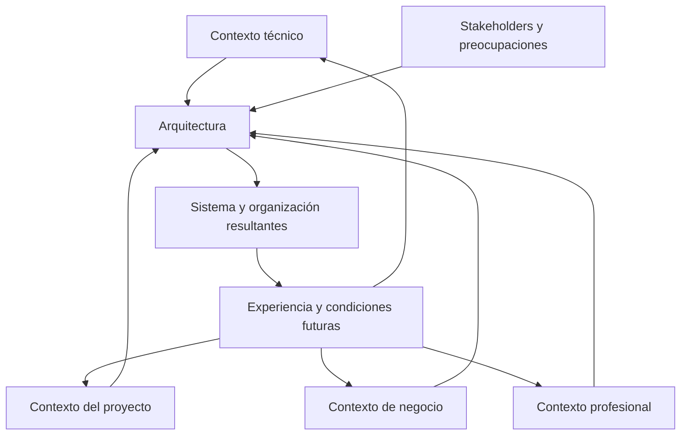

# CL01.04.01 — Contexto y participantes

> **Estado:** DRAFT_FOR_REVIEW. Esta revisión delimita la clase frente a CL01.03.01 y CL01.05.01. Se concentra en stakeholders, preocupaciones y los cuatro contextos de Software Architecture in Practice (3.ª ed.); no enseña a formular, clasificar, comparar ni seleccionar decisiones arquitectónicas. No modifica la ruta curricular, el estado de aprobación de la versión anterior ni el progreso de ningún estudiante.

## Ficha de la clase

- **Módulo:** M01 — Pensamiento arquitectónico y fundamentos.
- **Competencia declarada por el artefacto:** C02 — Reconocer el impacto arquitectónico.
- **Nivel esperado declarado por el artefacto:** JUSTIFICAR.
- **Duración de referencia:** 165 minutos, más trabajo autónomo.
- **Pregunta guía:** ¿Cómo condicionan los participantes y los contextos en los que existe un sistema lo que la arquitectura debe considerar y comunicar?
- **Prerrequisitos declarados:** CL01.01.01, CL01.02.01 y CL01.03.01. CL01.02.02 es repaso opcional, pendiente de revisión.
- **Evidencia:** `EV-SAC01-CL01.04.01-01`.

### Nota de compatibilidad curricular

El artefacto fuente declara C02/JUSTIFICAR. Sin embargo, el mapa curricular consultado asigna C02/EXPLICAR a CL01.03.01 y C02/EXPLICAR a CL01.05.01, mientras que la revisión curricular registrada señala que las secuencias no monotónicas de C02 requieren una decisión explícita. Esta revisión conserva el alcance declarado en el artefacto y no resuelve esa discrepancia. Antes de declarar la clase READY/APPROVED, la autoridad curricular debe confirmar el nivel y su relación con las clases adyacentes.

## 1. Propósito y límites

La arquitectura existe dentro de un entorno técnico, un proyecto, una organización y una práctica profesional. También debe ser comprensible para personas y grupos con responsabilidades y preocupaciones distintas. Esta clase estudia esos participantes y contextos, y explica cómo condicionan lo que la arquitectura debe considerar y comunicar.

La pregunta central es: **¿quiénes tienen interés en el sistema, qué les importa y qué condiciones del entorno influyen en la arquitectura?**

### Dentro del alcance
- Stakeholders, roles y preocupaciones.
- Los cuatro contextos de Bass, Clements y Kazman (3.ª ed.): técnico, ciclo de vida del proyecto, negocio y profesional.
- Relación entre participantes, preocupaciones y contextos.
- Influencia del contexto sobre la arquitectura y de la arquitectura sobre su contexto (Architecture Influence Cycle).
- Comunicación de preocupaciones y condiciones contextuales relevantes.

### Frontera explícita con las clases adyacentes

| Clase | Responsabilidad principal | Frontera |
|---|---|---|
| CL01.03.01 — Arquitectura, diseño e implementación | Explicar qué hace que una decisión tenga impacto arquitectónico y distinguir su alcance frente a decisiones locales o condicionales. | Esta clase no repite la definición ni la clasificación de decisiones. |
| **CL01.04.01 — Contexto y participantes** | **Identificar quiénes participan, qué les preocupa, qué contextos condicionan el sistema y cómo se influyen contexto y arquitectura.** | **No formula ni clasifica decisiones concretas, no compara alternativas para elegir una y no registra decisiones.** |
| CL01.05.01 — Decisiones arquitectónicas | Explicar qué son las decisiones arquitectónicas y cómo se estructuran y razonan según las fuentes asignadas. | La formulación, análisis, comparación, selección y registro de decisiones se reservan a esa clase. |

### Fuera del alcance
- Definir o volver a explicar qué convierte una decisión en arquitectónica.
- Clasificar decisiones como arquitectónicas, locales o condicionales.
- Formular decisiones arquitectónicas, identificar opciones o seleccionar alternativas.
- Justificar trade-offs o recomendar una arquitectura.
- Registrar decisiones mediante ADR u otro formato.
- Levantamiento exhaustivo de requisitos, especificación de ASR, utility trees o ATAM.
- Vistas UML o documentación arquitectónica detallada.

Estos temas pueden mencionarse brevemente para dar contexto, pero no serán objetivos, actividades centrales ni criterios de evaluación de esta clase.

## 2. Resultados de aprendizaje

Al terminar, el estudiante podrá:

1. **Identificar** stakeholders relevantes y distinguirlos de sus roles y preocupaciones.
2. **Formular** preocupaciones concretas sin convertirlas prematuramente en soluciones técnicas.
3. **Distinguir** los cuatro contextos de Bass et al. (3.ª ed.) y seleccionar cuáles son pertinentes para comprender un sistema.
4. **Explicar** cómo los contextos y las preocupaciones de los participantes condicionan lo que la arquitectura debe considerar y comunicar.
5. **Explicar** la influencia recíproca entre arquitectura y contexto, incluidos efectos sobre la organización y proyectos futuros.
6. **Justificar** por qué determinados participantes, preocupaciones y condiciones contextuales son relevantes para comprender un sistema, distinguiendo hechos, inferencias y supuestos.

### Criterios de éxito

La evidencia deberá identificar al menos cuatro stakeholders y sus roles; formular una preocupación concreta por participante; analizar al menos tres condiciones contextuales pertinentes; explicar la relación entre condiciones y preocupaciones; describir una influencia del contexto sobre la arquitectura y otra de la arquitectura sobre el contexto; separar hechos, inferencias y supuestos; y declarar información faltante.

**No se evaluará** la clasificación, formulación o selección de decisiones arquitectónicas. Ese desempeño se reserva a las clases adyacentes.

## 3. Fundamento bibliográfico y trazabilidad

**Fuente principal:** Bass, L., Clements, P. y Kazman, R. (2012). *Software Architecture in Practice* (3.ª ed.). Addison-Wesley.

| Sección de la fuente | Uso en esta clase |
|---|---|
| Cap. 2, §2.4 | La arquitectura como medio de comunicación entre stakeholders y como base para razonar sobre el sistema. |
| Cap. 3, §3.1 | Contexto técnico en el que existe la arquitectura. |
| Cap. 3, §3.2 | Contexto del ciclo de vida del proyecto. |
| Cap. 3, §3.3 | Contexto de negocio, incluida la organización que desarrolla y utiliza el sistema. |
| Cap. 3, §3.4 | Contexto profesional y experiencia del arquitecto. |
| Cap. 3, §3.5 | Stakeholders y sus preocupaciones. |
| Cap. 3, §3.6 | Influencias que el contexto ejerce sobre la arquitectura. |
| Cap. 3, §3.7 | Influencias que la arquitectura ejerce sobre su contexto. |

**Precisión de edición:** esta clase sigue la tercera edición, que presenta cuatro contextos. No se importan categorías de otras ediciones.

Las tablas de análisis, el método de justificación, los casos y las rúbricas son instrumentos didácticos elaborados para este curso. No se atribuyen como modelos textuales de Bass et al.

## 4. Desarrollo conceptual

### 4.1. La arquitectura necesita comunicación entre participantes

Una arquitectura no es útil únicamente para quienes diseñan o implementan el sistema. Distintos participantes necesitan comprender aspectos diferentes: qué responsabilidades existen, qué comportamiento pueden esperar, qué restricciones deben respetar y qué consecuencias pueden producir los cambios.

Bass et al. explican en el capítulo 2, §2.4, el papel de la arquitectura en la comunicación entre stakeholders. La arquitectura proporciona un objeto común para discutir el sistema, aunque los participantes tengan intereses y conocimientos distintos.

**Ejemplo.** En un sistema de turnos, el personal administrativo puede preocuparse por evitar duplicaciones; los pacientes, por conocer si su turno está confirmado; soporte, por investigar solicitudes ambiguas; y desarrollo, por mantener una integración comprensible. Una decisión que solo se explica en términos de una biblioteca o un protocolo no permite, por sí misma, que todos comprendan sus consecuencias.

La comunicación arquitectónica debe conectar la decisión con aquello que importa a los participantes. No exige que todos conozcan los detalles de implementación.

### 4.2. Stakeholders, roles y preocupaciones

Un **stakeholder** es una persona, grupo u organización que tiene interés en el sistema o puede verse afectado por él.

Un **rol** describe la función o responsabilidad que alguien desempeña respecto del sistema. Una persona puede asumir varios roles y un mismo rol puede ser desempeñado por varias personas.

Una **preocupación** es algo que importa a un stakeholder: una necesidad, objetivo, riesgo, obligación, expectativa o criterio que debe tenerse en cuenta.

No son conceptos intercambiables:

| Concepto | Pregunta que responde | Ejemplo |
|---|---|---|
| Stakeholder | ¿Quién tiene interés o puede verse afectado? | Personal administrativo |
| Rol | ¿Qué función desempeña? | Gestiona solicitudes de turnos |
| Preocupación | ¿Qué necesita o qué le importa? | Detectar solicitudes pendientes y evitar duplicaciones |

Una preocupación debe formularse de manera concreta. «Seguridad» o «rendimiento» son etiquetas demasiado generales. Una formulación más útil sería: «El área responsable necesita investigar quién consultó un resultado y en qué momento». La preocupación expresa qué importa; todavía no prescribe cómo resolverlo.

Una misma preocupación puede involucrar a varios participantes. También pueden existir tensiones entre preocupaciones: por ejemplo, reducir el tiempo de respuesta y, al mismo tiempo, confirmar que una operación se registró correctamente.

**Regla:** no deduzcas automáticamente una solución técnica a partir de una preocupación. Primero aclara quién la tiene, qué resultado necesita y bajo qué condiciones.

### 4.3. Los cuatro contextos de Bass et al. (3.ª ed.)

Bass et al. describen cuatro contextos en los que existe la arquitectura. Son perspectivas relacionadas. No son cuatro fases de un proceso ni una lista que deba completarse artificialmente para toda decisión.

#### A. Contexto técnico — §3.1

Se refiere al entorno técnico en el que la arquitectura existe: sistemas relacionados, tecnologías disponibles, plataformas, restricciones técnicas y condiciones que afectan al sistema. Incluye la relación entre la arquitectura y los atributos de calidad que el sistema debe alcanzar.

Preguntas orientadoras:

- ¿Con qué sistemas existentes debe relacionarse?
- ¿Qué plataformas, tecnologías o restricciones ya condicionan el sistema?
- ¿Qué atributos de calidad importan en este caso?
- ¿Qué características del entorno pueden habilitar o limitar una decisión?

**Ejemplo:** un portal debe consultar un sistema de agenda existente. La existencia de ese sistema es un dato del contexto técnico. No sabemos todavía qué protocolo utiliza ni qué garantías ofrece; inventarlos convertiría una hipótesis en un supuesto no declarado.

#### B. Contexto del ciclo de vida del proyecto — §3.2

Se refiere a cómo la arquitectura se relaciona con el ciclo de vida del proyecto y sus actividades: desarrollo, selección o creación de arquitectura, documentación, comunicación, análisis, implementación, pruebas y conformidad entre la implementación y la arquitectura.

Preguntas orientadoras:

- ¿En qué etapa del proyecto se tomará la decisión?
- ¿Qué actividades de desarrollo, integración y pruebas condicionan su aplicación?
- ¿Qué recursos, calendario o forma de organizar el trabajo son relevantes?
- ¿Cómo se comprobará que la implementación respeta las decisiones adoptadas?

**Ejemplo:** si una integración debe entregarse por etapas, el calendario y la estrategia de integración pueden condicionar cómo se organiza el trabajo. No debe confundirse este contexto con el organigrama de la empresa.

#### C. Contexto de negocio — §3.3

Se refiere a los objetivos y condiciones de negocio de la organización que desarrolla o utiliza el sistema. Incluye las organizaciones involucradas, sus objetivos, recursos, inversiones y estructura organizacional. La estructura organizacional forma parte de este contexto; no constituye un quinto contexto.

Preguntas orientadoras:

- ¿Qué objetivo de negocio justifica el sistema?
- ¿Qué organizaciones participan y qué intereses tienen?
- ¿Qué recursos e inversiones condicionan el trabajo?
- ¿Cómo influye la estructura organizacional en las decisiones y responsabilidades?

**Ejemplo:** una clínica quiere reducir duplicaciones y mejorar la atención. La prioridad del negocio y la distribución de responsabilidades entre áreas pueden influir en las decisiones del sistema.

#### D. Contexto profesional — §3.4

Este contexto se refiere a la influencia de la práctica y experiencia profesional del arquitecto. La experiencia obtenida al construir sistemas, los conocimientos acumulados y los resultados de decisiones anteriores pueden influir en cómo se abordan proyectos posteriores.

Una experiencia exitosa con un enfoque puede hacer que el arquitecto tienda a considerarlo en otros proyectos; una experiencia fallida puede hacer que lo cuestione o evite. La experiencia profesional forma parte del entorno que influye en las decisiones arquitectónicas futuras.

**No debe confundirse con:**

- el contexto del ciclo de vida del proyecto;
- una lista general de competencias o habilidades del arquitecto;
- las responsabilidades del personal de operación o soporte.

Preguntas orientadoras:

- ¿Qué experiencia previa influye en el juicio del arquitecto?
- ¿Qué aprendió la organización o el arquitecto de proyectos anteriores?
- ¿Qué prácticas o enfoques se tienden a repetir y por qué?
- ¿Qué evidencia respalda que una experiencia previa es pertinente para este sistema?

**Ejemplo:** un arquitecto participó en un proyecto anterior donde una integración directa con un proveedor produjo dificultades de evolución. Esa experiencia puede influir en su preferencia por aislar la integración. La experiencia es una influencia sobre su juicio, no una demostración automática de que la misma solución sea correcta en el nuevo proyecto.

#### Comparación de los contextos

| Contexto | Centro del análisis | No confundir con |
|---|---|---|
| Técnico | Entorno tecnológico y propiedades del sistema | La organización del equipo |
| Ciclo de vida del proyecto | Actividades y condiciones del proyecto | Los objetivos generales del negocio |
| Negocio | Objetivos, organizaciones, recursos y estructura organizacional | El protocolo o plataforma técnica |
| Profesional | Experiencia y aprendizaje profesional que influyen en el arquitecto | Un catálogo genérico de habilidades |

**No es obligatorio usar los cuatro contextos con el mismo peso.** Se analizan los que ayudan a explicar la decisión. Omitir uno puede ser correcto si se justifica su falta de pertinencia.

### 4.4. Cómo se relacionan participantes y contextos

Stakeholders y contextos responden preguntas diferentes:

- Los stakeholders permiten identificar quién tiene interés o recibe consecuencias.
- Las preocupaciones permiten precisar qué le importa a cada participante.
- Los contextos ayudan a comprender las condiciones que influyen en la arquitectura.

Una preocupación puede estar condicionada por más de un contexto. Por ejemplo, la necesidad de consultar resultados oportunamente puede relacionarse con el entorno técnico, el objetivo de atención de la organización y las actividades del proyecto. No se debe asignar cada stakeholder a un único contexto.

**Cadena de análisis:**

Participante → preocupación → condición contextual → influencia sobre la decisión → consecuencia.

Esta cadena es una herramienta didáctica del curso, no una fórmula atribuida literalmente a Bass et al.

### 4.5. Influencia recíproca: contexto y arquitectura

El contexto influye en las decisiones arquitectónicas. Pero la influencia no termina cuando se construye el sistema: la arquitectura puede cambiar el entorno que condicionará proyectos y decisiones futuras.

Bass et al. presentan esta relación mediante el *Architecture Influence Cycle* (AIC), en el capítulo 3.

- Las condiciones técnicas influyen en qué soluciones son viables y en las propiedades que se pueden alcanzar.
- Las condiciones del proyecto influyen en cómo se organiza el desarrollo, la integración y la asignación de recursos.
- Las condiciones de negocio influyen en los objetivos y en la organización del trabajo.
- La experiencia profesional influye en el juicio de arquitectos y organizaciones.

En sentido inverso, la arquitectura puede afectar la estructura de los equipos, la experiencia acumulada, las oportunidades de negocio y las expectativas sobre sistemas posteriores.

El diagrama es una simplificación didáctica. No representa una secuencia temporal rígida ni afirma que cada influencia tenga la misma intensidad.

**Ejemplo:** una arquitectura que divide el sistema en unidades con responsabilidades diferenciadas puede influir en cómo se forman los equipos, cómo se distribuye el trabajo y qué conocimientos desarrolla cada grupo. Esas condiciones organizacionales pueden influir en decisiones de proyectos posteriores.

### 4.6. Síntesis: leer el contexto antes de hablar de soluciones

El análisis de esta clase termina cuando puedes describir con evidencia:
- quiénes tienen interés en el sistema y qué responsabilidades desempeñan;
- qué preocupaciones concretas necesitan ser atendidas;
- qué condiciones técnicas, del proyecto, del negocio o profesionales son pertinentes;
- cómo esas condiciones influyen en lo que la arquitectura debe considerar y comunicar;
- cómo la arquitectura puede modificar el contexto de trabajo y las condiciones futuras.

**Límite:** aquí no se decide cómo resolver esas preocupaciones. No se redactan opciones técnicas, no se clasifica una decisión ni se recomienda una alternativa. La pregunta de esta clase es contextual: qué debe comprenderse y ponerse sobre la mesa antes de que avance el trabajo de decisiones arquitectónicas.

## 5. Método de análisis contextual

Esta secuencia construye una lectura fundamentada del contexto; no es un método para tomar decisiones arquitectónicas.

1. **Delimitar el sistema y su entorno.** Describe qué sistema se estudia, quién lo desarrolla y quién lo utiliza. No propongas componentes ni tecnologías.
2. **Identificar stakeholders y roles.** Registra personas, grupos y organizaciones con interés o que pueden verse afectados.
3. **Formular preocupaciones.** Escribe qué necesita, espera, teme o debe cumplir cada participante. No incluyas una solución en la formulación.
4. **Identificar condiciones contextuales.** Selecciona condiciones técnicas, del ciclo de vida del proyecto, de negocio y profesionales. No fuerces los cuatro contextos.
5. **Relacionar preocupación y contexto.** Explica qué condición vuelve relevante una preocupación y a qué participantes afecta.
6. **Examinar la influencia recíproca.** Describe cómo el contexto condiciona lo que la arquitectura debe considerar y cómo la arquitectura puede modificar equipos, procesos, capacidades y experiencia.
7. **Declarar la calidad de la información.** Distingue hechos, inferencias y supuestos.

### Ejemplo contextual: solicitudes de turnos

**Escenario:** un portal web se relaciona con un sistema existente de agenda médica. La clínica quiere evitar duplicaciones y comunicar con claridad el estado de cada solicitud. No se especifican protocolo, disponibilidad, volumen ni garantías de respuesta.

| Participante | Rol | Preocupación | Contexto relacionado |
|---|---|---|---|
| Paciente | Solicita y consulta turnos | Saber si su solicitud fue recibida y si el turno está confirmado | Negocio y técnico |
| Personal administrativo | Gestiona solicitudes | Detectar duplicaciones y resolver pendientes | Negocio y ciclo de vida del proyecto |
| Dirección | Patrocina y supervisa el servicio | Mejorar atención dentro de los recursos disponibles | Negocio |
| Desarrollo | Construye y mantiene el portal | Comprender restricciones del sistema de agenda existente | Técnico y ciclo de vida del proyecto |
| Soporte | Atiende incidencias | Investigar solicitudes cuyo estado no es claro | Ciclo de vida del proyecto |
| Arquitecto | Aporta criterio técnico | Aplicar aprendizajes previos sin asumir que la experiencia se repite idénticamente | Profesional |

**Hechos:** existe un sistema de agenda; la clínica quiere evitar duplicaciones.

**Inferencias:** pacientes y personal administrativo necesitan comprender el estado de las solicitudes; soporte podría necesitar rastrear solicitudes pendientes.

**Supuestos por validar:** el sistema de agenda permite consultar posteriormente el estado de una solicitud; soporte tiene acceso a esa información.

**Lectura contextual:** la existencia del sistema de agenda condiciona el entorno técnico; la distribución de tareas entre administración y soporte pertenece a las condiciones organizacionales y del proyecto; evitar duplicaciones es un objetivo de negocio; las experiencias anteriores del arquitecto pueden influir en su interpretación. El caso permite entender qué preocupaciones debe hacer visibles la arquitectura. No permite elegir una solución técnica ni clasificar una decisión.

## 6. Práctica guiada

Analiza el caso de turnos y completa la matriz contextual:

| Stakeholder | Rol | Preocupación concreta | Hecho del escenario | Contexto relacionado | Información faltante |
|---|---|---|---|---|---|
| Paciente | | | | | |
| Personal administrativo | | | | | |
| Dirección | | | | | |
| Desarrollo | | | | | |
| Soporte | | | | | |

Después responde:
1. ¿Qué condiciones técnicas y organizacionales son relevantes para comprender el sistema?
2. ¿Qué preocupaciones se relacionan con más de un contexto?
3. ¿Qué experiencias profesionales podrían influir en el juicio del arquitecto y por qué no prueban que una solución sea adecuada?
4. ¿Cómo podría la arquitectura modificar la distribución del trabajo o la experiencia de la organización?
5. ¿Qué información falta para comprender mejor el contexto?

Redacta una síntesis de 150–250 palabras que conecte stakeholders, preocupaciones y contextos. No propongas ni compares soluciones técnicas.

### Comprobación conceptual breve
1. ¿En qué se diferencian stakeholder, rol y preocupación?
2. ¿Por qué los cuatro contextos no son fases ni categorías excluyentes?
3. ¿Cómo distingues el contexto del ciclo de vida del proyecto del contexto profesional?
4. ¿Por qué una preocupación no equivale a un requisito técnico ni prescribe una solución?
5. ¿Cómo puede la arquitectura modificar el contexto que influirá en proyectos futuros?

Si se confunden los contextos, vuelve a §4.3. Si se mezclan hechos y supuestos, repite la matriz de §5. Si se empieza a proponer soluciones, regresa a la preocupación y describe qué necesita el stakeholder sin anticipar el mecanismo técnico.

## 7. Evidencia independiente

### Caso: publicación y consulta de resultados de laboratorio

Un laboratorio quiere que los resultados estén disponibles mediante un portal. El portal obtiene información de un sistema de laboratorio existente. Los profesionales de salud necesitan consultar ciertos resultados antes de que estén disponibles para pacientes. El área responsable de cumplimiento necesita investigar incidentes de acceso. Soporte recibe reportes de resultados que no aparecen en el portal.

El escenario no especifica legislación, infraestructura, protocolo de integración, volumen, SLA ni capacidades del sistema existente. No inventes esos datos ni presentes obligaciones regulatorias concretas como hechos.

### Pregunta central

**¿Quiénes participan en este sistema, qué les preocupa y qué condiciones contextuales influyen en lo que la arquitectura debe considerar y comunicar?**

No se pide diseñar el portal, proponer una integración, decidir dónde almacenar resultados, comparar alternativas, clasificar decisiones ni seleccionar una arquitectura.

### Entregable: EV-SAC01-CL01.04.01-01

Informe de **800–1,000 palabras**, con estas secciones:

1. Delimitación del sistema y entorno, sin diseñar la solución.
2. Stakeholders y roles: al menos cinco participantes.
3. Preocupaciones: al menos una preocupación concreta por participante, sin convertirla en solución.
4. Análisis contextual: al menos tres condiciones relacionadas con los contextos técnico, ciclo de vida del proyecto, negocio o profesional.
5. Influencia recíproca: cómo el contexto influye en lo que la arquitectura debe considerar y cómo la arquitectura puede modificar el contexto organizacional o profesional.
6. Calidad de la información: hechos, inferencias, supuestos e información faltante.
7. Síntesis: justificar qué participantes, preocupaciones y condiciones son más relevantes para comprender el sistema.

No se deben asumir obligaciones regulatorias ni capacidades técnicas no proporcionadas. No se evalúa una solución técnica.

## 8. Rúbrica analítica — CR-C02-JUSTIFY

La rúbrica evalúa la capacidad de justificar la relevancia de stakeholders, preocupaciones y condiciones contextuales para comprender el sistema. **No evalúa** la formulación, clasificación, comparación ni selección de decisiones arquitectónicas.

### Ponderación

| Criterio | Peso |
|---|---:|
| Identificación de stakeholders y roles | 20 % |
| Formulación de preocupaciones concretas | 25 % |
| Análisis y relación de los contextos | 30 % |
| Influencia recíproca y calidad de la evidencia | 25 % |
| **Total** | **100 %** |

### Descriptores

| Criterio | 1 — Insuficiente | 2 — Básico | 3 — Competente | 4 — Avanzado |
|---|---|---|---|---|
| Stakeholders y roles (20 %) | Omite participantes centrales o confunde personas, grupos y roles. | Identifica algunos participantes, pero sus roles son incompletos. | Identifica al menos cinco participantes y distingue sus roles. | Reconoce participantes indirectos y relaciones de responsabilidad sin inventar actores. |
| Preocupaciones (25 %) | Enumera etiquetas vagas o prescribe soluciones. | Formula preocupaciones genéricas o poco vinculadas a participantes. | Formula preocupaciones concretas y atribuibles a los stakeholders. | Reconoce tensiones entre preocupaciones y explica por qué importan. |
| Contextos (30 %) | Confunde los contextos o los presenta como fases. | Identifica contextos, pero relaciona pocos datos o mezcla negocio, proyecto y profesional. | Relaciona al menos tres condiciones pertinentes y distingue correctamente los cuatro contextos. | Explica interacciones entre contextos y justifica su relevancia relativa. |
| Influencia y evidencia (25 %) | No explica influencias o presenta supuestos como hechos. | Menciona influencias sin explicar el vínculo o mezcla la calidad de la información. | Explica influencia del contexto sobre la arquitectura y viceversa; separa hechos, inferencias y supuestos. | Identifica información faltante crítica y explica cómo cambiaría la lectura contextual. |

### Cálculo

Cada criterio recibe un nivel entero de 1 a 4. El nivel se convierte en el porcentaje del peso asignado:

| Nivel | Porcentaje del peso |
|---|---:|
| 1 — Insuficiente | 0 % |
| 2 — Básico | 60 % |
| 3 — Competente | 85 % |
| 4 — Avanzado | 100 % |

Puntuación final = suma de (peso del criterio × porcentaje correspondiente al nivel).

### Regla de decisión propuesta
- Umbral sugerido de aprobación: **70/100**.
- Una entrega no se considera competente si obtiene nivel 1 en el criterio de análisis contextual.
- El nivel 3 representa desempeño competente; el nivel 4, avanzado.
- El umbral y la conversión numérica se conservan como propuesta para piloto.

## 9. Secuencia didáctica — 165 minutos

La secuencia sigue la progresión: identificar participantes, precisar preocupaciones, comprender contextos, relacionarlos y analizar la influencia recíproca. No incluye un taller de decisiones arquitectónicas.

| Fase | Tiempo | Actividad | Resultado observable |
|---|---:|---|---|
| 1. Activación | 10 min | Presentar una decisión y preguntar quién puede verse afectado y qué información falta. | Hipótesis inicial y participantes identificados. |
| 2. Stakeholders y preocupaciones | 20 min | Explicar stakeholder, rol y preocupación; construir una matriz breve. | Preocupaciones concretas, no etiquetas. |
| 3. Cuatro contextos | 35 min | Explicar los cuatro contextos, contrastarlos y resolver preguntas de comprensión. | Diferencia entre contextos y selección de los pertinentes. |
| 4. Influencia recíproca | 15 min | Analizar el ciclo de influencia con un ejemplo. | Explicación de influencias en ambos sentidos. |
| 5. Relación entre participantes y contextos | 25 min | Relacionar stakeholders, preocupaciones y condiciones contextuales sin proponer soluciones. | Matriz contextual fundamentada. |
| 6. Caso guiado y práctica | 30 min | Analizar el caso de turnos y completar la matriz contextual. | Síntesis de participantes, preocupaciones y contextos. |
| 7. Comprobación y preparación | 15 min | Responder las preguntas conceptuales y delimitar el sistema, sus participantes y la información contextual del caso de laboratorio. | Identificación de dudas y esquema de evidencia. |
| 8. Cierre | 15 min | Sintetizar la relación participantes–preocupaciones–contextos–arquitectura y declarar información faltante. | Síntesis individual y límite explícito. |
| **Total** | **165 min** | | |

El informe completo se termina como trabajo autónomo. No se debe recortar la explicación de los contextos ni la práctica guiada para introducir análisis de decisiones, que corresponde a la clase siguiente.

## 10. Errores frecuentes y remediación

| Error | Por qué es incorrecto | Remediación |
|---|---|---|
| Tratar stakeholder, rol y preocupación como sinónimos. | Responden preguntas diferentes: quién, qué función y qué le importa. | Reconstruir la tabla de §4.2 con un caso nuevo. |
| Tratar los cuatro contextos como fases. | Son perspectivas relacionadas, no etapas secuenciales. | Clasificar ejemplos por la pregunta que responde cada contexto. |
| Confundir contexto profesional con ciclo de vida del proyecto. | Uno se relaciona con experiencia e influencia profesional; el otro, con actividades y condiciones del proyecto. | Contrastar un ejemplo de experiencia previa del arquitecto con uno de planificación y pruebas del proyecto. |
| Colocar la estructura organizacional en un quinto contexto. | En esta edición se trata dentro del contexto de negocio. | Volver a §4.3 y explicar dónde encaja y por qué. |
| Afirmar que una preocupación exige una tecnología específica. | La preocupación no prescribe por sí sola una solución. | Reformular la preocupación sin mencionar tecnología y listar más de una respuesta posible. |
| Empezar a clasificar o proponer decisiones. | Esta clase estudia participantes y contextos; la clasificación y el razonamiento de decisiones pertenecen a clases adyacentes. | Volver a formular la preocupación y describir el contexto sin prescribir una solución. |
| Presentar inferencias o supuestos como hechos. | La conclusión aparenta tener más evidencia de la disponible. | Etiquetar cada afirmación y declarar qué dato la verificaría. |
| Confundir una preocupación con una solución. | La preocupación expresa qué importa, no cómo resolverlo. | Reformularla sin mencionar componentes, tecnologías ni alternativas. |

Si la primera explicación no resuelve la dificultad, se debe presentar un ejemplo alternativo y comprobar nuevamente la comprensión. No basta con pedir que se repita una definición.

## 11. Materiales y preparación

- Consultar CL01.03.01 y la ruta curricular para respetar la frontera: esta clase se limita a participantes y contextos; CL01.05.01 aborda decisiones arquitectónicas.
- Tener disponible *Software Architecture in Practice* (3.ª ed.), capítulo 2, §2.4 y capítulo 3, §§3.1–3.7.
- Preparar una pizarra o documento con cuatro columnas para los contextos y otra matriz para stakeholder, rol y preocupación.
- Mantener visibles las categorías hecho, inferencia y supuesto.
- No se requiere lenguaje de programación, framework ni plataforma específicos.

## 12. Revisión de consistencia de esta versión

| Control | Estado | Observación |
|---|---|---|
| Identidad e IDs | PASS | Se conserva CL01.04.01, C02 y el ID de evidencia. |
| Propósito y resultados | PASS | Los resultados se limitan a stakeholders, preocupaciones, contextos e influencia recíproca. |
| Contextos de Bass, 3.ª ed. | PASS | Se presentan los cuatro contextos y se distingue el profesional del ciclo de vida del proyecto. |
| Stakeholders y preocupaciones | PASS | Se diferencian y se relacionan con las condiciones contextuales. |
| Influencia recíproca | PASS | Se incluye la influencia del contexto sobre la arquitectura y de la arquitectura sobre el contexto. |
| Progresión didáctica | PASS | Se organiza en explicación, contraste, ejemplo, comprobación, práctica guiada y evidencia independiente. |
| Alineación evidencia–rúbrica | PASS | La evidencia y la rúbrica evalúan participantes, preocupaciones, contextos e influencia recíproca. |
| Duración | PASS | La secuencia suma 165 minutos. |
| Frontera CL01.03.01 / CL01.05.01 | PASS | Se eliminan clasificación, formulación, comparación y selección de decisiones como objetivos, práctica y criterios de evaluación. |
| Compatibilidad con ruta curricular | PENDIENTE | La delimitación temática queda explícita; la discrepancia C02/JUSTIFICAR frente a C02/EXPLICAR sigue requiriendo decisión curricular formal. |
| Validación empírica | PENDIENTE | No se han observado aún entregas ni impartición de esta versión. |
| Estado académico | DRAFT_FOR_REVIEW | No declarar READY ni APPROVED hasta resolver los FIX y completar la revisión. |

## 13. Criterio de cierre

La clase cumple su propósito cuando el estudiante identifica stakeholders y roles, formula sus preocupaciones, distingue los cuatro contextos y explica la influencia recíproca entre contexto y arquitectura. Debe justificar la relevancia de esas condiciones para comprender el sistema, distinguir hechos de inferencias y supuestos y declarar la información faltante. No necesita formular ni clasificar decisiones arquitectónicas: ese es el objeto de la clase siguiente.

**Estado de esta revisión:** DRAFT_FOR_REVIEW. Esta versión está preparada para revisión académica; no reemplaza automáticamente el artefacto vigente ni modifica la ruta curricular o el estado de ningún estudiante.
