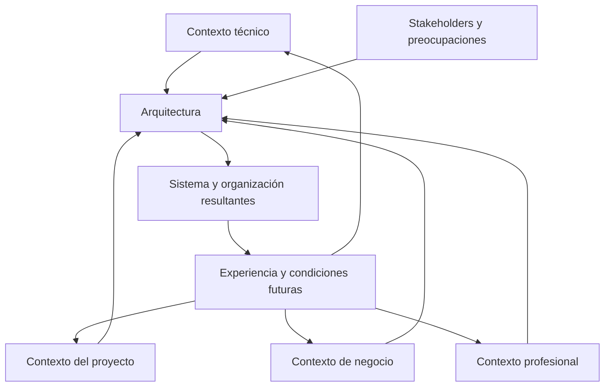

# CL01.04.01 — Contexto y participantes

> **Estado:** DRAFT_FOR_REVIEW. Esta revisión delimita la clase al análisis del contexto arquitectónico, los stakeholders, sus preocupaciones y las influencias recíprocas entre contexto y arquitectura. Alinea el nivel esperado con C02/EXPLICAR. No modifica por sí sola la ruta curricular ni el progreso de ningún estudiante.

## Ficha de la clase

- **Módulo:** M01 — Pensamiento arquitectónico y fundamentos.
- **Competencia:** C02 — Reconocer el impacto arquitectónico.
- **Nivel esperado:** EXPLICAR.
- **Duración de referencia:** 150 minutos, más trabajo autónomo.
- **Pregunta guía:** ¿En qué contexto existe un sistema de software, quiénes tienen interés en él y cómo influyen sus circunstancias en su arquitectura?
- **Prerrequisitos:** CL01.01.01, CL01.02.01 y CL01.03.01. CL01.02.02 puede utilizarse como repaso opcional.
- **Evidencia:** `EV-SAC01-CL01.04.01-01`.

### Nota de alineación curricular

Esta revisión adopta C02/EXPLICAR, en correspondencia con el nivel propuesto para las clases adyacentes de la ruta curricular. La decisión curricular aprobada para esta clase sustituye el nivel JUSTIFICAR del borrador anterior. La evidencia y la rúbrica se ajustan para evaluar explicación de relaciones contextuales, no justificación de la clasificación de decisiones arquitectónicas.

## 1. Propósito y límites

La arquitectura de software existe dentro de un contexto que condiciona su desarrollo, implementación y evolución. Este contexto comprende factores técnicos, condiciones del ciclo de vida del proyecto, objetivos de negocio y experiencia profesional.

Además, diferentes personas, grupos y organizaciones tienen intereses en el sistema. Sus preocupaciones ayudan a comprender qué aspectos deben considerarse y qué circunstancias influyen en el entorno arquitectónico.

Esta clase estudia la relación entre el contexto, los participantes y la arquitectura. El estudiante aprenderá a identificar los elementos relevantes de ese entorno y explicar cómo se relacionan.

**La idea central:** comprender la arquitectura requiere comprender también las circunstancias en las que existe, las personas a quienes afecta y las preocupaciones que esas personas tienen.

### Dentro del alcance

- Concepto de contexto arquitectónico.
- Stakeholders, roles y preocupaciones.
- Contextos técnico, del ciclo de vida del proyecto, de negocio y profesional.
- Relaciones entre participantes, preocupaciones y contextos.
- Influencia del contexto sobre la arquitectura.
- Influencia de la arquitectura sobre su contexto.
- Hechos, inferencias, supuestos e incertidumbre contextual.

### Fuera del alcance

- Levantamiento exhaustivo y especificación completa de requisitos.
- Identificación y especificación completa de requisitos arquitectónicamente significativos (ASR).
- Construcción de utility trees.
- Identificación, generación y comparación sistemática de alternativas arquitectónicas.
- Clasificación de decisiones como arquitectónicas o locales.
- Evaluación formal de arquitecturas mediante ATAM.
- Análisis exhaustivo de trade-offs y selección de una arquitectura óptima.
- Documentación detallada de vistas arquitectónicas.

Estos temas se estudian en otras clases del curso. Pueden mencionarse como contexto, pero no son objetivos ni criterios de evaluación de esta clase.

## 2. Resultados de aprendizaje

Al terminar, el estudiante podrá:

1. **Identificar** los stakeholders relevantes de un sistema y describir sus roles.
2. **Explicar** las preocupaciones de los participantes en relación con el sistema.
3. **Distinguir** los cuatro contextos descritos por Bass, Clements y Kazman (3.ª ed.).
4. **Identificar** condiciones contextuales relevantes para un sistema.
5. **Explicar** cómo el contexto influye en la arquitectura y cómo esta puede modificar su contexto.
6. **Diferenciar** hechos, inferencias y supuestos durante el análisis contextual.

### Criterios de éxito

La evidencia deberá demostrar que el estudiante:

- identifica participantes relevantes y describe sus roles;
- formula preocupaciones concretas sin confundirlas con soluciones técnicas;
- distingue los cuatro contextos y selecciona los pertinentes para el caso;
- relaciona participantes, preocupaciones y condiciones contextuales;
- explica influencias del contexto sobre la arquitectura y de la arquitectura sobre el contexto;
- distingue información confirmada de inferencias y supuestos;
- reconoce información faltante que podría modificar su explicación.

## 3. Fundamento bibliográfico y trazabilidad

**Fuente principal:** Bass, L., Clements, P. y Kazman, R. (2012). *Software Architecture in Practice* (3.ª ed.). Addison-Wesley.

| Sección de la fuente | Uso en esta clase |
|---|---|
| Cap. 2, §2.4 | La arquitectura como medio de comunicación entre stakeholders. |
| Cap. 3, §3.1 | Contexto técnico en el que existe la arquitectura. |
| Cap. 3, §3.2 | Contexto del ciclo de vida del proyecto. |
| Cap. 3, §3.3 | Contexto de negocio, incluida la organización que desarrolla y utiliza el sistema. |
| Cap. 3, §3.4 | Contexto profesional y experiencia del arquitecto. |
| Cap. 3, §3.5 | Stakeholders y sus preocupaciones. |
| Cap. 3, §3.6 | Influencias que el contexto ejerce sobre la arquitectura. |
| Cap. 3, §3.7 | Influencias que la arquitectura ejerce sobre su contexto. |

**Precisión de edición:** esta clase sigue la tercera edición, que presenta cuatro contextos. No se importan categorías de otras ediciones.

Las tablas, ejemplos, actividades y rúbricas son instrumentos didácticos elaborados para este curso. No se atribuyen como modelos textuales de Bass et al.

## 4. Desarrollo conceptual

### 4.1. La arquitectura necesita comunicación entre participantes

Una arquitectura no es útil únicamente para quienes diseñan o implementan el sistema. Distintos participantes necesitan comprender aspectos diferentes: qué responsabilidades existen, qué comportamiento pueden esperar, qué restricciones deben respetar y qué consecuencias pueden producir los cambios.

Bass et al. explican en el capítulo 2, §2.4, el papel de la arquitectura en la comunicación entre stakeholders. La arquitectura proporciona un objeto común para discutir el sistema, aunque los participantes tengan intereses y conocimientos distintos.

**Ejemplo.** En un sistema de turnos, el personal administrativo puede preocuparse por evitar duplicaciones; los pacientes, por conocer si su turno está confirmado; soporte, por investigar solicitudes ambiguas; y desarrollo, por mantener una integración comprensible. Una decisión que solo se explica en términos de una biblioteca o un protocolo no permite, por sí misma, que todos comprendan sus consecuencias.

La comunicación arquitectónica debe conectar la decisión con aquello que importa a los participantes. No exige que todos conozcan los detalles de implementación.

### 4.2. Stakeholders, roles y preocupaciones

Un **stakeholder** es una persona, grupo u organización que tiene interés en el sistema o puede verse afectado por él.

Un **rol** describe la función o responsabilidad que alguien desempeña respecto del sistema. Una persona puede asumir varios roles y un mismo rol puede ser desempeñado por varias personas.

Una **preocupación** es algo que importa a un stakeholder: una necesidad, objetivo, riesgo, obligación, expectativa o criterio que debe tenerse en cuenta.

No son conceptos intercambiables:

| Concepto | Pregunta que responde | Ejemplo |
|---|---|---|
| Stakeholder | ¿Quién tiene interés o puede verse afectado? | Personal administrativo |
| Rol | ¿Qué función desempeña? | Gestiona solicitudes de turnos |
| Preocupación | ¿Qué necesita o qué le importa? | Detectar solicitudes pendientes y evitar duplicaciones |

Una preocupación debe formularse de manera concreta. «Seguridad» o «rendimiento» son etiquetas demasiado generales. Una formulación más útil sería: «El área responsable necesita investigar quién consultó un resultado y en qué momento». La preocupación expresa qué importa; todavía no prescribe cómo resolverlo.

Una misma preocupación puede involucrar a varios participantes. También pueden existir tensiones entre preocupaciones: por ejemplo, reducir el tiempo de respuesta y, al mismo tiempo, confirmar que una operación se registró correctamente.

**Regla:** no deduzcas automáticamente una solución técnica a partir de una preocupación. Primero aclara quién la tiene, qué resultado necesita y bajo qué condiciones.

### 4.3. Los cuatro contextos de Bass et al. (3.ª ed.)

Bass et al. describen cuatro contextos en los que existe la arquitectura. Son perspectivas relacionadas, no fases de un proceso ni categorías excluyentes. No es necesario que todos tengan la misma relevancia en cada sistema.

#### A. Contexto técnico — §3.1

Se refiere al entorno técnico en el que la arquitectura existe: sistemas relacionados, tecnologías disponibles, plataformas, restricciones técnicas y condiciones que afectan al sistema. Incluye la relación entre la arquitectura y los atributos de calidad que el sistema debe alcanzar.

Preguntas orientadoras:

- ¿Con qué sistemas existentes debe relacionarse?
- ¿Qué plataformas, tecnologías o restricciones ya condicionan el sistema?
- ¿Qué características del entorno pueden habilitar o limitar su desarrollo?

**Ejemplo:** un portal debe consultar un sistema de agenda existente. La existencia de ese sistema es un dato del contexto técnico. No conocemos todavía su protocolo ni sus garantías; no debemos inventarlos.

#### B. Contexto del ciclo de vida del proyecto — §3.2

Se refiere a cómo la arquitectura se relaciona con las actividades y condiciones del proyecto: desarrollo, diseño, documentación, comunicación, análisis, implementación, pruebas y conformidad entre la implementación y la arquitectura.

Preguntas orientadoras:

- ¿En qué etapa del proyecto se encuentra el sistema?
- ¿Qué actividades de desarrollo, integración y pruebas son relevantes?
- ¿Qué calendario, recursos o forma de organizar el trabajo condicionan el proyecto?
- ¿Cómo se comprobará que la implementación respeta la arquitectura?

**Ejemplo:** si una integración debe entregarse por etapas, el calendario y la estrategia de integración forman parte de las condiciones del proyecto.

#### C. Contexto de negocio — §3.3

Se refiere a los objetivos y condiciones de negocio de la organización que desarrolla o utiliza el sistema. Incluye las organizaciones involucradas, sus objetivos, recursos, inversiones y estructura organizacional. La estructura organizacional forma parte de este contexto; no constituye un quinto contexto.

Preguntas orientadoras:

- ¿Qué objetivo de negocio justifica el sistema?
- ¿Qué organizaciones participan y qué intereses tienen?
- ¿Qué recursos e inversiones condicionan el trabajo?
- ¿Cómo influye la estructura organizacional en las responsabilidades?

**Ejemplo:** una clínica quiere reducir duplicaciones y mejorar la atención. La prioridad del negocio y la distribución de responsabilidades entre áreas forman parte de su contexto.

#### D. Contexto profesional — §3.4

Se refiere a la influencia de la práctica y experiencia profesional del arquitecto. La experiencia obtenida al construir sistemas, los conocimientos acumulados y los resultados de decisiones anteriores pueden influir en cómo se abordan proyectos posteriores.

Una experiencia exitosa con un enfoque puede hacer que el arquitecto tienda a considerarlo en otros proyectos; una experiencia fallida puede hacer que lo cuestione o evite. La experiencia es una influencia sobre el juicio profesional, no una demostración automática de que una solución sea correcta en un proyecto nuevo.

Preguntas orientadoras:

- ¿Qué experiencia previa influye en el juicio del arquitecto?
- ¿Qué aprendió el arquitecto o la organización de proyectos anteriores?
- ¿Qué prácticas tienden a repetirse y por qué?
- ¿Qué evidencia respalda que esa experiencia sea pertinente para el sistema actual?

**Ejemplo:** un arquitecto participó en un proyecto donde una integración directa con un proveedor produjo dificultades de evolución. Esa experiencia puede influir en su análisis de un proyecto nuevo, pero debe contrastarse con las condiciones actuales.

#### Comparación de los contextos

| Contexto | Centro del análisis | No confundir con |
|---|---|---|
| Técnico | Entorno tecnológico y propiedades del sistema | Organización del equipo |
| Ciclo de vida del proyecto | Actividades y condiciones del proyecto | Objetivos generales del negocio |
| Negocio | Objetivos, organizaciones, recursos y estructura organizacional | Protocolo o plataforma técnica |
| Profesional | Experiencia y aprendizaje que influyen en el arquitecto | Un catálogo genérico de habilidades |

**No es obligatorio utilizar los cuatro contextos con el mismo peso.** Se analizan los que ayudan a explicar el sistema. Omitir uno puede ser correcto si se explica por qué no resulta pertinente.

### 4.4. Cómo se relacionan participantes y contextos

Stakeholders y contextos responden preguntas diferentes:

- Los stakeholders permiten identificar quién tiene interés o puede verse afectado.
- Las preocupaciones permiten precisar qué le importa a cada participante.
- Los contextos ayudan a comprender las condiciones en las que existe la arquitectura.

Una preocupación puede estar condicionada por más de un contexto. Por ejemplo, la necesidad de consultar resultados oportunamente puede relacionarse con el entorno técnico, los objetivos de atención de la organización y las actividades del proyecto. No se debe asignar cada stakeholder a un único contexto.

**Cadena de análisis contextual:**

Participante → preocupación → condición contextual → influencia sobre la arquitectura.

Esta cadena es una herramienta didáctica del curso, no una fórmula atribuida literalmente a Bass et al.

### 4.5. Influencia recíproca: contexto y arquitectura

Bass et al. presentan esta relación mediante el *Architecture Influence Cycle* (AIC), en el capítulo 3.

El contexto influye en la arquitectura:

- Las condiciones técnicas influyen en qué soluciones son viables y en las propiedades que se pueden alcanzar.
- Las condiciones del proyecto influyen en cómo se organiza el desarrollo, la integración y la asignación de recursos.
- Las condiciones de negocio influyen en los objetivos y en la organización del trabajo.
- La experiencia profesional influye en el juicio de arquitectos y organizaciones.

En sentido inverso, la arquitectura puede afectar la estructura de los equipos, la experiencia acumulada, las oportunidades de negocio y las expectativas sobre sistemas posteriores.

El diagrama es una simplificación didáctica. No representa una secuencia temporal rígida ni afirma que cada influencia tenga la misma intensidad.

**Ejemplo:** una arquitectura que divide el sistema en unidades con responsabilidades diferenciadas puede influir en cómo se forman los equipos, cómo se distribuye el trabajo y qué conocimientos desarrolla cada grupo. Esas condiciones pueden influir en proyectos posteriores.

## 5. Método de análisis contextual

Utiliza esta secuencia para comprender el entorno en el que existe un sistema. El objetivo es explicar las relaciones contextuales, no seleccionar una solución arquitectónica.

### Paso 1. Delimitar el sistema y su entorno

Describe brevemente qué sistema se analiza, para qué organización existe y qué límites conocidos tiene. No agregues características que el escenario no proporcione.

### Paso 2. Identificar stakeholders y roles

Incluye personas, grupos u organizaciones que tengan interés en el sistema o puedan verse afectados. Registra el rol que desempeñan respecto al sistema.

### Paso 3. Precisar preocupaciones

Expresa qué necesita, espera o considera importante cada participante. Evita etiquetas vagas y no conviertas una preocupación en una solución técnica anticipada.

### Paso 4. Identificar los contextos pertinentes

Analiza las condiciones técnicas, del ciclo de vida del proyecto, de negocio y profesionales. No fuerces la presencia de los cuatro contextos.

### Paso 5. Relacionar participantes, preocupaciones y condiciones

Explica qué condiciones contextuales ayudan a comprender las preocupaciones de los participantes. Una preocupación puede relacionarse con más de un contexto.

### Paso 6. Explicar las influencias recíprocas

Describe cómo el contexto condiciona la arquitectura y cómo la arquitectura puede modificar las condiciones técnicas, organizacionales o profesionales futuras.

### Paso 7. Separar la evidencia

Clasifica las afirmaciones relevantes como:

- **Hecho:** información expresamente indicada o verificada.
- **Inferencia:** conclusión razonable derivada de hechos, pero no verificada directamente.
- **Supuesto:** condición adoptada provisionalmente porque el escenario no la especifica.

### Ejemplo de análisis contextual: solicitudes de turnos

**Escenario:** una clínica utiliza un sistema existente de agenda médica y quiere habilitar un portal para que los pacientes consulten sus turnos. El personal administrativo gestiona solicitudes y el equipo de soporte recibe reportes de problemas. No se especifican tecnologías, protocolos, infraestructura ni volumen de uso.

| Elemento | Análisis |
|---|---|
| Stakeholder | Paciente |
| Rol | Usuario del portal |
| Preocupación | Conocer si su solicitud fue recibida y si el turno está confirmado |
| Contexto relacionado | Técnico y de negocio |
| Stakeholder | Personal administrativo |
| Rol | Gestión de solicitudes |
| Preocupación | Evitar duplicaciones y resolver solicitudes pendientes |
| Contexto relacionado | Negocio y ciclo de vida del proyecto |
| Stakeholder | Equipo de desarrollo |
| Rol | Construcción e integración del portal |
| Preocupación | Comprender las capacidades y restricciones del sistema existente |
| Contexto relacionado | Técnico y ciclo de vida del proyecto |
| Stakeholder | Equipo de soporte |
| Rol | Atención de incidencias |
| Preocupación | Investigar solicitudes cuyo estado no está claro |
| Contexto relacionado | Técnico y ciclo de vida del proyecto |

**Hechos:** existe un sistema de agenda, la clínica quiere habilitar un portal y hay participantes con responsabilidades diferentes.

**Inferencias:** la integración entre portal y agenda será relevante; los estados de las solicitudes pueden afectar la comunicación con pacientes y personal.

**Supuestos:** el sistema existente permite consultar el estado de una solicitud; el equipo de soporte tiene acceso a registros suficientes para investigar incidencias.

**Explicación contextual:** el sistema existente forma parte del contexto técnico; la necesidad de habilitar el portal y coordinar el trabajo forma parte del contexto del proyecto; el objetivo de mejorar la atención pertenece al contexto de negocio. La experiencia previa de los profesionales que participen puede influir en cómo interpretan el problema. No hay información suficiente para describir con precisión el contexto profesional, por lo que no debe inventarse.

## 6. Práctica guiada

En parejas o individualmente, analiza el caso de turnos de §5. Completa la matriz:

| Stakeholder | Rol | Preocupación | Contexto relacionado | Evidencia o procedencia |
|---|---|---|---|---|
| Paciente | | | | |
| Personal administrativo | | | | |
| Desarrollo | | | | |
| Soporte | | | | |

Después, responde:

1. ¿Qué condiciones del contexto técnico son conocidas?
2. ¿Qué condiciones del negocio explican la existencia del portal?
3. ¿Qué actividades del proyecto podrían ser relevantes?
4. ¿Qué información permitiría comprender mejor el contexto profesional?
5. ¿Cómo podría la arquitectura modificar la organización del trabajo o la experiencia futura?

La práctica es formativa. Se evalúa la precisión de las relaciones explicadas y la distinción entre hechos, inferencias y supuestos.

### Comprobación conceptual breve

1. ¿En qué se diferencian stakeholder, rol y preocupación?
2. ¿Por qué los cuatro contextos no deben tratarse como fases ni como categorías excluyentes?
3. ¿Qué diferencia hay entre el contexto del ciclo de vida del proyecto y el contexto profesional?
4. ¿Por qué una preocupación no determina automáticamente una solución técnica?
5. ¿Cómo puede la arquitectura modificar el contexto que influirá en proyectos futuros?

## 7. Evidencia independiente

### Caso: publicación y consulta de resultados de laboratorio

Un laboratorio quiere que los resultados estén disponibles mediante un portal. El portal obtiene la información de un sistema de laboratorio existente. Los profesionales de salud necesitan consultar ciertos resultados antes de que estén disponibles para pacientes. El área responsable de cumplimiento necesita investigar incidentes de acceso. Soporte recibe reportes de resultados que no aparecen en el portal.

El escenario no especifica legislación, infraestructura, protocolo de integración, volumen, SLA ni capacidades del sistema existente. No se deben inventar esos datos ni presentar obligaciones regulatorias concretas como hechos.

### Entregable: `EV-SAC01-CL01.04.01-01`

Informe de **700–900 palabras**, con estas secciones:

1. **Descripción del sistema y su entorno:** explica brevemente el propósito del sistema y sus límites conocidos.
2. **Stakeholders y roles:** identifica al menos cuatro participantes y describe su relación con el sistema.
3. **Preocupaciones:** formula al menos una preocupación concreta por participante.
4. **Contextos:** identifica condiciones pertinentes de los cuatro contextos de Bass et al. Distingue hechos, inferencias y supuestos; no fuerces información inexistente.
5. **Relaciones e influencias:** explica cómo las preocupaciones y condiciones contextuales se relacionan con la arquitectura.
6. **Influencia recíproca:** describe al menos un ejemplo de cómo la arquitectura puede modificar su contexto futuro.
7. **Incertidumbre:** declara información faltante que podría modificar el análisis.

No se solicita clasificar decisiones como arquitectónicas o locales, comparar alternativas, seleccionar una solución ni justificar trade-offs.

## 8. Rúbrica analítica — `CR-C02-EXPLAIN`

La rúbrica evalúa la capacidad de explicar el contexto arquitectónico, los participantes, sus preocupaciones y las influencias recíprocas entre contexto y arquitectura.

### Ponderación

| Criterio | Peso |
|---|---:|
| Identificación de stakeholders y roles | 15 % |
| Formulación de preocupaciones | 20 % |
| Comprensión de los cuatro contextos | 25 % |
| Relaciones e influencias recíprocas | 25 % |
| Calidad de la evidencia e incertidumbre | 15 % |
| **Total** | **100 %** |

### Descriptores

| Criterio | 1 — Insuficiente | 2 — Básico | 3 — Competente | 4 — Avanzado |
|---|---|---|---|---|
| Stakeholders y roles (15 %) | Omite participantes relevantes o confunde participantes con funciones. | Identifica algunos participantes, pero describe roles de forma incompleta. | Identifica al menos cuatro participantes y explica sus roles respecto al sistema. | Además, reconoce participantes indirectos y explica cómo se relacionan con el sistema. |
| Preocupaciones (20 %) | No identifica preocupaciones o las sustituye por tecnologías. | Presenta preocupaciones vagas o poco relacionadas con los participantes. | Formula preocupaciones concretas y coherentes para los participantes identificados. | Además, explica coincidencias o tensiones entre preocupaciones sin anticipar soluciones. |
| Contextos (25 %) | Confunde los contextos o no logra distinguirlos. | Reconoce algunos contextos, pero mezcla sus características. | Distingue los cuatro contextos y relaciona datos pertinentes con cada uno cuando están disponibles. | Además, explica interacciones entre contextos y reconoce explícitamente cuándo falta información. |
| Relaciones e influencias (25 %) | Enumera elementos sin explicar sus relaciones. | Explica algunas relaciones, pero solo en una dirección o de manera superficial. | Explica cómo participantes y condiciones contextuales influyen en la arquitectura y cómo esta puede modificar su contexto. | Además, desarrolla relaciones causales plausibles y contextualizadas, sin presentar inferencias como hechos. |
| Evidencia e incertidumbre (15 %) | Presenta supuestos como hechos. | Distingue algunos hechos, pero no identifica claramente las inferencias o información faltante. | Diferencia hechos, inferencias y supuestos, y señala información faltante relevante. | Además, explica cómo la información faltante podría cambiar su interpretación del contexto. |

### Cálculo

Cada criterio recibe un nivel entero de 1 a 4. El nivel se convierte en el porcentaje del peso asignado:

| Nivel | Porcentaje del peso |
|---|---:|
| 1 — Insuficiente | 0 % |
| 2 — Básico | 60 % |
| 3 — Competente | 85 % |
| 4 — Avanzado | 100 % |

**Fórmula:** puntuación final = suma de (peso del criterio × porcentaje correspondiente al nivel).

**Umbral propuesto de aprobación:** 70/100. Una entrega no se considera competente si obtiene nivel 1 en comprensión de contextos o relaciones e influencias, aunque alcance 70 puntos por suma. El umbral y la conversión se mantienen como propuesta para piloto y requieren validación con entregas reales.

## 9. Secuencia didáctica — 150 minutos

| Fase | Tiempo | Actividad | Resultado observable |
|---|---:|---|---|
| 1. Activación | 10 min | Presentar un sistema y preguntar quiénes tienen interés en él. | Participantes iniciales identificados. |
| 2. Stakeholders y preocupaciones | 25 min | Explicar conceptos y construir una matriz breve. | Diferencia entre participante, rol y preocupación. |
| 3. Cuatro contextos | 35 min | Explicar los contextos, contrastarlos y resolver preguntas. | Identificación de condiciones contextuales. |
| 4. Relaciones contextuales | 20 min | Conectar participantes, preocupaciones y contextos. | Mapa de relaciones contextual. |
| 5. Influencia recíproca | 15 min | Analizar el ciclo de influencia con un ejemplo. | Explicación de influencias en ambos sentidos. |
| 6. Caso guiado y práctica | 25 min | Completar la matriz del caso de turnos. | Análisis contextual formativo. |
| 7. Comprobación y cierre | 20 min | Responder preguntas conceptuales y sintetizar el análisis. | Síntesis individual y dudas identificadas. |
| **Total** | **150 min** | | |

El informe independiente se termina como trabajo autónomo. No se debe reducir la explicación de los contextos para ampliar la exposición magistral.

## 10. Errores frecuentes y remediación

| Error | Por qué es incorrecto | Remediación |
|---|---|---|
| Tratar stakeholder, rol y preocupación como sinónimos. | Responden preguntas diferentes: quién, qué función y qué le importa. | Reconstruir la tabla de §4.2 con un caso nuevo. |
| Tratar los cuatro contextos como fases. | Son perspectivas relacionadas, no etapas secuenciales. | Clasificar ejemplos por la pregunta que responde cada contexto. |
| Confundir contexto profesional con ciclo de vida del proyecto. | Uno se relaciona con experiencia e influencia profesional; el otro, con actividades y condiciones del proyecto. | Contrastar experiencia previa del arquitecto con planificación y pruebas del proyecto. |
| Colocar la estructura organizacional en un quinto contexto. | En esta edición se trata dentro del contexto de negocio. | Volver a §4.3 y explicar dónde encaja. |
| Afirmar que una preocupación exige una tecnología específica. | La preocupación no prescribe por sí sola una solución. | Reformular la preocupación sin mencionar tecnología. |
| Asignar cada stakeholder a un único contexto. | Una preocupación puede estar condicionada por varios contextos. | Construir un ejemplo donde una preocupación se relacione con dos contextos. |
| Presentar inferencias o supuestos como hechos. | La conclusión aparenta tener más evidencia de la disponible. | Etiquetar cada afirmación y declarar qué dato la verificaría. |
| Explicar solo la influencia del contexto sobre la arquitectura. | La relación también opera en sentido inverso. | Analizar cómo una arquitectura puede cambiar equipos, prácticas o experiencia futura. |

## 11. Materiales y preparación

- Consultar la matriz C02 y verificar la progresión de las clases adyacentes.
- Tener disponible *Software Architecture in Practice* (3.ª ed.), capítulo 2, §2.4 y capítulo 3, §§3.1–3.7.
- Preparar una matriz para stakeholder, rol y preocupación.
- Preparar una tabla comparativa de los cuatro contextos.
- Mantener visibles las categorías hecho, inferencia y supuesto.
- No se requiere lenguaje de programación, framework ni plataforma específicos.

## 12. Revisión de consistencia de esta versión

| Control | Estado | Observación |
|---|---|---|
| Identidad e IDs | PASS | Se conserva CL01.04.01, C02 y el ID de evidencia. |
| Nivel esperado | PASS | C02/EXPLICAR, aprobado para esta clase. |
| Propósito y resultados | PASS | Se centran en explicar el contexto y sus relaciones. |
| Contextos de Bass, 3.ª ed. | PASS | Se presentan los cuatro contextos y se distingue el profesional del ciclo de vida del proyecto. |
| Stakeholders y preocupaciones | PASS | Se diferencian y relacionan con las condiciones contextuales. |
| Influencia recíproca | PASS | Se explica la influencia del contexto sobre la arquitectura y de la arquitectura sobre el contexto. |
| Evidencia y rúbrica | PASS | Evalúan explicación contextual, no clasificación de decisiones. |
| Alcance de M02 | PASS | No se evalúa generación ni comparación de alternativas, ni trade-offs. |
| Duración | PASS | La secuencia suma 150 minutos. |
| Validación empírica | PENDIENTE | No se han observado aún entregas ni impartición de esta versión. |
| Estado académico | DRAFT_FOR_REVIEW | Requiere revisión académica y validación con estudiantes antes de declararse READY/APPROVED. |

## 13. Criterio de cierre

La clase cumple su propósito cuando el estudiante puede explicar quiénes participan en un sistema, qué les importa, qué condiciones contextuales existen y cómo esas condiciones influyen en la arquitectura. También debe describir cómo la arquitectura puede modificar su entorno y distinguir la información confirmada de las inferencias y los supuestos.

**Estado de esta revisión:** DRAFT_FOR_REVIEW. Esta versión constituye la revisión 3 del artefacto y conserva la versión anterior como antecedente. No modifica el progreso de ningún estudiante ni declara la clase READY/APPROVED.
