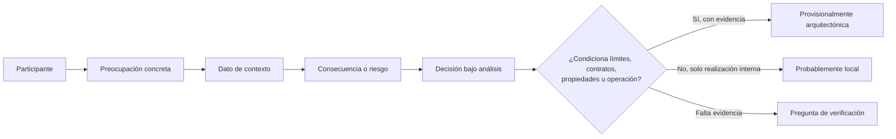

# CL01.04.01 — Contexto y participantes

> **Estado curricular:** publicada para revisión curricular. La ruta ubica esta clase en M01 y propone C02 — *Reconocer el impacto arquitectónico*, nivel `JUSTIFICAR`. La matriz de competencias está aprobada, pero la ruta es un mapa de planificación y este documento no autoriza por sí mismo la impartición ni acredita dominio.

## Ficha de la clase

- **Duración estimada:** 150–180 minutos, más trabajo autónomo.
- **Pregunta guía:** ¿Cómo cambia el carácter arquitectónico de una decisión cuando cambian los participantes, sus preocupaciones y el contexto?
- **Prerrequisitos:** CL01.01.01, CL01.02.01 y CL01.03.01. CL01.02.02 puede emplearse como repaso de representaciones, pero continúa pendiente de revisión.
- **Evidencia propuesta:** `EV-SAC01-CL01.04.01-01`, análisis argumentado de contexto, participantes y una decisión.
- **No equivale a:** levantar requisitos de manera exhaustiva, construir un utility tree, priorizar ASR, seleccionar una arquitectura completa ni producir un ADR. Esos desempeños se desarrollan en módulos posteriores.

## 1. Resultados de aprendizaje

Al terminar, la persona podrá:

1. Diferenciar **participante (stakeholder)**, rol, preocupación, requisito, restricción y decisión sin tratarlos como sinónimos.
2. Identificar participantes y preocupaciones relevantes en un caso, incluyendo conflicto o incertidumbre cuando exista.
3. Explicar cómo los contextos de negocio, técnico, proyecto y operación hacen relevante una preocupación.
4. Justificar si una decisión propuesta tiene impacto arquitectónico o es local de diseño/implementación, usando participantes, contexto, consecuencias y evidencia disponible.
5. Declarar hechos, inferencias, supuestos y preguntas de verificación, sin convertir una tecnología en respuesta automática.

### Criterios de éxito

El análisis es satisfactorio si identifica al menos tres participantes con preocupaciones distinguibles; relaciona cada preocupación con un dato contextual; compara una alternativa con una decisión local; y defiende su clasificación con una consecuencia verificable, una limitación y una pregunta abierta. La conclusión puede ser condicional: la calidad del razonamiento no exige fingir que toda incertidumbre está resuelta.

## 2. Alcance y fuentes

### Dentro del alcance

- Participantes y preocupaciones arquitectónicamente relevantes.
- Contexto de negocio, técnico, proyecto, organización y operación.
- Restricciones como información que limita alternativas.
- Razonamiento inicial sobre impacto arquitectónico de una decisión.

### Fuera del alcance

- Entrevistas sistemáticas, ASR, escenarios de calidad y utility trees (M02).
- Evaluación formal de alternativas o trade-offs completos (C05).
- Vistas, notación UML o documentación arquitectónica detallada (M03).

### Mapa de fuentes y límites

| Fuente | Uso verificable en esta clase | Límite |
|---|---|---|
| *Software Architecture in Practice*, 4.ª ed., cap. 2 §2.4; cap. 22 §22.8; cap. 24 §24.2 | El índice editorial confirma las secciones «Communication among Stakeholders», «Architecture Stakeholders» e «Incremental Architecture and Stakeholders». Sirve para situar participantes y comunicación como asuntos arquitectónicos. | Solo se verificó el índice/editorial disponible, no el texto íntegro de las secciones. No se atribuyen citas ni reglas específicas no consultadas. |
| Bruegge y Dutoit, *Object-Oriented Software Engineering Using UML, Patterns, and Java*, 3.ª ed., caps. 1–4 | El índice editorial confirma participantes y roles, requisitos funcionales/no funcionales, organización y comunicación de proyecto. | Se usa como apoyo de terminología; no se enseña UML ni un proceso completo. |
| Cervantes y Kazman, *Designing Software Architectures*, 2.ª ed., §§1.3 y 2.4 | El índice público confirma «The Role of the Architect» y «Architectural Drivers». Apoya conectar contexto con decisiones. | No se ejecuta ADD ni se introducen drivers como técnica formal en esta sesión. |
| `LEARNING_PATH.md`, `MATRIZ_COMPETENCIAS.md`, CL01.03.01 del repositorio | Definen C02, el nivel JUSTIFICAR, la posición curricular y la distinción de impacto arquitectónico frente a diseño local. | La ruta no convierte las fuentes bibliográficas en texto disponible ni valida por sí sola la evidencia. |

## 3. Conceptos de trabajo

| Concepto | Definición operativa | No es |
|---|---|---|
| Participante | Persona, grupo, área o entidad externa que puede afectar, usar, operar, financiar, regular o sufrir consecuencias del sistema. | Solo el usuario final ni cualquier nombre de cargo sin relación con el caso. |
| Rol | Responsabilidad que un participante asume en un contexto. Una persona puede tener varios roles. | Una propiedad fija de la persona. |
| Preocupación | Pregunta, necesidad, riesgo, obligación o criterio que importa a un participante respecto del sistema. | Una solución ya elegida. |
| Contexto | Hechos y restricciones de negocio, técnica, proyecto, organización y operación que dan significado a una decisión. | Decoración del caso ni un conjunto de tecnologías. |
| Restricción | Condición que limita alternativas admisibles: regulación, fecha, integración, presupuesto, plataforma o política. | Una preferencia presentada como ley técnica. |
| Decisión arquitectónica | Decisión que condiciona límites, dependencias, propiedades relevantes, operación o evolución más allá de una realización local. | Toda elección técnica. |

Una cadena útil de razonamiento es: **participante → preocupación → dato de contexto → consecuencia a evitar o lograr → decisión a investigar**. La flecha no dice que la última decisión esté tomada; hace visible por qué merece atención arquitectónica.

## 4. Explicación desarrollada

### 4.1 Empezar por quién se ve afectado, no por la tecnología

Decir «necesitamos una base de datos X» omite la pregunta que permitiría evaluar la afirmación. ¿Qué persona o entidad necesita qué resultado? ¿Con qué restricción? ¿Qué ocurriría si no se cumple? Una misma tecnología puede ser razonable en un producto pequeño y problemática en un sistema sujeto a auditoría, alta disponibilidad o integración externa.

Los participantes habituales incluyen usuarios, patrocinadores, personal de operación, seguridad, desarrollo, soporte, organizaciones integradas y reguladores. La lista no se aplica mecánicamente: solo se incorpora a quien tiene una preocupación demostrable en el caso.

### 4.2 Una preocupación debe poder expresarse como pregunta

«Seguridad» no es todavía una preocupación útil. Una formulación más precisa sería: «el responsable de cumplimiento necesita poder demostrar quién accedió a una historia clínica y cuándo». Esa frase permite preguntar qué información debe conservarse, quién puede verla y qué alternativas quedarían descartadas. Aún no prescribe un producto ni una arquitectura.

Una preocupación puede generar tensión con otra. Por ejemplo, una persona usuaria puede valorar confirmar un turno inmediatamente; el área de operación puede preferir una integración que no bloquee cuando Agenda médica no responde. El conflicto no se resuelve diciendo que una parte tiene razón por jerarquía: se registra y se investiga con evidencia posterior.

### 4.3 Cinco lentes de contexto

| Lente | Preguntas que orientan | Ejemplo de dato relevante |
|---|---|---|
| Negocio | ¿Qué valor, regla, coste o plazo condiciona el sistema? | La clínica debe evitar reservar dos veces el mismo horario. |
| Técnico | ¿Qué sistemas existentes, datos, interfaces o límites existen? | Agenda médica ya es un sistema externo y sus capacidades de integración no se conocen. |
| Proyecto | ¿Qué equipo, calendario, presupuesto o conocimiento limita el cambio? | El equipo tiene seis semanas para la primera versión. |
| Organización | ¿Quién posee los datos y quién aprueba cambios? | Seguridad aprueba accesos a información clínica. |
| Operación | ¿Cómo se observa, soporta y recupera el servicio? | Soporte necesita distinguir una solicitud pendiente de una confirmada. |

Las lentes no son una lista de requisitos. Son una forma de evitar que una preocupación importante quede invisible. Cuando falten datos, se registra una pregunta en vez de rellenar el vacío con experiencia previa.

### 4.4 Contexto e impacto arquitectónico

El impacto arquitectónico no reside en una palabra como «API», «nube» o «microservicio». Surge de sus consecuencias. Una decisión tiende a ser arquitectónica cuando cambia fronteras, contratos, propiedad de datos, dependencias, modos de fallo, operación o capacidad de evolución de varias partes.

Una decisión local suele resolver cómo realizar una responsabilidad ya delimitada sin cambiar esos elementos. La clasificación puede cambiar: elegir una librería de validación en un módulo puede ser local; imponer una biblioteca única a múltiples equipos y servicios, por razones de cumplimiento y soporte, puede adquirir efecto arquitectónico. Para justificarlo se debe mostrar el cambio de contexto y de radio de impacto, no solo declarar que «escala».

#### Procedimiento para justificar, sin saltar a la solución

1. **Nombra la decisión, sin adornarla.** Por ejemplo: «confirmar solo después de consultar Agenda médica», no «usar la mejor integración».  
2. **Localiza a quién le importa y por qué.** Vincula participantes con preocupaciones observables, no con preferencias tecnológicas.  
3. **Separa evidencia de interpretación.** Marca qué afirma el caso, qué se infiere y qué todavía debe comprobarse.  
4. **Traza las consecuencias.** Pregunta qué límites, contratos, propiedad de datos, operación o evolución resultarían condicionados.  
5. **Compara el radio de impacto.** Si la decisión cambia solo la realización interna de una responsabilidad, es candidata a local. Si condiciona varias partes o una propiedad importante, es candidata a arquitectónica.  
6. **Formula una conclusión condicionada.** Declara qué información falta y qué evidencia podría confirmar, descartar o reclasificar la decisión.

Este procedimiento no reemplaza el análisis formal de requisitos ni de trade-offs. Es una forma disciplinada de decidir qué asunto merece investigación arquitectónica en el punto de la ruta donde se encuentra esta clase.

### 4.5 Diagrama: de una preocupación a una decisión que merece investigar

El diagrama representa el **orden del razonamiento**, no una secuencia de ejecución del software ni un método de diseño completo. Una flecha indica que se debe justificar la relación; no demuestra que la conclusión sea cierta.

## 5. Teoría aplicada: ejemplo razonado

### Caso: turnos clínicos

Una clínica permite solicitar turnos desde una interfaz web. Gestión de turnos consulta disponibilidad en Agenda médica y registra el turno cuando se cumplen las condiciones conocidas. La clínica atiende información clínica sensible. El caso no indica protocolo de integración, volumen, acuerdos de disponibilidad, infraestructura ni mecanismo de reintento.

| Participante | Preocupación | Hecho / supuesto | Posible consecuencia arquitectónica |
|---|---|---|---|
| Persona usuaria | Conocer si el turno fue confirmado. | Hecho: solicita un turno. | El sistema debe distinguir un resultado confirmado de uno pendiente; no se concluye aún cómo. |
| Personal de agenda | Evitar duplicación de horarios. | Hecho: Agenda médica participa; supuesto: es fuente de disponibilidad. | Puede ser relevante definir quién posee la disponibilidad y qué ocurre ante respuesta tardía. |
| Responsable de seguridad | Proteger información clínica. | Hecho: el dominio es clínico; detalles regulatorios no dados. | Es razonable investigar control de acceso y trazabilidad; no afirmar todavía un estándar o mecanismo. |
| Soporte | Resolver solicitudes inconclusas. | Inferencia condicionada: una integración puede fallar o demorar. | Podría requerirse estado observable y procedimientos de recuperación; hay que confirmar objetivos de operación. |

**Decisión bajo análisis:** «Gestión de turnos no confirmará un turno hasta recibir una respuesta de Agenda médica». Esta decisión parece arquitectónicamente relevante porque condiciona el contrato entre dos partes, la experiencia visible para la persona usuaria y el tratamiento de fallos. Sin embargo, falta información sobre la disponibilidad de Agenda y las reglas de negocio. Una justificación honesta concluye: *provisionalmente arquitectónica; confirmar políticas de espera, responsabilidad de datos y estado de una solicitud pendiente antes de aprobar una realización concreta*.

**Contraejemplo local:** renombrar una función interna que formatea una fecha no altera responsabilidades, contratos ni preocupaciones del caso. Es diseño/implementación local salvo que el cambio modifique un contrato expuesto u otra condición contextual.

## 6. Preguntas conceptuales (antes de las tareas)

Una empresa dice: «usemos colas porque el sistema tiene muchos usuarios». Responde en tres a cinco líneas:

1. ¿Qué participante o preocupación faltaría identificar antes de evaluar la frase?
2. ¿Qué dato contextual podría volver relevante la comunicación asíncrona?
3. ¿La propuesta es ya una decisión justificada? ¿Por qué?

**Respuesta esperada:** debe señalar al menos una preocupación concreta (por ejemplo, confirmación, recuperación, coste u operación), un dato verificable y que «muchos usuarios» no basta para seleccionar una tecnología. Si se responde con una solución sin condiciones, volver a la cadena participante → preocupación → contexto → consecuencia.

Responde también las siguientes preguntas con tus propias palabras. No memorices definiciones: muestra la relación causal y declara los límites de la información.

4. ¿Por qué «el usuario final» puede ser una descripción insuficiente de los participantes relevantes de un sistema?
5. Explica la diferencia entre una preocupación y una restricción usando un ejemplo que no aparezca en la clase.
6. En el caso clínico, ¿qué información adicional necesitarías para concluir que la disponibilidad de Agenda médica es una preocupación arquitectónica?
7. ¿Por qué dos equipos podrían clasificar de manera distinta una misma decisión sin que uno de ellos necesariamente esté equivocado?
8. Da un ejemplo de una decisión inicialmente local que se vuelva arquitectónica al cambiar el contexto. Identifica el cambio de contexto.
9. ¿Qué error lógico se comete cuando se concluye que una tecnología es obligatoria solo porque un participante tiene una preocupación?

### Retroalimentación y ruta de remediación

Si una respuesta enumera tecnologías pero no participantes, preocupaciones y consecuencias, la persona debe volver a la sección 4.2 y reescribir la respuesta con la cadena de razonamiento. Si confunde hecho e inferencia, debe etiquetar cada oración del caso como **hecho**, **inferencia** o **supuesto** antes de responder de nuevo. Solo después de esa corrección pasa a las tareas independientes.

## 7. Tarea 1 — Práctica guiada (formativa)

En parejas, completen una fila de la siguiente matriz para el caso clínico. Elijan un participante distinto al de otra pareja.

| Participante | Preocupación formulada como pregunta | Dato del caso | Dato faltante | Decisión que merece investigar |
|---|---|---|---|---|
|  |  |  |  |  |

Después, intercambien matrices. La persona revisora debe preguntar: «¿Qué evidencia te permitiría sostener que esta decisión es arquitectónica y no local?». Corrijan la fila sin agregar hechos no presentes.

Esta práctica es formativa: recibe retroalimentación y permite corregir antes de producir evidencia. No acredita dominio por sí sola.

## 8. Tarea 2 — Análisis de caso independiente (evidencia propuesta)

### Caso: plataforma de entrega de resultados de laboratorio

Un laboratorio publica resultados para pacientes mediante un portal. El portal consulta un sistema de laboratorio existente. Profesionales de salud necesitan acceder a ciertos resultados antes de que sean visibles para pacientes. El área de cumplimiento exige investigar incidentes de acceso. Soporte atiende reportes de resultados que no aparecen. El caso no especifica legislación concreta, identidad digital, infraestructura, protocolo de integración, SLA ni volumen.

### Entregable: `EV-SAC01-CL01.04.01-01`

Entrega un documento de 700–900 palabras con:

1. Una matriz de al menos cuatro participantes, sus preocupaciones y los datos que las respaldan.
2. Cuatro datos de contexto, al menos uno de negocio/organización y uno técnico u operativo; marca cada uno como hecho, inferencia o supuesto.
3. Análisis de dos decisiones: una que consideres provisionalmente arquitectónica y una local. Para cada una, explica consecuencias, radio de impacto, incertidumbre y evidencia que pedirías.
4. Una tensión entre preocupaciones y una pregunta abierta que impida resolverla prematuramente.

No uses un producto, patrón, nube, cola, base de datos o protocolo como sustituto de la justificación. Puedes mencionar una alternativa solo como hipótesis condicionada.

### Rúbrica propuesta — `CR-C02-JUSTIFY`

| Dimensión | Logro observable | Aún no logrado |
|---|---|---|
| Participantes y preocupaciones | Distingue participantes relevantes y formula preocupaciones concretas. | Enumera cargos o tecnologías sin relación causal. |
| Lectura de contexto | Separa hechos, inferencias y supuestos; identifica datos faltantes significativos. | Trata conjeturas como requisitos confirmados. |
| Clasificación de impacto | Justifica la clasificación por límites, contratos, propiedades, operación o evolución. | Etiqueta por popularidad de la tecnología o tamaño aparente. |
| Argumentación | Reconoce consecuencias, una tensión y límites de la conclusión. | Presenta una solución como inevitable o ignora trade-offs. |

La evidencia debe revisarse contra estos criterios antes de registrar cualquier decisión de dominio. Completarla no equivale a acreditar C02.

## 9. Errores frecuentes y remediación

- **«Stakeholder es solo quien usa la pantalla».** Buscar quién opera, aprueba, integra o asume consecuencias.
- **«Una preocupación es una herramienta».** Reescribir «queremos Kafka» como la pregunta o resultado que se pretende lograr, y anotar la evidencia faltante.
- **«Toda decisión técnica es arquitectónica».** Dibujar su radio de impacto y preguntar qué contratos, propiedades o equipos cambiarían.
- **«Si no conocemos un dato, elegimos una solución estándar».** Convertir el vacío en pregunta verificable.

Para remediar, repetir el análisis con un caso de tres participantes y una sola decisión. Primero clasificar información (hecho, inferencia, supuesto); luego elaborar la matriz; solo al final justificar el alcance de la decisión.

## 10. Secuencia docente sugerida

1. Activación y recuperación de CL01.03.01 (10 min).
2. Explicación de participantes, preocupaciones y cinco lentes de contexto (30 min).
3. Ejemplo clínico y comprobación conceptual (25 min).
4. Práctica guiada con matriz (25 min).
5. Actividad independiente (45–60 min).
6. Cierre: una decisión que cambió de clasificación al cambiar el contexto (10 min).

## 11. Referencias

1. Bass, L., Clements, P. y Kazman, R. *Software Architecture in Practice*, 4.ª ed. Addison-Wesley, 2021. [Ficha e índice editorial](https://www.informit.com/store/software-architecture-in-practice-9780136885672). Secciones de la ruta: 2.4, 22.8 y 24.2.
2. Bruegge, B. y Dutoit, A. H. *Object-Oriented Software Engineering Using UML, Patterns, and Java*, 3.ª ed. Pearson, 2010. [Ficha e índice editorial](https://www.informit.com/store/object-oriented-software-engineering-using-uml-patterns-9780136061250). Capítulos de la ruta: 3–4.
3. Cervantes, H. y Kazman, R. *Designing Software Architectures: A Practical Approach*, 2.ª ed. Addison-Wesley, 2024. [Índice editorial](https://www.oreilly.com/library/view/designing-software-architectures/9780138108069/toc.xhtml). Secciones de la ruta: 1.3 y 2.4.
4. Curso SAC01: `LEARNING_PATH.md`, `MATRIZ_COMPETENCIAS.md` y `CL01.03.01 — Arquitectura, diseño e implementación`, repositorio `acuscorp/SoftwareArchitecture`, rama `main`.

Los títulos disponibles en la carpeta de Drive son materiales de consulta; no se incorporan al repositorio ni se redistribuyen con este artefacto.

## 12. Revisión de aceptación

| Revisión | Estado | Razón |
|---|---|---|
| Alineación con ruta y C02 | PASS | Mantiene CL01.04.01, C02 y JUSTIFICAR; no redefine la competencia. |
| Prerrequisitos y progresión | PASS | Usa CL01.03.01 para impacto; deja ASR, utility trees y trade-offs formales para después. |
| Fuente y trazabilidad | FIX | Las referencias del editor y los artefactos del repositorio son trazables, pero falta cotejar los pasajes concretos disponibles en Drive antes de afirmar que respaldan cada explicación o convertirlas en lectura obligatoria cerrada. |
| Objetivo–actividad–evidencia | PASS | La actividad requiere justificar clasificación y límites, no solo identificar participantes. |
| Explicación y práctica | PASS | Incluye definiciones, límites, ejemplo razonado, comprobación previa, práctica, tarea y remediación. |
| Orden pedagógico y representación | PASS | La teoría detallada (incluido ejemplo y diagrama) precede las preguntas conceptuales; las tareas siguen una práctica guiada formativa y un análisis de caso independiente. |
| Estado de aprobación | FIX | Falta revisión curricular y autorización del responsable para cambiar el estado de `REVIEW_REQUIRED`. |

### Revisión posterior a correcciones

- **PASS:** los objetivos, contenido, ejemplo, diagrama, preguntas conceptuales, práctica, entregable, rúbrica y remediación están alineados con C02/JUSTIFICAR.
- **PASS:** se conservaron los límites de M01; no se convirtió ASR, utility trees, evaluación formal de alternativas o UML en objetivos de esta clase.
- **FIX pendiente:** cotejar el contenido de las secciones fuente y completar la revisión curricular. Hasta entonces el artefacto conserva el estado `REVIEW_REQUIRED` y no puede marcarse como FINAL/READY.

## 13. Gobierno

- Este archivo no modifica estado individual, evidencias reales ni dominio estudiantil.
- Antes de publicación, confirmar versión activa del curso, rama, reemplazo del archivo actual y si la lectura propuesta estará disponible para el estudiante.
- Conservar `SAC01-CP-013` como referencia de cambio hasta que la autoridad curricular registre una decisión.

