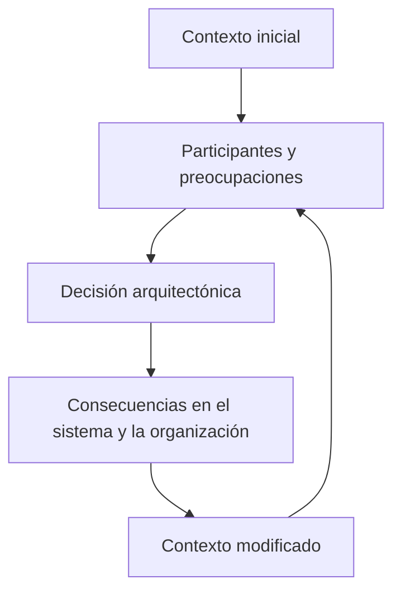

# CL01.04.01 — Contexto y participantes

> **Estado:** versión corregida para revisión curricular. La matriz C02 está aprobada; esta clase y su evidencia continúan pendientes de validación. No debe considerarse lista para impartirse hasta cerrar los controles de aceptación.

## Ficha de la clase

- **Módulo:** M01 — Pensamiento arquitectónico y fundamentos.
- **Competencia:** C02 — Reconocer el impacto arquitectónico.
- **Nivel esperado:** JUSTIFICAR.
- **Duración:** 165 minutos, más trabajo autónomo.
- **Pregunta guía:** ¿Cómo justificamos que una decisión tiene impacto arquitectónico —o es local— considerando a quién afecta y en qué contexto?
- **Prerrequisitos:** CL01.01.01, CL01.02.01 y CL01.03.01. CL01.02.02 es repaso opcional y continúa pendiente de revisión.
- **Evidencia:** `EV-SAC01-CL01.04.01-01`.

### Propósito

Justificar la clasificación de una decisión como arquitectónica o local a partir de los participantes afectados, sus preocupaciones, las condiciones contextuales y el alcance de sus consecuencias. El estudiante debe defender su razonamiento, reconocer límites de la evidencia y declarar qué información podría cambiar su conclusión.

### Continuidad curricular

- **CL01.03.01 — EXPLICAR:** explica la diferencia entre arquitectura, diseño e implementación, y cómo una decisión puede tener impacto arquitectónico.
- **CL01.04.01 — JUSTIFICAR:** fundamenta esa clasificación en participantes, preocupaciones, contexto, dependencias y consecuencias.
- **Límite con C05:** se comparan consecuencias solo en la medida necesaria para justificar la clasificación. No se realiza una evaluación exhaustiva de trade-offs ni se selecciona una arquitectura óptima.

### Alcance

**Dentro:** stakeholders, roles, preocupaciones, cuatro contextos de Bass et al., restricciones, radio de impacto, consecuencias, clasificación y justificación contextual.

**Fuera:** levantamiento exhaustivo de requisitos, ASR, utility trees, evaluación formal de arquitectura, análisis completo de trade-offs, vistas UML y documentación arquitectónica detallada.

## 1. Resultados de aprendizaje

Al terminar, el estudiante podrá:

1. Identificar participantes relevantes y formular sus preocupaciones de forma concreta.
2. Relacionar las preocupaciones con datos de contexto y restricciones.
3. Distinguir hechos, inferencias y supuestos, indicando qué evidencia falta.
4. Clasificar una decisión como arquitectónica, local o condicional al contexto, justificando su alcance y radio de impacto.
5. Defender la clasificación mediante consecuencias para los participantes, reconocer una limitación y declarar qué dato podría modificarla.

### Criterios de éxito

La evidencia debe:

- identificar al menos cuatro participantes y una preocupación concreta por participante;
- relacionar al menos tres condiciones contextuales con la decisión analizada;
- separar explícitamente hechos, inferencias y supuestos;
- explicar cómo se propaga el efecto de la decisión y quién debe adaptarse si cambia;
- justificar una clasificación arquitectónica o local con criterios explícitos;
- reconocer una desventaja, incertidumbre o condición que podría cambiar la clasificación.

## 2. Fundamento bibliográfico

Fuente principal cotejada en el PDF disponible en el proyecto:

Bass, L., Clements, P. y Kazman, R. (2012). *Software Architecture in Practice* (3.ª ed.). Addison-Wesley.

| Sección | Aplicación en esta clase |
|---|---|
| Cap. 2, §2.4 | Arquitectura como abstracción común para comunicación, entendimiento, negociación y consenso entre stakeholders. |
| Cap. 3, §3.1 | Contexto técnico: relación entre arquitectura, entorno técnico y atributos de calidad. |
| Cap. 3, §3.2 | Contexto del ciclo de vida del proyecto. |
| Cap. 3, §3.3 | Contexto de negocio, incluidas organizaciones involucradas y estructura organizacional. |
| Cap. 3, §3.4 | Contexto profesional: práctica del arquitecto, deberes, habilidades, conocimientos, comunicación, negociación y experiencia. |
| Cap. 3, §3.5 | Stakeholders y sus preocupaciones. |
| Cap. 3, §§3.6–3.7 | Influencias sobre la arquitectura e influencias de la arquitectura sobre su entorno. |

**Precisión de edición:** esta clase utiliza la tercera edición, que presenta cuatro contextos. No se sustituyen sus contenidos por los de la cuarta edición.

Las cadenas de análisis, plantillas, ejercicios y rúbrica de este documento son instrumentos didácticos del curso; no se atribuyen como modelos textuales de Bass et al.

## 3. Desarrollo conceptual

### 3.1. Participantes y preocupaciones

Un **stakeholder** es una persona, grupo u organización que tiene interés o participación en el éxito del sistema, o que puede verse afectado por él. Puede incluir clientes, usuarios, desarrolladores, responsables de proyecto, mantenedores y otros grupos pertinentes.

Un **rol** describe la función o responsabilidad que alguien desempeña en relación con el sistema. Una persona puede desempeñar más de un rol; un rol puede corresponder a varias personas.

Una **preocupación** expresa algo que importa a un participante: una necesidad, riesgo, objetivo, obligación o criterio que el sistema debe considerar.

Ejemplos:

- Vago: «seguridad».
- Concreto: «el área responsable necesita reconstruir quién consultó un resultado y en qué momento».
- Vago: «rendimiento».
- Concreto: «el profesional necesita consultar resultados disponibles sin que una demora del portal interrumpa su flujo de trabajo».

Una preocupación no prescribe por sí sola una solución. Puede atenderse mediante una decisión arquitectónica, una decisión local, una política o un procedimiento operativo.

### 3.2. Los cuatro contextos de *Software Architecture in Practice* (3.ª ed.)

Bass et al. describen cuatro contextos. Son perspectivas relacionadas, no compartimentos independientes.

**A. Contexto técnico — §3.1**

Incluye el entorno técnico en el que se construye y opera el sistema, los sistemas existentes, plataformas, tecnologías, interfaces y restricciones. También importa cómo la arquitectura habilita o inhibe atributos de calidad, por ejemplo rendimiento, disponibilidad, usabilidad, testabilidad, seguridad e interoperabilidad.

Preguntas:
- ¿Qué sistemas existentes condicionan la solución?
- ¿Qué interfaces, plataformas o restricciones técnicas ya existen?
- ¿Qué atributos de calidad se ven afectados y mediante qué mecanismo?

**B. Contexto del ciclo de vida del proyecto — §3.2**

Incluye procesos y condiciones del proyecto que influyen en la arquitectura: cómo se desarrolla, organiza, financia, entrega y evoluciona el trabajo, así como los recursos y condiciones del proyecto.

Preguntas:
- ¿Qué proceso y etapas de entrega están previstos?
- ¿Qué recursos y restricciones del proyecto condicionan las decisiones?
- ¿Qué condiciones de desarrollo y evolución deben considerarse?

**C. Contexto de negocio — §3.3**

Incluye objetivos y necesidades del negocio, organizaciones involucradas, condiciones económicas, inversiones, recursos y estructura organizacional. La estructura de la organización forma parte de este contexto en Bass et al.; no debe presentarse como un quinto contexto ni como una dimensión ajena a él.

Preguntas:
- ¿Qué objetivo justifica el sistema?
- ¿Qué organizaciones participan y qué intereses tienen?
- ¿Cómo influyen la estructura, autoridad, inversión y recursos en las decisiones?

**D. Contexto profesional — §3.4**

Se refiere a la práctica profesional del arquitecto: sus deberes, habilidades, conocimientos, experiencia, formación y capacidad para comunicar, negociar y ejercer criterio profesional. No equivale a las condiciones generales del equipo de operación.

Preguntas:
- ¿Qué responsabilidades corresponden al arquitecto?
- ¿Qué conocimientos y experiencia profesional requiere la decisión?
- ¿Qué capacidades de comunicación y negociación son necesarias para alinear a los participantes?

| Contexto | Centro del análisis |
|---|---|
| Técnico | Entorno técnico y atributos de calidad |
| Ciclo de vida del proyecto | Procesos y condiciones del proyecto |
| Negocio | Objetivos, organizaciones, economía, recursos y estructura organizacional |
| Profesional | Deberes, habilidades, conocimientos y práctica del arquitecto |

**Perspectiva operativa complementaria del curso:** soporte, mantenimiento, supervisión y recuperación pueden incorporarse al análisis de consecuencias. No se presentan como un quinto contexto formal de la tercera edición.

### 3.3. La arquitectura como abstracción compartida

La arquitectura sirve como punto de referencia para que participantes con intereses distintos puedan comprender, discutir y negociar decisiones. No basta con que el equipo técnico conozca una decisión: quienes se ven afectados necesitan entender qué cambia, por qué y qué consecuencias pueden esperar.

Una preocupación puede entrar en conflicto con otra. Por ejemplo, una respuesta inmediata al usuario puede entrar en tensión con la necesidad de confirmar primero una operación en un sistema externo. El análisis debe hacer explícita la tensión, no ocultarla bajo una solución tecnológica.

### 3.4. Influencia recíproca entre contexto y arquitectura

El contexto influye en las decisiones arquitectónicas y estas, a su vez, pueden cambiar el contexto. Una decisión puede modificar responsabilidades, procesos, costes, dependencias, capacidades técnicas y opciones futuras.

Ejemplo: introducir una plataforma puede habilitar una capacidad técnica, pero también crear nuevas responsabilidades profesionales, costes de operación y dependencias. La consecuencia pasa a formar parte del contexto de decisiones posteriores.

### 3.5. Clasificar el impacto de una decisión

La clasificación no depende del tamaño del cambio, del lenguaje utilizado ni de si la decisión se implementa en código. Depende de lo que condiciona y del alcance de sus consecuencias.

Indicadores de impacto arquitectónico:

- cambia límites, responsabilidades o relaciones entre partes del sistema;
- establece o modifica contratos consumidos por otros componentes o sistemas;
- introduce dependencias que condicionan a varios equipos o capacidades;
- determina cómo se gestionan fallos en una interacción relevante;
- condiciona atributos de calidad importantes;
- modifica de forma significativa operación, mantenimiento o evolución;
- obliga a otros equipos o sistemas a adaptarse.

Una decisión tiende a ser **local** cuando resuelve un detalle interno y delimitado, sin imponer restricciones relevantes fuera de su ámbito.

La clasificación es **condicional al contexto** cuando faltan datos que pueden cambiar el alcance real. En ese caso, el estudiante debe declarar la condición: por ejemplo, una biblioteca puede ser local si queda encapsulada en un módulo, pero adquirir impacto arquitectónico si se convierte en dependencia obligatoria de varios equipos.

**Importante:** llamar arquitectónica a una decisión no significa que sea correcta. Clasificar su impacto y evaluar su conveniencia son juicios diferentes.

## 4. Método de justificación para C02

Aplicar esta secuencia a una decisión concreta:

1. **Formular la decisión:** describir qué se elige o cambia, sin nombrar solamente una tecnología.
2. **Identificar participantes:** incluir a quienes reciben consecuencias directas o indirectas.
3. **Precisar preocupaciones:** formular qué necesita cada participante y dónde puede existir tensión.
4. **Situar el contexto:** usar los cuatro contextos pertinentes y separar hechos, inferencias y supuestos.
5. **Determinar el radio de impacto:** identificar límites, contratos, dependencias, atributos de calidad, equipos y procesos afectados.
6. **Contrastar la clasificación:** explicar por qué el impacto es arquitectónico o local; si depende de información ausente, formular la condición.
7. **Defender la conclusión:** presentar consecuencias relevantes, una limitación y la evidencia que podría modificar el juicio.

### Ejemplo resuelto: hechos, inferencias y supuestos

Escenario: un portal consulta un sistema externo de agenda. Una respuesta puede tardar y el usuario necesita conocer el estado de su solicitud.

| Afirmación | Tipo | Razón |
|---|---|---|
| El portal consulta un sistema externo de agenda. | Hecho del escenario | Está expresamente indicado. |
| Una respuesta tardía puede dejar al portal sin confirmación inmediata. | Inferencia | Se deriva de la posibilidad de demora, pero no describe una frecuencia medida. |
| El sistema externo permite consultar posteriormente el estado de la solicitud. | Supuesto | El escenario no confirma esa capacidad. |
| La decisión sobre estados pendientes puede afectar soporte y experiencia de usuario. | Inferencia | Es una consecuencia plausible que debe validarse con reglas y procesos reales. |

No convertir una inferencia en hecho ni utilizar un supuesto como fundamento definitivo. Si la clasificación depende de una capacidad desconocida, declararla como condición pendiente.

## 5. Caso transversal guiado: gestión de turnos clínicos

Una clínica permite solicitar turnos desde un portal web. El portal consulta un sistema existente llamado Agenda médica. La clínica quiere evitar duplicaciones y comunicar con claridad el estado de cada solicitud.

No se especifican protocolo de integración, disponibilidad, volumen, garantías de respuesta ni reglas completas de confirmación.

| Participante | Preocupación |
|---|---|
| Paciente | Saber si la solicitud fue recibida y si el turno está confirmado. |
| Personal administrativo | Resolver solicitudes pendientes y evitar duplicaciones. |
| Dirección | Mantener una atención adecuada dentro de los recursos disponibles. |
| Equipo de desarrollo | Integrar el portal con Agenda médica. |
| Soporte | Investigar solicitudes cuyo resultado no está claro. |

### Decisión a clasificar

¿Cómo debe organizarse la responsabilidad de gestionar una solicitud cuando Agenda médica no devuelve una respuesta concluyente?

- **Opción A:** el portal solo comunica confirmación después de recibir una respuesta concluyente de Agenda médica. Debe definirse qué comunica mientras espera.
- **Opción B:** el portal registra la recepción de la solicitud con estado pendiente y comunica la confirmación solo después de resolverla con Agenda médica. Requiere definir cómo se identifican, consultan y resuelven solicitudes pendientes.

No se afirma que una opción sea universalmente superior. Para clasificar el impacto de esta decisión, analiza si establece estados y responsabilidades compartidos, afecta contratos entre sistemas, condiciona el tratamiento de fallos y obliga a soporte o administración a adoptar procesos nuevos.

### Discusión guiada

1. ¿Qué participantes reciben consecuencias de cada opción?
2. ¿Qué datos del contexto técnico y de negocio faltan?
3. ¿Qué responsabilidades o contratos podrían cambiar?
4. ¿La decisión afecta un detalle interno o establece comportamiento que otros componentes/equipos deben respetar?
5. ¿Qué condición permitiría clasificarla como local? ¿Qué condición la haría arquitectónica?

## 6. Práctica guiada formativa

En parejas, completen la tabla para el caso clínico.

| Decisión o aspecto | Participante afectado | Preocupación | Contexto | Consecuencia | Dato faltante |
|---|---|---|---|---|---|
| Estado de solicitud | | | | | |
| Confirmación | | | | | |
| Gestión de solicitudes pendientes | | | | | |

Después, seleccionen una decisión y redacten una justificación breve:

- clasificación propuesta;
- dos razones basadas en alcance o dependencias;
- una consecuencia para un participante;
- un supuesto o dato faltante;
- una condición que podría cambiar la clasificación.

La práctica recibe retroalimentación y no acredita por sí sola el dominio.

## 7. Comprobación conceptual

1. ¿Qué diferencia existe entre participante, rol y preocupación?
2. ¿Por qué una preocupación no determina automáticamente una solución?
3. ¿Qué distingue el contexto profesional del contexto del ciclo de vida del proyecto en la tercera edición?
4. ¿Por qué la estructura organizacional se analiza dentro del contexto de negocio?
5. ¿Qué evidencia permite sostener que una decisión afecta a más de un componente o equipo?
6. ¿Por qué el número de líneas modificadas no determina el impacto arquitectónico?
7. ¿Qué diferencia existe entre clasificar el impacto de una decisión y recomendar que se adopte?
8. ¿Qué información convertiría una clasificación condicional en una conclusión mejor fundamentada?

**Remediación:** si se confunden contextos, volver a §3.2 y explicar cada uno con su pregunta central. Si se clasifica por tamaño del cambio, volver a §3.5 y describir límites, dependencias y radio de impacto. Si se presentan supuestos como hechos, repetir la tabla de §4.

## 8. Evidencia independiente

### Caso: publicación y consulta de resultados de laboratorio

Un laboratorio quiere que los resultados estén disponibles mediante un portal. El portal obtiene la información de un sistema de laboratorio existente. Los profesionales de salud necesitan consultar ciertos resultados antes de que estén disponibles para pacientes. El área responsable de cumplimiento necesita investigar incidentes de acceso. Soporte recibe reportes de resultados que no aparecen en el portal.

El escenario no especifica legislación, infraestructura, protocolo de integración, volumen, SLA ni capacidades del sistema existente. No se deben inventar esos datos.

### Decisión central que debe analizarse

**¿Cómo debe delimitarse la responsabilidad de publicar y consultar resultados entre el portal y el sistema de laboratorio existente, considerando los distintos participantes y momentos de disponibilidad?**

El estudiante debe formular una decisión concreta dentro de ese límite. Puede, por ejemplo, analizar si el portal debe mantener una responsabilidad propia de publicación/consulta o limitarse a presentar el resultado que obtiene del sistema existente. No debe asumir capacidades técnicas no indicadas: las condiciones necesarias se expresan como supuestos por validar.

### Entregable: `EV-SAC01-CL01.04.01-01`

Informe de **900–1,100 palabras**, con estas secciones:

1. **Decisión delimitada:** formula una decisión concreta y su alcance.
2. **Participantes:** identifica al menos cuatro participantes, roles y preocupaciones.
3. **Contexto:** relaciona al menos tres datos con los contextos técnico, de ciclo de vida del proyecto, de negocio o profesional. Distingue hechos, inferencias y supuestos.
4. **Clasificación:** determina si la decisión es arquitectónica, local o condicional al contexto.
5. **Justificación:** explica el radio de impacto, los límites/dependencias afectados y al menos dos consecuencias para participantes.
6. **Contraste mínimo:** identifica una alternativa plausible o condición distinta y explica cómo cambiaría el impacto. No se exige seleccionar una arquitectura óptima.
7. **Límites:** declara una desventaja, incertidumbre y pregunta abierta que podría cambiar la clasificación.

No se deben asumir obligaciones regulatorias concretas ni características técnicas no proporcionadas. Toda hipótesis debe identificarse como tal.

## 9. Rúbrica analítica propuesta — `CR-C02-JUSTIFY`

Los descriptores se aplican por criterio. El nivel 3 representa desempeño competente; el nivel 4 exige mayor precisión y profundidad, no más tecnologías ni extensión.

| Criterio | Peso |
|---|---:|
| Participantes, roles y preocupaciones | 15 % |
| Análisis contextual y calidad de la evidencia | 20 % |
| **Clasificación y justificación del impacto arquitectónico/local** | **35 %** |
| Consecuencias, contraste, riesgos e incertidumbre | 30 % |
| **Total** | **100 %** |

### Descriptores por criterio

| Criterio | 1 — Insuficiente | 2 — Básico | 3 — Competente | 4 — Avanzado |
|---|---|---|---|---|
| Participantes y preocupaciones (15 %) | Omite participantes relevantes o enumera etiquetas sin preocupaciones. | Identifica algunos participantes, pero confunde roles o formula preocupaciones vagas. | Identifica al menos cuatro participantes, distingue roles y formula preocupaciones concretas relacionadas con la decisión. | Además, reconoce intereses indirectos y tensiones entre preocupaciones, sin atribuir necesidades no sustentadas. |
| Contexto y evidencia (20 %) | Ignora el contexto o presenta supuestos como hechos. | Reconoce algunos datos, pero mezcla hechos e inferencias o deja fuera contextos relevantes. | Relaciona al menos tres datos contextuales con la decisión y distingue hechos, inferencias y supuestos. | Además, explica cómo interactúan los contextos y prioriza la evidencia faltante que más puede cambiar la conclusión. |
| Clasificación y justificación del impacto (35 %) | Clasifica sin razones o usa el tamaño del cambio/la tecnología como criterio. | Ofrece razones generales, pero no explica el mecanismo ni el radio de impacto. | Clasifica como arquitectónica, local o condicional y justifica mediante límites, contratos, dependencias, atributos de calidad o equipos afectados. | Además, identifica condiciones de frontera y explica con precisión qué evidencia cambiaría la clasificación. |
| Consecuencias, contraste e incertidumbre (30 %) | No identifica consecuencias o recomienda sin fundamento. | Menciona consecuencias o una alternativa, pero sin vincularlas claramente con participantes y contexto. | Explica consecuencias relevantes para participantes, contrasta una alternativa o condición, reconoce una desventaja y declara incertidumbre. | Además, prioriza riesgos y demuestra cómo una variación contextual modifica el alcance o la clasificación, sin exceder el objetivo de C02. |

### Regla de interpretación propuesta

- Calificación ponderada sobre 100.
- Umbral sugerido: 70/100.
- No se considera competente una entrega con nivel 1 en el criterio central de clasificación y justificación del impacto.
- El umbral y la regla son propuestas pedagógicas pendientes de validación curricular; no modifican la matriz maestra.

## 10. Secuencia didáctica sugerida — 165 minutos

| Fase | Tiempo | Actividad | Evidencia inmediata |
|---|---:|---|---|
| Activación | 10 min | Recuperar una decisión de CL01.03.01 y preguntar qué contexto podría cambiar su clasificación. | Hipótesis inicial |
| Participantes | 25 min | Explicar stakeholders, roles y preocupaciones; identificar conflictos. | Matriz de participantes |
| Contextos | 30 min | Trabajar los cuatro contextos de Bass et al. y el ejemplo de hechos/inferencias/supuestos. | Clasificación contextual |
| Impacto y justificación | 35 min | Aplicar método de §4 a decisiones locales, arquitectónicas y condicionales. | Justificación breve |
| Caso guiado | 35 min | Resolver el caso de turnos clínicos en equipos y discutir condiciones. | Argumento revisado |
| Evidencia individual | 15 min | Delimitar la decisión del caso de laboratorio y bosquejar su clasificación. | Esquema de entrega |
| Cierre | 15 min | Comprobación conceptual y pregunta abierta. | Conclusión y dato faltante |

El informe completo puede terminarse como trabajo autónomo. No reducir la práctica de clasificación para ampliar una exposición teórica.

## 11. Materiales y preparación

- Consultar la matriz C02 y la progresión CL01.03.01 → CL01.04.01.
- Preparar una pizarra o documento con tres categorías: hecho, inferencia y supuesto.
- Mantener visibles los cuatro contextos de la tercera edición.
- No se requiere lenguaje de programación, framework ni plataforma específicos.
- La fuente primaria y las secciones asignadas se cotejaron en el PDF de *Software Architecture in Practice* (3.ª ed.) disponible en el proyecto. Las referencias secundarias no se usan como fundamento de esta clase.

## 12. Revisión de consistencia — controles pendientes

| Control | Estado | Justificación |
|---|---|---|
| Identidad, competencia y nivel | PASS | CL01.04.01, C02, JUSTIFICAR; contrastado con la ruta y matriz. |
| Progresión desde CL01.03.01 | PASS | Avanza de explicar impacto a justificar la clasificación según contexto. |
| Contextos de Bass, 3.ª ed. | PASS | Se describen los cuatro contextos y se corrigen los límites de negocio y profesional. |
| Bibliografía de esta clase | PASS | Fuente primaria y secciones cotejadas en el PDF de la tercera edición. |
| Centralidad de C02 | PASS | La clasificación y justificación del impacto representa el 35 % y organiza la evidencia. |
| Evidencia independiente | REVIEW REQUIRED | La decisión está delimitada, pero debe validarse su suficiencia y dificultad con estudiantes/docente. |
| Rúbrica | REVIEW REQUIRED | Descriptores específicos propuestos; ponderación y umbral requieren validación curricular. |
| Secuencia de 165 minutos | PASS | Suma 165 minutos; la elaboración final se completa como trabajo autónomo. |
| Validación pedagógica | NOT PERFORMED | No hay resultados de aplicación piloto ni calibración entre evaluadores. |
| Publicación/aprobación | NOT PERFORMED | El artefacto permanece en revisión; no se declara READY. |

## 13. Criterio de cierre

La clase cumple su propósito cuando el estudiante puede defender por qué una decisión tiene impacto arquitectónico o es local, apoyándose en participantes, preocupaciones, contexto, alcance y consecuencias. Cuando la información no permite una clasificación definitiva, debe formular la condición y la evidencia necesaria para resolverla.

**Estado del artefacto:** `REVIEW_REQUIRED`. Esta versión incorpora correcciones de contenido y alineación, pero no equivale a aprobación curricular ni a validación mediante impartición.
