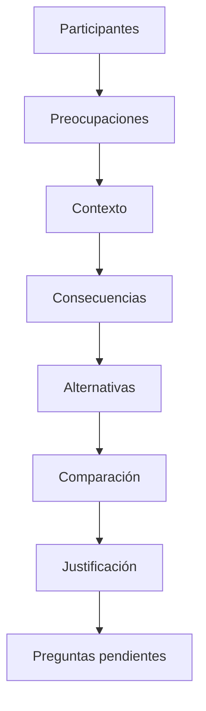

# CL01.04.01 — Contexto y participantes

> **Estado:** propuesta revisada, pendiente de validación curricular final. La clase desarrolla C02 — Reconocer el impacto arquitectónico — en nivel JUSTIFICAR. El estado de la matriz de competencias no implica que esta clase o su evidencia estén aprobadas.

## Ficha de la clase

- **Módulo:** M01 — Pensamiento arquitectónico y fundamentos.
- **Duración:** 165 minutos, más trabajo autónomo.
- **Pregunta guía:** ¿Cómo influyen los participantes y el contexto en la justificación de las decisiones arquitectónicas?
- **Prerrequisitos:** CL01.01.01, CL01.02.01 y CL01.03.01. CL01.02.02 puede emplearse como repaso opcional y continúa pendiente de revisión.
- **Evidencia propuesta:** `EV-SAC01-CL01.04.01-01`, análisis argumentado de participantes, contexto y decisiones.

### Propósito

Analizar quiénes se ven afectados por un sistema, comprender sus preocupaciones y explicar cómo las condiciones del entorno influyen en las decisiones arquitectónicas y sus consecuencias. La clase avanza desde la identificación de participantes hasta la comparación y justificación contextual de alternativas.

### Alcance

**Dentro:** participantes, roles, preocupaciones, contextos, restricciones, consecuencias y justificación inicial de decisiones.

**Fuera:** levantamiento exhaustivo de requisitos, ASR, utility trees, evaluación formal de arquitectura, trade-offs completos, vistas UML y documentación arquitectónica detallada. Estos desempeños se desarrollan en módulos posteriores.

## 1. Resultados de aprendizaje

Al terminar, el estudiante podrá:

1. Identificar participantes relevantes y distinguir sus roles, responsabilidades y preocupaciones.
2. Analizar preocupaciones que pueden entrar en conflicto.
3. Explicar cómo los contextos técnico, de ciclo de vida del proyecto, de negocio y profesional influyen en la arquitectura.
4. Analizar consecuencias de una decisión arquitectónica desde distintas perspectivas.
5. Comparar alternativas y justificar cuál responde mejor a las condiciones identificadas, declarando riesgos, supuestos e incertidumbres.

### Criterios de éxito

El análisis identifica al menos cuatro participantes, formula preocupaciones concretas, relaciona estas con el contexto, distingue hechos de inferencias y supuestos, compara alternativas y defiende una conclusión con sus limitaciones. Debe señalar qué información adicional podría cambiar la recomendación.

## 2. Fundamento bibliográfico y límites

La fuente principal es Bass, L., Clements, P. y Kazman, R. (2012), *Software Architecture in Practice* (3.ª ed.), Addison-Wesley.

| Sección | Uso en esta clase |
|---|---|
| Cap. 2, §2.4 | Arquitectura como abstracción común para comunicación y negociación entre participantes. |
| Cap. 3, §§3.1–3.4 | Contextos técnico, de ciclo de vida del proyecto, de negocio y profesional. |
| Cap. 3, §3.5 | Participantes (stakeholders) y sus preocupaciones. |
| Cap. 3, §§3.6–3.7 | Influencias sobre la arquitectura e influencias de la arquitectura sobre su entorno. |

La tercera edición presenta cuatro contextos. Organización y operación se emplean más adelante como dimensiones didácticas complementarias; no se atribuyen a Bass et al. como categorías formales adicionales. La cadena de análisis y los procedimientos de esta clase también son herramientas didácticas del curso, no citas textuales de los autores.

## 3. Desarrollo conceptual

### 3.1. La arquitectura como punto de encuentro

La arquitectura no interesa únicamente a quienes escriben código o utilizan directamente una aplicación. Un sistema puede afectar a usuarios, responsables de negocio, operadores, desarrolladores, soporte, organizaciones externas y reguladores.

Cada participante observa el sistema desde una perspectiva distinta:

- La persona usuaria puede interesarse por la facilidad de uso.
- El responsable de negocio puede interesarse por costes y resultados.
- El desarrollador puede interesarse por la capacidad de evolución.
- El operador puede interesarse por recuperación y continuidad.
- El responsable de seguridad puede interesarse por el control de acceso.

Estas perspectivas pueden coincidir o entrar en conflicto. Bass et al. explican que la arquitectura proporciona una abstracción común para facilitar la comunicación y negociación entre participantes. Por ello, una decisión arquitectónica debe poder explicarse a quienes resultan afectados, no solamente a quienes la implementan.

**Idea central:** la arquitectura también es un medio de comunicación, negociación y coordinación.

### 3.2. Participantes, roles y preocupaciones

**Participante (stakeholder):** persona, grupo u organización que puede afectar, utilizar, operar, financiar, mantener o experimentar consecuencias derivadas del sistema.

**Rol:** función o responsabilidad que un participante desempeña en un contexto. Una persona puede asumir varios roles y un rol puede estar representado por varias personas.

**Preocupación:** necesidad, pregunta, riesgo, obligación o criterio que importa a un participante respecto del sistema. Debe formularse de manera que permita investigar sus implicaciones.

Ejemplo:
- Impreciso: «Seguridad».
- Concreto: «El responsable necesita investigar quién accedió a determinada información y cuándo».

La formulación concreta permite investigar qué información conservar, quién puede consultarla y qué alternativas son admisibles, sin imponer una solución anticipadamente.

**Conceptos relacionados:**

| Concepto | Significado |
|---|---|
| Requisito | Condición o capacidad que el sistema debe satisfacer. |
| Restricción | Condición que limita las alternativas admisibles. |
| Decisión | Elección realizada entre opciones posibles. |
| Consecuencia | Efecto que puede producir una decisión. |

No toda preocupación se convierte en requisito ni todo requisito conduce a una decisión arquitectónica. Una preocupación puede atenderse mediante una política, un procedimiento operativo, una decisión local de implementación o una decisión arquitectónica.

### 3.3. Los cuatro contextos de la arquitectura

Bass et al. describen cuatro contextos desde los cuales comprender influencias sobre la arquitectura. Son perspectivas de análisis, no una lista exhaustiva de todas las condiciones posibles.

**A. Contexto técnico**

Comprende tecnologías, sistemas existentes, plataformas, interfaces y condiciones técnicas.

Preguntas:
- ¿Qué sistemas existentes deben integrarse?
- ¿Qué tecnologías o plataformas están establecidas?
- ¿Qué limitaciones técnicas existen?

Ejemplo: una clínica dispone de un sistema de agenda existente y el nuevo portal debe consultar información de ese sistema. La integración puede condicionar límites, contratos y dependencias.

**B. Contexto del ciclo de vida del proyecto**

Comprende las condiciones que rodean la construcción y evolución del sistema.

Preguntas:
- ¿Qué equipo desarrollará la solución?
- ¿Qué experiencia tiene?
- ¿Qué calendario y recursos están disponibles?

Ejemplo: el equipo dispone de seis semanas para entregar una primera versión y tiene poca experiencia con sistemas distribuidos. Esto puede influir en la complejidad aceptable y la estrategia de evolución.

**C. Contexto de negocio**

Comprende objetivos, necesidades, condiciones económicas y circunstancias que justifican la existencia del sistema.

Preguntas:
- ¿Qué valor busca producir?
- ¿Qué problema pretende resolver?
- ¿Qué costes y reglas condicionan el sistema?

Ejemplo: una clínica busca reducir el tiempo administrativo dedicado a gestionar turnos. La necesidad puede influir en las capacidades y la evolución del sistema.

**D. Contexto profesional**

Comprende las condiciones relacionadas con las personas que ejercen actividades profesionales alrededor de la arquitectura y el desarrollo.

Preguntas:
- ¿Qué experiencia tiene el equipo?
- ¿Qué responsabilidades profesionales intervienen?
- ¿Qué conocimientos están disponibles?

Ejemplo: el equipo de operación no tiene experiencia administrando infraestructura distribuida. Una decisión que incremente la complejidad operativa debe analizarse considerando esa condición.

**Dimensiones complementarias del curso**

- **Organizacional:** autoridad, responsabilidades, políticas, estructura de equipos y asignación de recursos.
- **Operativa:** soporte, mantenimiento, supervisión, recuperación y gestión de incidentes.

Estas dos dimensiones complementan el análisis, pero no constituyen categorías formales adicionales atribuidas a Bass et al.

| Perspectiva | Pregunta principal |
|---|---|
| Técnica | ¿Con qué sistemas y condiciones técnicas debemos trabajar? |
| Ciclo de vida del proyecto | ¿Qué condiciones existen para construir y evolucionar? |
| Negocio | ¿Qué objetivos y necesidades justifican el sistema? |
| Profesional | ¿Qué capacidades y responsabilidades profesionales intervienen? |
| Organizacional | ¿Cómo se distribuyen autoridad y responsabilidades? |
| Operativa | ¿Cómo se mantiene y recupera el sistema? |

### 3.4. El ciclo de influencia arquitectónica

El contexto influye en la arquitectura, pero la arquitectura también puede modificar las condiciones del contexto.

**Influencias hacia la arquitectura:**
- Necesidades de negocio.
- Sistemas existentes y restricciones técnicas.
- Recursos, calendario y capacidades del equipo.
- Responsabilidades organizacionales.
- Condiciones de operación.

**Influencias desde la arquitectura:**
- Responsabilidades de los equipos.
- Costes de operación y mantenimiento.
- Capacidades técnicas disponibles.
- Procesos organizacionales.
- Posibilidades de evolución del negocio.
- Dependencias con otros sistemas.

Por ejemplo, introducir una plataforma puede habilitar capacidades nuevas, pero también crear responsabilidades de operación y mantenimiento.

Síntesis didáctica: **contexto → decisiones arquitectónicas → consecuencias → contexto futuro**. Esta representación resume la relación de influencia discutida en el capítulo 3, §§3.6–3.7.

### 3.5. De las preocupaciones a las decisiones

Identificar participantes y preocupaciones no basta para justificar una decisión. Es necesario relacionarlos con las condiciones existentes y con las consecuencias posibles.

Usaremos esta cadena didáctica:

**Participante → preocupación → dato de contexto → consecuencia → alternativas → justificación.**

Ejemplo: una persona solicita un turno desde un portal. Necesita conocer si quedó registrado. El portal consulta un sistema de agenda existente. Una respuesta tardía o fallida puede impedir que el portal conozca inmediatamente el resultado. La decisión que merece investigarse es cómo gestionar una solicitud cuando no existe una respuesta concluyente.

La preocupación no determina automáticamente una solución. Antes deben conocerse las reglas de negocio, las capacidades del sistema existente y las consecuencias de cada alternativa.

### 3.6. ¿Cuándo una decisión tiene impacto arquitectónico?

Una decisión puede tener impacto arquitectónico cuando condiciona elementos que afectan una parte significativa del sistema o su evolución.

Indicadores:
- Modifica límites o responsabilidades entre componentes.
- Establece contratos entre sistemas.
- Introduce dependencias relevantes.
- Condiciona el tratamiento de fallos.
- Afecta la operación o el mantenimiento.
- Modifica capacidades de evolución.
- Introduce restricciones que otros equipos deben respetar.

Una decisión suele ser local cuando resuelve un detalle interno de una responsabilidad delimitada sin modificar esos elementos.

La clasificación depende del contexto. Elegir una biblioteca para validar fechas dentro de un módulo puede ser local. Establecer una biblioteca obligatoria para múltiples equipos puede adquirir impacto arquitectónico si condiciona contratos, mantenimiento o evolución.

Que una decisión sea arquitectónica no significa que sea correcta o esté aprobada. La clasificación identifica su alcance e impacto, no su calidad.

## 4. Procedimiento para justificar una decisión

1. **Describir la decisión:** explicar qué se propone cambiar o elegir.
2. **Identificar participantes:** reconocer quiénes pueden verse afectados.
3. **Identificar preocupaciones:** explicar qué necesita cada participante.
4. **Analizar el contexto:** separar hechos, inferencias y supuestos.
5. **Comparar alternativas:** reconocer consecuencias, restricciones y limitaciones.
6. **Justificar:** defender una alternativa y declarar qué información podría cambiar la conclusión.

Este procedimiento es una herramienta didáctica para C02. No sustituye la evaluación formal de arquitectura ni el análisis completo de trade-offs.

## 5. Caso transversal: gestión de turnos clínicos

Una clínica permite solicitar turnos desde un portal web. El portal consulta un sistema existente denominado Agenda médica. La clínica necesita evitar duplicaciones y proporcionar información comprensible sobre el estado de las solicitudes.

El caso no especifica protocolo de integración, disponibilidad de Agenda médica, volumen de solicitudes ni reglas completas de confirmación.

| Participante | Preocupación |
|---|---|
| Paciente | Conocer si su solicitud fue confirmada. |
| Personal administrativo | Evitar duplicaciones y resolver solicitudes inconclusas. |
| Dirección | Controlar costes y mejorar la atención. |
| Equipo técnico | Integrarse con Agenda médica. |
| Soporte | Identificar y atender solicitudes pendientes. |

### Decisión bajo análisis

**Alternativa A: confirmar después de recibir respuesta de Agenda médica.**

Ventaja posible: evita presentar como confirmado un turno que todavía no tiene confirmación del sistema correspondiente.

Limitación posible: una respuesta tardía puede prolongar la espera; debe definirse qué información recibe la persona mientras tanto.

**Alternativa B: aceptar provisionalmente y confirmar después.**

Ventaja posible: proporciona una respuesta inmediata sobre la recepción de la solicitud y distingue recepción de confirmación.

Limitación posible: requiere gestionar estados pendientes y definir reglas para evitar duplicaciones y resolver resultados inconclusos.

### Análisis

La alternativa A puede ser adecuada si la confirmación de Agenda médica es necesaria antes de comunicar que existe un turno. La alternativa B puede convenir si el negocio permite solicitudes provisionales y existe una forma confiable de resolverlas posteriormente.

No se puede determinar cuál es mejor sin conocer:
- Las reglas de confirmación.
- La responsabilidad sobre la disponibilidad.
- Las capacidades de integración.
- El comportamiento ante respuestas tardías.
- Las expectativas de los participantes.

La conclusión debe ser condicional y sustentada en esos datos.

## 6. Comprobación conceptual

Responde con tus propias palabras:

1. ¿Por qué la arquitectura debe considerar participantes que no utilizan directamente el sistema?
2. ¿Cuál es la diferencia entre participante, rol y preocupación?
3. ¿Por qué una preocupación no implica necesariamente una decisión arquitectónica?
4. ¿Qué diferencia existe entre el contexto técnico y el contexto del ciclo de vida del proyecto?
5. ¿Cómo puede una decisión arquitectónica modificar las condiciones de una organización?
6. ¿Por qué una decisión arquitectónica no necesariamente es una buena decisión?
7. ¿Qué información permitiría determinar si una solicitud provisional de turno es apropiada?

Las respuestas deben explicar relaciones y consecuencias, no limitarse a repetir definiciones.

**Remediación:** si se enumeran tecnologías sin preocupaciones, regresar a §3.2. Si se confunden hechos y supuestos, etiquetar las afirmaciones del caso. Si se clasifica una decisión sin mostrar consecuencias, repetir el procedimiento de §4.

## 7. Práctica guiada (formativa)

En parejas, completen la matriz para el caso de turnos clínicos:

| Participante | Preocupación | Contexto relacionado | Información faltante | Consecuencia |
|---|---|---|---|---|
| | | | | |
| | | | | |
| | | | | |

Después:
1. Seleccionen una preocupación que entre en conflicto con otra.
2. Expliquen por qué existe el conflicto.
3. Identifiquen qué alternativa podría favorecer a cada participante.
4. Expongan qué información necesitarían para recomendar una alternativa.

La práctica recibe retroalimentación y permite corregir antes de producir la evidencia independiente. No acredita dominio por sí sola.

## 8. Evidencia independiente

### Caso: plataforma de entrega de resultados de laboratorio

Un laboratorio quiere publicar resultados mediante un portal. El portal consulta un sistema de laboratorio existente. Los profesionales de salud necesitan acceder a determinados resultados antes de que estén disponibles para pacientes. El área responsable de cumplimiento necesita investigar incidentes de acceso. Soporte recibe reportes de resultados que no aparecen en el portal.

El caso no especifica legislación concreta, infraestructura, protocolo de integración, SLA ni volumen de solicitudes.

### Entregable: `EV-SAC01-CL01.04.01-01`

Documento de 700–900 palabras que incluya:

1. Una matriz de al menos cuatro participantes y sus preocupaciones.
2. Cuatro datos contextuales, distinguiendo hechos, inferencias y supuestos.
3. Comparación de dos alternativas relacionadas con una decisión del caso.
4. Justificación de la alternativa recomendada.
5. Identificación de una decisión arquitectónica y una local, explicando su clasificación.
6. Una tensión entre preocupaciones y una pregunta abierta que podría cambiar la recomendación.

No se deben asumir obligaciones regulatorias específicas ni características técnicas que el caso no proporciona. Las tecnologías pueden mencionarse como hipótesis, pero no sustituyen la argumentación.

## 9. Rúbrica analítica — `CR-C02-JUSTIFY`

### Ponderación

| Criterio | Peso |
|---|---:|
| Identificación de participantes y preocupaciones | 20 % |
| Análisis del contexto y calidad de la evidencia | 25 % |
| Comparación de alternativas y consecuencias | 30 % |
| Justificación, riesgos e incertidumbre | 25 % |
| **Total** | **100 %** |

### Niveles de desempeño

| Nivel | Descriptor |
|---|---|
| **1 — Insuficiente** | Enumera elementos sin establecer relaciones ni justificar. |
| **2 — Básico** | Identifica participantes y contexto, pero el análisis es parcial o presenta supuestos como hechos. |
| **3 — Competente** | Relaciona participantes, preocupaciones y contexto; compara alternativas y justifica una decisión con criterios explícitos. |
| **4 — Avanzado** | Además, analiza conflictos, riesgos, trade-offs e incertidumbres y explica qué evidencia podría cambiar su conclusión. |

### Asignación de puntos

Para cada criterio se asigna un nivel de 1 a 4. La puntuación ponderada se calcula así:

**Puntos del criterio = (nivel obtenido ÷ 4) × peso del criterio.**

La suma de los cuatro criterios produce una calificación de 0 a 100.

### Umbral propuesto

- **70/100 puntos** para acreditar la evidencia.
- Ningún criterio puede quedar en nivel 1.
- El nivel 3 representa el desempeño esperado para JUSTIFICAR.

No se evalúa que el estudiante elija una alternativa predeterminada. Se evalúa la calidad de su justificación y la correspondencia entre evidencia, contexto y conclusión.

Completar la evidencia no equivale por sí solo a acreditar globalmente C02.

## 10. Errores frecuentes y remediación

- **«Stakeholder es solo quien usa la pantalla».** Buscar quién opera, aprueba, integra o asume consecuencias.
- **«Una preocupación es una herramienta».** Reescribir «queremos Kafka» como la pregunta o resultado que se pretende lograr y anotar la evidencia faltante.
- **«Toda decisión técnica es arquitectónica».** Examinar su radio de impacto y qué contratos, propiedades o equipos cambiarían.
- **«Si falta un dato, elegimos una solución estándar».** Convertir el vacío en una pregunta verificable.
- **«La decisión arquitectónica siempre es la mejor».** Separar alcance arquitectónico de calidad de la decisión.

Para remediar, repetir el análisis con un caso de tres participantes y una decisión: clasificar hechos, inferencias y supuestos; elaborar la matriz; comparar consecuencias; y justificar el alcance de la decisión.

## 11. Secuencia docente

| Etapa | Actividad | Tiempo |
|---|---|---:|
| 1 | Activación y recuperación de CL01.03.01 | 10 min |
| 2 | Arquitectura, participantes y preocupaciones | 25 min |
| 3 | Contextos e influencia arquitectónica | 35 min |
| 4 | Caso transversal y comparación de alternativas | 35 min |
| 5 | Práctica guiada | 30 min |
| 6 | Síntesis y comprobación | 15 min |
| 7 | Indicaciones para evidencia independiente | 15 min |
| **Total** | | **165 min** |

La evidencia independiente se completa fuera de la sesión.

## 12. Referencias

1. Bass, L., Clements, P. y Kazman, R. (2012). *Software Architecture in Practice* (3.ª ed.). Addison-Wesley. Cap. 2, §2.4; cap. 3, §§3.1–3.7.
2. Curso SAC01: `LEARNING_PATH.md`.
3. Curso SAC01: `MATRIZ_COMPETENCIAS.md`.
4. Curso SAC01: `CL01.03.01 — Arquitectura, diseño e implementación`.

La tercera edición de *Software Architecture in Practice* es la copia disponible y cotejada para esta clase. No se sustituye por la cuarta edición. Las referencias secundarias se incorporarán cuando sus pasajes específicos hayan sido cotejados directamente.

## 13. Revisión de aceptación

| Criterio | Estado |
|---|---|
| Alineación con C02 y JUSTIFICAR | PASS |
| Continuidad con CL01.03.01 | PASS |
| Uso correcto de los cuatro contextos de Bass et al. | PASS |
| Distinción entre contextos y dimensiones complementarias | PASS |
| Participantes, roles y preocupaciones | PASS |
| Comparación argumentada de alternativas | PASS |
| Alineación entre objetivos, actividades, evidencia y rúbrica | PASS |
| Cotejo de fuente principal | PASS |
| Validación curricular final | PENDIENTE |

**Estado del artefacto: `REVIEW_REQUIRED`.** Esta propuesta no autoriza por sí misma la impartición ni la publicación final de la clase.

## 14. Gobierno

- Este archivo no modifica estados individuales, evidencias reales ni dominio estudiantil.
- La actualización bibliográfica de la ruta debe limitarse a esta clase; otras clases que citen distintas ediciones requieren revisión independiente.
- Conservar el estado `REVIEW_REQUIRED` hasta que la autoridad curricular registre su aprobación.
